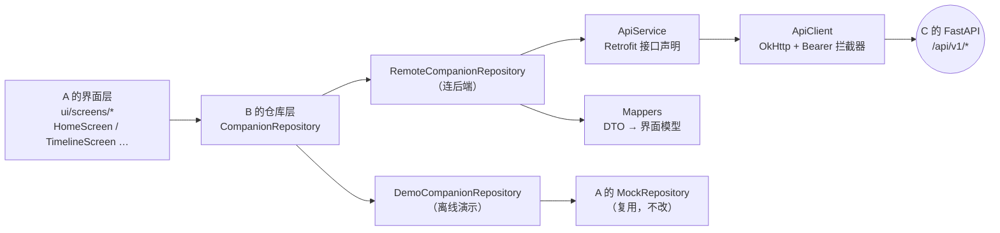

# 《伴行·时序 Companion Lite》Android 端数据层源代码

**交付人：** 成员 B（Android 数据交互方向）
**模块范围：** 网络通信 + 数据模型 + 仓库层
**代码位置：** `android-app/app/src/main/java/com/companionlite/data/`
**对应分支：** `feature/android-api`
**构建状态：** `assembleDebug` BUILD SUCCESSFUL（Kotlin 编译通过）

---

## 文档说明

这份文档把成员 B 负责的 7 个 Kotlin 源文件完整收录在一起，每个文件前有一段说明（这个文件负责什么、为什么这么写），代码内部补上了逐行注释。

代码在工程里是**分 7 个文件、4 个包**存的，这里按依赖顺序排开成一整份阅读材料：

```
先看怎么表示结果 → 再看数据长什么样 → 再看怎么转换 → 再看怎么发请求 → 最后看业务逻辑怎么组织
   UiState.kt        Dtos.kt          Mappers.kt      ApiClient/ApiService   Repository
```

> ⚠️ 注意：这份文档是**阅读和提交材料用的**，不是可以直接编译的单文件。7 个文件分属 4 个不同的 Kotlin 包（`data`、`data.model`、`data.remote`、`data.repository`），合并成一个文件只能有一个 `package` 声明，工程会编译不过。真正参与构建的仍然是那 7 个独立文件。

---

## 一、这份代码在整个项目里的位置

项目是三人分工的 Android 应用：A 做界面，B 做数据层（本文件），C 做后端，D 做算法。

B 的职责边界非常明确 —— 只碰 `data/` 目录，一行 `ui/` 都不改。这条边界写在仓库 `README.md` 里：

> B 只允许改 `android-app/app/src/main/java/com/companionlite/data`

这不是形式主义。A 的界面层已经写好了 9 个页面，如果 B 动 `ui/`，两人会同时改同一批文件，合并时必然冲突。

**B 补的是 A 工程里唯一缺失的那一层。** A 的代码里原本只有 `data/mock/MockRepository.kt`（写死的假数据），所有页面都从它取数。真接后端时，需要有人把「HTTP 请求 → JSON → 界面模型」这条链路搭起来，这份代码就是这条链路。



---

## 二、文件清单

| # | 文件 | 行数 | 职责 | 谁写的 |
| --- | --- | --- | --- | --- |
| 1 | `data/UiState.kt` | 25 | 请求结果三态封装：加载中 / 成功 / 失败 | B |
| 2 | `data/model/Dtos.kt` | 164 | 传输对象，与后端 JSON 字段一一对应 | B |
| 3 | `data/model/Mappers.kt` | 226 | DTO ↔ 界面模型的双向转换 | B |
| 4 | `data/remote/ApiClient.kt` | 131 | OkHttp 配置、登录态持久化、Token 自动注入 | B |
| 5 | `data/remote/ApiService.kt` | 105 | 16 个接口的声明，路径照 `docs/api.md` | B |
| 6 | `data/repository/CompanionRepository.kt` | 201 | 仓库接口 + 离线演示实现 | B |
| 7 | `data/repository/RemoteCompanionRepository.kt` | 258 | 仓库接口的真实网络实现 | B |

合计 **1110 行**（不含空行与 import）。另有 2 个文件是 A 提供的、B 的代码依赖它们，收在**附录 A**：`model/Models.kt`（界面展示模型与枚举）。

---

## 三、三层结构

```
┌──────────────────────────────────────────────────────┐
│  界面层（A）                                          │
│  HomeViewModel / TimelineViewModel …                  │
│  只认 CompanionRepository 接口，不知道数据从哪来        │
└───────────────────────┬──────────────────────────────┘
                        │ UiState<DailyCheckIn> 这样的统一返回
┌───────────────────────▼──────────────────────────────┐
│  仓库层（B）                                          │
│  CompanionRepository（接口）                          │
│    ├─ RemoteCompanionRepository  真实网络              │
│    └─ DemoCompanionRepository    离线演示              │
│  负责：错误翻译、读写区分、时间区间计算、DTO→界面模型    │
└───────────────────────┬──────────────────────────────┘
┌───────────────────────▼──────────────────────────────┐
│  网络层（B）                                          │
│  ApiService（Retrofit 接口声明）                       │
│  ApiClient（OkHttp + 拦截器 + Token 存储）             │
│  Dtos（JSON 映射） / Mappers（格式转换）               │
└───────────────────────┬──────────────────────────────┘
                        │ HTTP /api/v1/*
                   C 的 FastAPI 后端
```

**为什么要分三层而不是直接在页面里调 Retrofit？**

页面只关心「给我今天签到数据」，不应该关心 token 怎么加、时间怎么格式化、网络断了该说什么话。分层之后，这三个问题各自有唯一的处理地点：换后端地址改 `ApiClient` 一处，改字段名改 `Dtos` 一处，改提示语文案改 `RemoteCompanionRepository` 一处。

---

## 四、源码

### 4.1 `data/UiState.kt`

**这个文件解决什么问题：** 一次网络请求有三种结局 —— 还在转圈、拿到了数据、失败了。如果函数直接返回 `List<DailyCheckIn>`，失败只能用抛异常表示，页面就得写 `try/catch`；如果返回可空类型，又分不清「加载中」和「真的没有数据」。

`UiState` 把这个状态做成类型的一部分，页面在 `when` 里必须同时处理三个分支，编译器强制不漏掉失败情况。

**关键字段 `offlineFallback`：** 失败时是否已经退回了演示数据。为 `true` 表示界面还有内容可展示，但必须打上「演示数据」标识 —— 这是项目的诚信底线，不能让评委或用户以为假数据是真采集的。写入类操作（签到、回答询问）永远不允许降级，否则等于骗用户「提交成功了」。

```kotlin
package com.companionlite.data

/**
 * 统一的请求结果包装：加载中 / 成功 / 失败三态。
 *
 * 为什么要有它？
 * - 界面不能只拿到"数据"，还要知道"现在是在转圈、还是失败了、失败原因是什么"。
 * - 网络错误必须翻译成人话（见 [RemoteCompanionRepository]），不能把
 *   `java.net.ConnectException` 直接甩给用户看。
 *
 * 用 sealed interface 而不是 enum + 可空字段，是因为：
 * 三个状态携带的数据完全不同 —— Loading 什么都没带，Success 带结果，Error 带文字。
 * sealed 让每个状态各自声明自己的字段，页面 when 分支里拿到的类型是精确的。
 *
 * @param T 成功时携带的数据类型。`out T` 表示协变：
 *        UiState<DailyCheckIn> 可以当作 UiState<Any> 用，但反过来不行。
 * @param offlineFallback 失败时是否已经退回到演示数据。
 *        为 true 表示界面还有东西可展示，但必须显示「演示数据」标识；
 *        写入类操作（签到、回答）永远不允许降级，否则等于骗用户"提交成功了"。
 */
sealed interface UiState<out T> {

    /**
     * 请求进行中。
     * 用 data object 而不是 object：反正在 Compose 里要做相等比较，
     * data object 自带 equals/hashCode/toString，日志里也好读。
     */
    data object Loading : UiState<Nothing>

    /**
     * 成功，携带结果。
     * @param data 后端返回并转换完成的界面模型
     */
    data class Success<T>(val data: T) : UiState<T>

    /**
     * 失败。
     * @param message 已经翻译过的中文提示，可以直接显示在界面上
     * @param offlineFallback 是否降级到了演示数据（默认否）
     */
    data class Error(
        val message: String,
        val offlineFallback: Boolean = false
    ) : UiState<Nothing>
}
```

---

### 4.2 `data/model/Dtos.kt`

**这个文件解决什么问题：** 后端返回的 JSON 字段是 `snake_case`（`check_in_at`），Kotlin 习惯是驼峰（`checkInAt`）。Gson 能自动猜出对应关系，但**猜错时不报错，只是静默变成 null** —— 这种 bug 在答辩现场最难查，因为 App 不崩，只是某一行数据莫名空白。

所以这里每个下划线字段都显式写 `@SerializedName`，把映射关系钉死。后端改名了，改这一个注解就能修好，不用去翻页面代码。

**为什么 DTO 和界面模型要分成两套？** 因为它们的变更节奏不同。后端字段是可变的（C 还在定稿），界面模型已经写进了 A 的 9 个页面（不能动）。中间隔一层 Mappers，后端怎么改都只影响 Dtos + Mappers，页面一行不用碰。

**重要：`trust_state` 字段。** 这是项目的创新点之一。`trust_state` 说明数据为什么可信或不可信（正常 / 数据缺失 / 设备离线 / 同步延迟 / 本人反馈 / 数据不足），UI 必须能显示它。**不允许在客户端自己猜** —— 猜「正常」会掩盖问题，猜「危险」会造成误报。

```kotlin
package com.companionlite.data.model

import com.google.gson.annotations.SerializedName

/*
 * ============================================================================
 * 传输对象（DTO）—— 和后端 JSON 一一对应，只负责"搬数据"，界面不直接用它们。
 * ============================================================================
 *
 * 分工上的一句话总结：
 *   Dtos.kt    ← 忠于后端（字段名跟 JSON 走，允许有 @SerializedName）
 *   Models.kt  ← 忠于界面（字段名跟 UI 走，时间是 LocalDate/LocalTime 而不是字符串）
 *   Mappers.kt ← 两者之间的翻译官
 *
 * 界面用的是 Models.kt 里的 DailyCheckIn / ActivityRecord 等展示模型，
 * 两者的转换在 Mappers.kt 里做。
 *
 * 约定（摘自 docs/api.md）：
 *   - JSON 字段一律 snake_case；Kotlin 用驼峰，靠 @SerializedName 显式绑定。
 *     不写 @SerializedName 也能靠 Gson 猜，但后端一改名就会静默变成 null，
 *     所以这里全部显式写死。
 *   - 时间一律 ISO-8601 UTC 字符串，例 "2026-11-26T00:30:00Z"。
 *     客户端负责转成本机时区，后端不管时区。
 *   - 列表为空时后端返回 []，不返回 null。
 *
 * ⚠️ 待确认：docs/api.md 第 3 节目前只给了接口路径和公共字段，
 *    具体的响应体结构还是草案。下面的字段是按「公共字段约定」+ A 的界面需求推出来的，
 *    需要 C 定稿后逐个核对，对不上的地方以 api.md 为准，改这里，不要改页面。
 */


// ============================ 认证 ============================

/**
 * 注册请求体。
 * @param username 登录名，后端唯一
 * @param password 明文传输（走 HTTPS），后端存哈希
 * @param displayName 显示名，界面上的称呼
 * @param role 角色，只有两个值："elder"（本人端）/ "family"（家属端）
 * @param phone 手机号，选填。可为 null，所以给默认值
 */
data class RegisterRequest(
    val username: String,
    val password: String,
    @SerializedName("display_name") val displayName: String,
    val role: String,                    // elder / family
    val phone: String? = null
)

/**
 * 登录请求体。
 * 只有两个字段，不需要 @SerializedName —— 单词本身就是小写，驼峰下划线一样。
 */
data class LoginRequest(
    val username: String,
    val password: String
)

/**
 * 登录 / 注册成功后的返回。
 * @param accessToken JWT，后续每个请求都要带上它
 * @param tokenType 固定 "Bearer"，后端给了就用它的，没给默认 Bearer
 * @param user 当前用户信息，省一次 /users/me 请求
 */
data class LoginResponse(
    @SerializedName("access_token") val accessToken: String,
    @SerializedName("token_type") val tokenType: String = "Bearer",
    val user: UserDto
)

/**
 * 用户信息。
 * 除 id 外所有字段都有默认值 —— 后端少返一个字段时，Gson 会用默认值而不是 null，
 * 避免非空类型被塞进 null 导致运行时崩溃。
 *
 * @param inviteCode 邀请码，家属凭它绑定本人。只有本人端有值
 */
data class UserDto(
    val id: Int,
    val username: String = "",
    @SerializedName("display_name") val displayName: String = "",
    val role: String = "elder",           // elder / family
    val phone: String? = null,
    @SerializedName("invite_code") val inviteCode: String? = null
)


// ============================ 家庭关系 ============================

/**
 * 邀请码。
 * @param expiresAt 过期时间，ISO-8601 UTC；null 表示不限期
 */
data class InviteCodeDto(
    @SerializedName("invite_code") val inviteCode: String,
    @SerializedName("expires_at") val expiresAt: String? = null
)

/**
 * 绑定家属的请求。
 * @param relation 关系描述，如"女儿""儿子"，选填
 */
data class BindRequest(
    @SerializedName("invite_code") val inviteCode: String,
    val relation: String? = null          // 女儿 / 儿子 / 其他
)

/**
 * 一条绑定关系。这是本项目"授权可见"机制的载体。
 *
 * @param status pending 待确认 / active 生效中 / revoked 已撤销
 * @param canViewStatus 能否看本人签到状态
 * @param canViewActivity 能否看活动记录
 * @param canViewFeedback 能否看本人对询问的反馈内容
 * @param canReceiveAlerts 异常时是否给这位家属推送提醒
 *
 * 四个开关默认 false —— 权限必须显式授予，不能因为代码写得松就默认全开。
 */
data class FamilyLinkDto(
    val id: Int,
    @SerializedName("elder_id") val elderId: Int,
    @SerializedName("family_id") val familyId: Int,
    val status: String = "pending",       // pending / active / revoked
    @SerializedName("elder_name") val elderName: String? = null,
    @SerializedName("family_name") val familyName: String? = null,
    val relation: String? = null,
    @SerializedName("can_view_status") val canViewStatus: Boolean = false,
    @SerializedName("can_view_activity") val canViewActivity: Boolean = false,
    @SerializedName("can_view_feedback") val canViewFeedback: Boolean = false,
    @SerializedName("can_receive_alerts") val canReceiveAlerts: Boolean = false
)

/**
 * 修改授权范围 / 撤销授权都用它，只传要改的字段。
 *
 * 所有字段都是可空且默认 null，这样后端能区分"没传"和"传了 false"：
 * 只想关掉「查看活动」，其他三个开关保持原样 —— 传 null 即可，不用把四个值都读出来再写回。
 */
data class FamilyLinkUpdateRequest(
    val status: String? = null,           // 撤销授权时传 revoked
    @SerializedName("can_view_status") val canViewStatus: Boolean? = null,
    @SerializedName("can_view_activity") val canViewActivity: Boolean? = null,
    @SerializedName("can_view_feedback") val canViewFeedback: Boolean? = null,
    @SerializedName("can_receive_alerts") val canReceiveAlerts: Boolean? = null
)


// ============================ 生活记录 ============================

/**
 * 提交一条签到。
 * @param status 很好 / 一般 / 不舒服 / 需要帮助
 * @param mood 心情，选填（老人可能只愿意点一个状态，不想选心情）
 * @param note 补充说明，选填
 * @param wantFamilyCall 本人主动勾选"希望家人联系我"
 * @param dataSource 数据来源：manual 本人填写 / phone 手机自动 / watch 手表采集
 */
data class CheckInRequest(
    val status: String,                   // good / normal / unwell / need_help
    val mood: String? = null,             // happy / calm / tired / low
    val note: String? = null,
    @SerializedName("want_family_call") val wantFamilyCall: Boolean = false,
    @SerializedName("data_source") val dataSource: String = "manual"
)

/**
 * 一条签到记录（后端返回）。
 *
 * @param checkInAt 签到时刻，ISO-8601 UTC，例如 "2026-11-26T00:30:00Z"
 * @param syncStatus 同步状态：synced 已同步 / pending 待上传（离线补传用）
 * @param trustState 数据可信度，界面必须拿到它，不允许在客户端猜
 *
 * 注意 id / userId 给了默认值 0：提交签到时后端可能不回填 id，
 * 这时界面只需要显示"已签到"，不需要 id，给 0 比崩掉好。
 */
data class CheckInDto(
    val id: Int = 0,
    @SerializedName("user_id") val userId: Int = 0,
    @SerializedName("check_in_at") val checkInAt: String,
    val status: String = "normal",
    val mood: String? = null,
    val note: String? = null,
    @SerializedName("want_family_call") val wantFamilyCall: Boolean = false,
    @SerializedName("data_source") val dataSource: String = "manual",
    @SerializedName("sync_status") val syncStatus: String = "synced",
    /** 数据可信度：界面必须拿到它，不允许在客户端猜 */
    @SerializedName("trust_state") val trustState: String = "normal"
)

/**
 * 提交一条活动记录。
 * @param activityType wake / out / home / meal / exercise / rest / medicine / other
 * @param recordedAt 发生时刻，null 表示"就是现在"，由后端补当前时间
 */
data class ActivityRequest(
    @SerializedName("activity_type") val activityType: String,
    @SerializedName("recorded_at") val recordedAt: String? = null,
    val note: String? = null,
    @SerializedName("data_source") val dataSource: String = "manual"
)

/**
 * 一条活动记录（后端返回）。
 * 字段与 CheckInDto 基本对称，同样带 trust_state。
 */
data class ActivityDto(
    val id: Int = 0,
    @SerializedName("user_id") val userId: Int = 0,
    @SerializedName("activity_type") val activityType: String,
    @SerializedName("recorded_at") val recordedAt: String,
    val note: String? = null,
    @SerializedName("data_source") val dataSource: String = "manual",
    @SerializedName("sync_status") val syncStatus: String = "synced",
    @SerializedName("trust_state") val trustState: String = "normal"
)


// ============================ 分析与关怀 ============================

/**
 * 个人生活基线。数值由成员 D 的算法算出，后端透传，客户端只展示不重算。
 *
 * @param windowDays 统计窗口，默认近 14 天
 * @param validDays 窗口内真正有数据的天数
 * @param sampleSufficient 样本够不够。不够时界面必须显示"数据不足，暂不判断"
 * @param checkinMedian 签到时刻中位数，格式 "07:52"
 * @param spreadMinutes 最早与最晚签到的分钟跨度，用来衡量作息规律性
 * @param activityDailyMean 日均活动条数
 * @param trustState 默认 insufficient —— 没数据时宁可说不足，也不能说正常
 */
data class BaselineDto(
    @SerializedName("user_id") val userId: Int = 0,
    @SerializedName("window_days") val windowDays: Int = 14,
    @SerializedName("valid_days") val validDays: Int = 0,
    /** 样本不够时后端返回 false，界面显示「数据不足，暂不判断」 */
    @SerializedName("sample_sufficient") val sampleSufficient: Boolean = false,
    @SerializedName("checkin_median") val checkinMedian: String? = null,   // "07:52"
    @SerializedName("checkin_earliest") val checkinEarliest: String? = null,
    @SerializedName("checkin_latest") val checkinLatest: String? = null,
    @SerializedName("spread_minutes") val spreadMinutes: Int = 0,
    @SerializedName("activity_daily_mean") val activityDailyMean: Double = 0.0,
    @SerializedName("trust_state") val trustState: String = "insufficient"
)

/**
 * 关怀事件 —— 项目的核心业务对象。
 * 一次关怀事件的完整生命周期：
 *   规则命中 → 生成事件（pending）→ 系统向本人询问 → 本人反馈
 *   → 需要家人介入（awaiting_family）→ 处理完（handled）→ 关闭（closed）
 *
 * @param triggerRule 触发的规则标识，如 "no_checkin_by_noon"
 * @param inquiryText 系统想对本人说的话，例如"今天还没有收到你的签到记录，还好吗？"
 *                    这句话由后端按规则生成，客户端不拼文案，保证口径统一
 * @param eventStatus pending / awaiting_family / handled / closed
 */
data class CareEventDto(
    val id: Int,
    @SerializedName("user_id") val userId: Int = 0,
    @SerializedName("trigger_rule") val triggerRule: String = "",
    /** 系统想对本人说的话，例如"今天还没有收到你的签到记录……" */
    @SerializedName("inquiry_text") val inquiryText: String = "",
    @SerializedName("created_at") val createdAt: String = "",
    @SerializedName("event_status") val eventStatus: String = "pending",
    @SerializedName("trust_state") val trustState: String = "normal"
)

/**
 * 本人对询问的反馈。
 * feedbackType 取值：i_am_fine / busy / unwell / want_call / no_answer
 *
 * 「暂时不想回答」也是合法答案 —— 这一点很重要：
 * 不回答不等于出事，系统不能把沉默解释成危险信号。
 */
data class FeedbackRequest(
    /** i_am_fine / busy / unwell / want_call / no_answer */
    @SerializedName("feedback_type") val feedbackType: String
)

/**
 * 修改事件状态（家属端处理后调用）。
 * eventStatus 取值：awaiting_family / handled / closed
 */
data class EventStatusRequest(
    /** awaiting_family / handled / closed */
    @SerializedName("event_status") val eventStatus: String
)
```

---

### 4.3 `data/model/Mappers.kt`

**这个文件解决什么问题：** 后端给的是字符串（`"2026-11-26T00:30:00Z"`、`"good"`、`"awaiting_family"`），界面要的是类型安全的东西（`LocalDate`、`CheckInStatus.GOOD`、`CareEventStatus.AWAITING_FAMILY`）。这个文件负责翻译。

**两条铁律**，都是踩过坑才定下来的：

**第一条：转换函数永远不抛异常。** 网络数据是不可信的 —— 后端哪天多返回个 null、时间格式写错、多出个没见过的状态值，都不能让页面崩。所以每个解析函数都返回可空类型，解析失败就是 `null`，界面上顶多这一条不显示。

**第二条：不认识的状态一律按「数据缺失」处理。** 不许当成「正常」，更不许当成「危险」。这是项目定位决定的：没有信息的时候，系统只能说「不清楚」，不能替用户猜。举例：后端返回了 `trust_state: "syncing"`（第七种状态，契约里没有），代码走 `else -> MISSING`，界面显示「数据缺失，原因未知」，而不是显示「一切正常」。

**为什么要有 `toWire` 一系列反向函数？** 发送请求时得把枚举变回字符串（`CheckInStatus.NEED_HELP` → `"need_help"`）。正反两个方向都写在一个文件里，改枚举时不会漏改一边。

```kotlin
package com.companionlite.data.model

import java.time.Instant
import java.time.LocalDate
import java.time.LocalTime
import java.time.OffsetDateTime
import java.time.ZoneId
import java.time.ZonedDateTime
import java.time.format.DateTimeFormatter

/**
 * DTO ←→ 界面模型的转换。
 *
 * 两条铁律：
 * 1. **转换函数永远不抛异常**。后端哪天多返回个 null、时间格式不对，
 *    顶多是"这一条显示不出来"，不能让整个页面崩掉。
 * 2. **不认识的状态一律按"数据缺失"处理**，不许当成"正常"，更不许当成"危险"。
 *    这是项目定位决定的：没有信息的时候，系统只能说"不清楚"。
 *
 * 用 object 而不是 class：这些函数都是纯函数，没有状态，全局一份就够。
 */
object Mappers {

    // 时间显示格式。HH 是 24 小时制（07:52），hh 是 12 小时制（07 点但下午会变 04）
    private val TIME_TEXT = DateTimeFormatter.ofPattern("HH:mm")
    private val DATE_TEXT = DateTimeFormatter.ofPattern("M月d日")


    // ======================== 时间 ========================

    /**
     * "2026-11-26T00:30:00Z" / "2026-11-26T08:30:00+08:00" → 本机时区的时刻
     *
     * 为什么试两种解析？
     * - OffsetDateTime.parse 能吃带时区偏移的（+08:00）和带 Z 的
     * - Instant.parse 只吃 Z 结尾的
     * 后端两种都可能给（Python 的 datetime 序列化行为不一致），所以兜一层。
     *
     * 解析完统一 atZoneSameInstant(本机时区)：把 UTC 的"时刻"换算成用户看得懂的本地时间，
     * 而不是简单地改时区标签 —— 后者会让 00:30Z 显示成 08:30 但日期错位。
     *
     * @return 解析失败返回 null，调用方负责决定是丢弃这条还是兜底
     */
    private fun parseZoned(text: String?): ZonedDateTime? {
        if (text.isNullOrBlank()) return null
        return try {
            OffsetDateTime.parse(text).atZoneSameInstant(ZoneId.systemDefault())
        } catch (_: Exception) {
            try {
                Instant.parse(text).atZone(ZoneId.systemDefault())
            } catch (_: Exception) {
                // 两种都失败：格式真的不对，返回 null，不让异常往上冒
                null
            }
        }
    }

    /**
     * "07:52" / "07:52:00" → LocalTime，失败返回 null。
     *
     * take(8) 是为了兼容带秒的写法：LocalTime.parse 能接受 "07:52" 和 "07:52:00"，
     * 但吃不接受 "07:52:00.000"。截到 8 位正好是 HH:mm:ss。
     */
    private fun parseLocalTime(text: String?): LocalTime? {
        if (text.isNullOrBlank()) return null
        return try {
            LocalTime.parse(text.take(8))
        } catch (_: Exception) {
            null
        }
    }

    /**
     * 关怀事件列表里显示成"今天 10:30"，比一整串 ISO 时间好读。
     *
     * 只区分今天 / 昨天 / 更早三种，没有再细分"3 天前"——
     * 老人对"3 天前"的感知不如直接看日期清楚。
     */
    private fun dayTimeText(zoned: ZonedDateTime?): String {
        if (zoned == null) return ""
        val date = zoned.toLocalDate()
        val today = LocalDate.now()
        val time = zoned.toLocalTime().format(TIME_TEXT)
        return when (date) {
            today -> "今天 $time"
            today.minusDays(1) -> "昨天 $time"
            else -> "${date.format(DATE_TEXT)} $time"
        }
    }


    // ============ 状态字符串 → A 的展示枚举 ============

    /**
     * trust_state。docs/api.md 定义了 6 种；后端若返回了没见过的值，
     * 我们既不能说"正常"，也不能说"有危险"，只能老老实实说"原因未知"。
     *
     * 这就是 else 分支返回 MISSING 而不是 NORMAL 的原因。
     * lowercase() 是为了容忍后端大小写不一致（"Normal" / "NORMAL" 都认）。
     */
    fun trustState(raw: String?): DataTrustState = when (raw?.lowercase()) {
        "normal" -> DataTrustState.NORMAL
        "missing" -> DataTrustState.MISSING
        "offline" -> DataTrustState.OFFLINE
        "delayed" -> DataTrustState.DELAYED
        "user_feedback" -> DataTrustState.USER_FEEDBACK
        "insufficient" -> DataTrustState.INSUFFICIENT
        else -> DataTrustState.MISSING          // 不认识 = 不知道，不是"正常"
    }

    /**
     * 签到状态。
     * 注意 "normal" 也走 else —— 它是默认值，和"后端给了个怪值"结果一样，都是"一般"。
     * 这里可以容忍兜底成 NORMAL，因为签到状态不影响安全判断（信任度由 trust_state 单独管）。
     */
    fun checkInStatus(raw: String?): CheckInStatus = when (raw?.lowercase()) {
        "good" -> CheckInStatus.GOOD
        "unwell" -> CheckInStatus.UNWELL
        "need_help" -> CheckInStatus.NEED_HELP
        else -> CheckInStatus.NORMAL
    }

    /** 反向：把界面枚举变回后端认的字符串（提交签到时用） */
    fun checkInStatusToWire(status: CheckInStatus): String = when (status) {
        CheckInStatus.GOOD -> "good"
        CheckInStatus.NORMAL -> "normal"
        CheckInStatus.UNWELL -> "unwell"
        CheckInStatus.NEED_HELP -> "need_help"
    }

    /**
     * 心情。
     *
     * 这里做了兼容映射，原因：contract 里 mood 是 happy/calm/tired/low，
     * 但后端示例代码里出现过 good/normal/bad 的写法（和 status 的用词串了）。
     * 两种都认，返回的界面枚举不变，等 C 定稿后删掉多余的分支即可。
     *
     * 返回可空类型：心情是选填的，null 表示"没选"，不是"没心情"。
     * 界面要显示成"未选择"，不能显示成空白或"不太好"。
     */
    fun mood(raw: String?): MoodType? = when (raw?.lowercase()) {
        "happy", "good" -> MoodType.HAPPY
        "calm", "normal" -> MoodType.CALM
        "tired" -> MoodType.TIRED
        "low", "bad" -> MoodType.LOW
        else -> null                            // 认不出来就说没选，别瞎猜
    }

    /** 反向：界面选的心情 → 后端字段。null 就是不发这个字段 */
    fun moodToWire(mood: MoodType?): String? = when (mood) {
        MoodType.HAPPY -> "happy"
        MoodType.CALM -> "calm"
        MoodType.TIRED -> "tired"
        MoodType.LOW -> "low"
        else -> null                            // MoodType.UNKNOWN 和 null 都不发
    }

    /** 活动类型。认不出来的归到"其他"，这是唯一合理的兜底 —— 活动只是记录，不涉及安全判断 */
    fun activityType(raw: String?): ActivityType = when (raw?.lowercase()) {
        "wake" -> ActivityType.WAKE
        "out" -> ActivityType.OUT
        "home" -> ActivityType.HOME
        "meal" -> ActivityType.MEAL
        "exercise" -> ActivityType.EXERCISE
        "rest" -> ActivityType.REST
        "medicine" -> ActivityType.MEDICINE
        else -> ActivityType.OTHER
    }

    /** 反向：界面枚举 → 后端字段 */
    fun activityTypeToWire(type: ActivityType): String = when (type) {
        ActivityType.WAKE -> "wake"
        ActivityType.OUT -> "out"
        ActivityType.HOME -> "home"
        ActivityType.MEAL -> "meal"
        ActivityType.EXERCISE -> "exercise"
        ActivityType.REST -> "rest"
        ActivityType.MEDICINE -> "medicine"
        ActivityType.OTHER -> "other"
    }

    /**
     * 关怀事件状态。
     * 认不出来兜底成 PENDING（"待本人确认"）而不是 CLOSED ——
     * 宁可多问一次，也不能默默把事件关掉。
     */
    fun careEventStatus(raw: String?): CareEventStatus = when (raw?.lowercase()) {
        "pending" -> CareEventStatus.PENDING
        "awaiting_family" -> CareEventStatus.AWAITING_FAMILY
        "handled" -> CareEventStatus.HANDLED
        "closed" -> CareEventStatus.CLOSED
        else -> CareEventStatus.PENDING
    }

    /**
     * 本人反馈类型。
     * 认不出来兜底成 NO_ANSWER（"暂时不想回答"）——
     * 这是最保守的解释：不把沉默当成"我很好"，也不当成"不舒服"。
     */
    fun feedbackType(raw: String?): FeedbackType = when (raw?.lowercase()) {
        "i_am_fine" -> FeedbackType.I_AM_FINE
        "busy" -> FeedbackType.BUSY
        "unwell" -> FeedbackType.UNWELL
        "want_call" -> FeedbackType.WANT_CALL
        "no_answer" -> FeedbackType.NO_ANSWER
        else -> FeedbackType.NO_ANSWER
    }

    /** 反向：界面点选的反馈 → 后端字段 */
    fun feedbackTypeToWire(feedback: FeedbackType): String = when (feedback) {
        FeedbackType.I_AM_FINE -> "i_am_fine"
        FeedbackType.BUSY -> "busy"
        FeedbackType.UNWELL -> "unwell"
        FeedbackType.WANT_CALL -> "want_call"
        FeedbackType.NO_ANSWER -> "no_answer"
    }


    // ============ DTO → 界面模型 ============

    /**
     * 签到 DTO → 界面模型。
     *
     * 返回可空：时间解析不出来时返回 null，调用方用 mapNotNull 过滤掉这一条。
     * 为什么不用"当前时间"兜底？因为那样会造出一条假记录 —— 列表里凭空多一行。
     * 宁可少显示一条，也不能编数据。
     *
     * （唯一的例外是提交签到后的即时反馈，见 RemoteCompanionRepository.submitCheckIn，
     *  那里用本地时间兜底是可以接受的，因为用户刚点完按钮，记录确实是"刚刚"发生的。）
     */
    fun toDailyCheckIn(dto: CheckInDto): DailyCheckIn? {
        val zoned = parseZoned(dto.checkInAt) ?: return null
        return DailyCheckIn(
            date = zoned.toLocalDate(),
            time = zoned.toLocalTime(),
            status = checkInStatus(dto.status),
            mood = mood(dto.mood),
            note = dto.note.orEmpty(),          // orEmpty() 把 null 变空串，界面不用判空
            trust = trustState(dto.trustState)
        )
    }

    /**
     * 活动 DTO → 界面模型。
     *
     * data_source 在界面上要变成人话：老人看不懂 "watch"，但看得懂"手表采集"。
     * 这一步放在 Mapper 里而不是页面里，是为了让所有出现活动的地方口径一致。
     */
    fun toActivityRecord(dto: ActivityDto): ActivityRecord? {
        val zoned = parseZoned(dto.recordedAt) ?: return null
        return ActivityRecord(
            id = dto.id.toLong(),               // DTO 用 Int（后端主键），界面模型用 Long
            type = activityType(dto.activityType),
            date = zoned.toLocalDate(),
            time = zoned.toLocalTime(),
            note = dto.note.orEmpty(),
            source = when (dto.dataSource) {
                "watch" -> "手表采集"
                "phone" -> "手机自动记录"
                else -> "本人记录"
            },
            trust = trustState(dto.trustState)
        )
    }

    /**
     * 基线 DTO → 界面模型。
     *
     * 关键在最后那个 trust 字段：sampleSufficient == false 时，**强制** INSUFFICIENT，
     * 不管后端 trust_state 说了什么。
     *
     * 为什么这里要覆盖后端的结果？因为 14 天里只有 2 天数据时算出"平均 7:52 起床"，
     * 这个数字是没有意义的。哪怕后端说 trust_state=normal，界面也必须显示"数据不足"，
     * 否则就是在用两个样本糊弄用户。这条规则由客户端兜底，比指望后端实现更可靠。
     */
    fun toBaseline(dto: BaselineDto): BaselineProfile = BaselineProfile(
        validDays = dto.validDays,
        medianCheckIn = parseLocalTime(dto.checkinMedian),
        earliest = parseLocalTime(dto.checkinEarliest),
        latest = parseLocalTime(dto.checkinLatest),
        spreadMinutes = dto.spreadMinutes,
        dailyActivityAvg = dto.activityDailyMean,
        // 样本不足时必须显示"数据不足，暂不判断"，不能被后端的 trust_state 盖过去
        trust = if (!dto.sampleSufficient) {
            DataTrustState.INSUFFICIENT
        } else {
            trustState(dto.trustState)
        }
    )

    /**
     * 关怀事件 DTO → 界面模型。
     *
     * inquiryText 映射到 reason：界面模型里这个字段叫"原因/说明"，
     * 装的就是后端生成的那句询问文案。
     * createdAtText 直接给格式化好的字符串，页面不用再 import java.time。
     */
    fun toCareEvent(dto: CareEventDto): CareEvent = CareEvent(
        id = dto.id.toLong(),
        triggerRule = dto.triggerRule,
        reason = dto.inquiryText,
        createdAtText = dayTimeText(parseZoned(dto.createdAt)),
        status = careEventStatus(dto.eventStatus),
        trust = trustState(dto.trustState)
    )

    /**
     * 家庭绑定 → 成员展示模型。
     *
     * name 取 familyName，若为空则取 elderName —— 因为同一条绑定关系，
     * 本人端看的是"我的家属是谁"，家属端看的是"我绑的是谁"，两边要显示的名字不一样。
     * 这里统一取"有的那个"，具体显示哪边由页面决定。
     */
    fun toFamilyMember(dto: FamilyLinkDto): FamilyMember = FamilyMember(
        name = dto.familyName ?: dto.elderName.orEmpty(),
        relation = dto.relation ?: "家属",
        canViewStatus = dto.canViewStatus,
        canReceiveAlert = dto.canReceiveAlerts
    )

    /**
     * 用户信息 → 资料展示模型。
     *
     * name 用 ifBlank 而不是 ?: —— displayName 可能是空串 ""，
     * 空串不是 null，?: 拦不住，会显示成一片空白。ifBlank 能同时处理两种情况。
     */
    fun toUserProfile(dto: UserDto): UserProfile = UserProfile(
        userId = dto.id.toLong(),
        name = dto.displayName.ifBlank { dto.username },
        roleLabel = if (dto.role == "family") "家属" else "本人",
        phone = dto.phone.orEmpty(),
        inviteCode = dto.inviteCode.orEmpty()
    )
}
```

---

### 4.4 `data/remote/ApiClient.kt`

**这个文件解决什么问题：** 两件事 —— 造出配置好的 Retrofit 实例，以及把登录态存下来。

**Token 怎么自动加上？** 用 OkHttp 的 `Interceptor`。每个请求出发前，拦截器看一眼当前有没有 token，有就加一行 `Authorization: Bearer xxx`。好处是 `ApiService` 里 16 个方法**一个都不用写 `@Header`**，也不可能漏加。

**超时为什么设这么短？** 8 秒连接 / 15 秒读取，比常见的 30 秒短。理由写在注释里：老人家里的网络往往不好，与其让界面转圈 30 秒，不如 8 秒就告诉用户「连不上，检查一下 WiFi」。转圈太久用户会以为 App 卡死了。

**为什么日志只在 debug 打？** `HttpLoggingInterceptor` 打到 BODY 级别会把请求头也打出来，里面就有 `Authorization: Bearer <token>`。release 包如果打日志，token 会明文躺在 logcat 里，任何人接上 adb 都能看到。所以用 `BuildConfig.DEBUG` 卡住。

**登录态存哪：** `SharedPreferences`，文件名 `companion_session`。四个 `@Volatile` 字段做内存缓存，避免每次请求都读磁盘。

```kotlin
package com.companionlite.data.remote

import android.content.Context
import android.content.SharedPreferences
import com.companionlite.BuildConfig
import okhttp3.OkHttpClient
import okhttp3.logging.HttpLoggingInterceptor
import retrofit2.Retrofit
import retrofit2.converter.gson.GsonConverterFactory
import java.util.concurrent.TimeUnit

/**
 * 网络客户端与登录态（成员 B 负责）。
 *
 * 后端地址在哪配？
 * - 模拟器访问本机后端：`http://10.0.2.2:8000/`（10.0.2.2 是模拟器看到的"你的电脑"）
 * - 手机真机：改成电脑的局域网 IP，例如 `http://192.168.1.5:8000/`
 * - 改 `app/build.gradle.kts` 里的 `BASE_URL`（已经留好这个字段），改完重新运行即可。
 * - 注意地址**结尾必须带 `/`**，Retrofit 的规矩，少了会在运行时抛
 *   `IllegalArgumentException: baseUrl must end in /`。
 *
 * 登录态怎么持久化？
 * 调用 [init] 一次即可（在 Application.onCreate 里最合适）。
 * 现在还没调——因为那要改 A 的 MainActivity / Manifest，按 README 的边界得先跟 A 说一声。
 * 没调用也不会崩，只是杀掉进程后需要重新登录（内存里的 token 没了）。
 *
 * 为什么是 object？
 * 全局只能有一份 OkHttp 客户端：OkHttp 内部维护连接池和线程池，
 * 每 new 一个实例就多一套线程，重复创建会拖慢请求还可能 OOM。
 */
object ApiClient {

    // SharedPreferences 的键名。用常量而不是到处写字符串，改的时候不会漏
    private const val PREFS_NAME = "companion_session"
    private const val KEY_TOKEN = "access_token"
    private const val KEY_USER_ID = "user_id"
    private const val KEY_ROLE = "role"
    private const val KEY_NAME = "display_name"

    /** 磁盘存储句柄。init 之前是 null，此时只走内存，不持久化 */
    private var prefs: SharedPreferences? = null

    /**
     * 可选初始化：传进来 Application 或 Activity 的 Context 就能记住登录态。
     *
     * 内部用 applicationContext 而不是传进来的 context：
     * 如果传的是 Activity，直接持有会导致 Activity 无法回收（内存泄漏）。
     * applicationContext 的生命周期和进程一样长，安全。
     *
     * init 同时会 restore 一次 —— 冷启动时把上次的登录态读回内存。
     */
    fun init(context: Context) {
        prefs = context.applicationContext
            .getSharedPreferences(PREFS_NAME, Context.MODE_PRIVATE)
            .also { restore(it) }               // also：用完这个对象顺手把数据读出来
    }


    // ==================== 登录态 ====================
    // 这几个字段会被 UI 线程和 OkHttp 的后台线程同时访问
    // （拦截器在 IO 线程读 token，登录成功在主线程写 token），
    // 所以加 @Volatile 保证可见性：一个线程写完，另一个线程能立刻看到新值。

    /** 当前 token，null 表示未登录。private set 防止外部乱改，只能走 saveSession */
    @Volatile
    var token: String? = null
        private set

    /** 当前用户 id，-1 表示未知 */
    @Volatile
    var userId: Int = -1
        private set

    /** 当前角色 elder / family，决定进本人端还是家属端 */
    @Volatile
    var role: String = "elder"
        private set

    /** 当前用户显示名 */
    @Volatile
    var displayName: String = ""
        private set

    /** 是否已登录。用 isNullOrBlank 而不是 != null：空串 token 等于没登录 */
    val isLoggedIn: Boolean get() = !token.isNullOrBlank()

    /**
     * 登录 / 注册成功后调用：内存 + 磁盘同时写入。
     *
     * apply() 是异步写盘（不阻塞调用线程），commit() 是同步写。
     * 这里用 apply —— 登录后界面马上要跳转，没必要为了写 4 个字段卡住主线程。
     * 即使进程在此刻被杀，下次启动最坏情况是重新登录，不会丢数据。
     */
    fun saveSession(accessToken: String, user: com.companionlite.data.model.UserDto) {
        token = accessToken
        userId = user.id
        role = user.role
        displayName = user.displayName
        prefs?.edit()
            ?.putString(KEY_TOKEN, accessToken)
            ?.putInt(KEY_USER_ID, user.id)
            ?.putString(KEY_ROLE, user.role)
            ?.putString(KEY_NAME, user.displayName)
            ?.apply()
    }

    /** 退出登录：内存清空 + 磁盘清空。clear() 比逐个 remove 更保险，不会漏字段 */
    fun clear() {
        token = null
        userId = -1
        role = "elder"
        displayName = ""
        prefs?.edit()?.clear()?.apply()
    }

    /**
     * 冷启动时从磁盘恢复到内存。
     * 每个 get 都给了默认值，磁盘里没这个键也不会抛异常。
     */
    private fun restore(p: SharedPreferences) {
        token = p.getString(KEY_TOKEN, null)
        userId = p.getInt(KEY_USER_ID, -1)
        role = p.getString(KEY_ROLE, "elder") ?: "elder"   // 防老版本存了 null
        displayName = p.getString(KEY_NAME, "") ?: ""
    }


    // ==================== Retrofit ====================

    /**
     * OkHttp 客户端。
     *
     * by lazy：第一次访问时才创建，之后复用。启动 App 时即使还没发请求也不会浪费资源。
     * Kotlin 的 lazy 默认是线程安全的（SYNCHRONIZED），多线程同时首次访问也只会创建一个。
     */
    private val httpClient: OkHttpClient by lazy {
        OkHttpClient.Builder()
            // 老人家里网络往往不好，超时给短一点，让界面早点说"连不上"，而不是一直转圈
            .connectTimeout(8, TimeUnit.SECONDS)
            .readTimeout(15, TimeUnit.SECONDS)
            .writeTimeout(15, TimeUnit.SECONDS)
            .apply {
                if (BuildConfig.DEBUG) {
                    // 只在 debug 打日志：release 包打印请求头会把 token 写进 logcat
                    // BASIC 级别只打方法、URL、状态码、耗时，不打 body（body 里可能有密码）
                    addInterceptor(
                        HttpLoggingInterceptor().apply {
                            level = HttpLoggingInterceptor.Level.BASIC
                        }
                    )
                }
            }
            .addInterceptor { chain ->
                // 这是整个网络层最关键的一段：发请求前统一注入 token
                val current = token
                val request = if (current.isNullOrBlank()) {
                    // 未登录（登录 / 注册请求本身就走这条），原样放行
                    chain.request()
                } else {
                    // 已登录：复制一份请求并加上认证头。
                    // Request 是不可变对象，必须 newBuilder() 而不是 setHeader()
                    chain.request().newBuilder()
                        .addHeader("Authorization", "Bearer $current")
                        .build()
                }
                chain.proceed(request)          // 交回给 OkHttp 真正发出去
            }
            .build()
    }

    /**
     * 对外的接口实例。页面不直接用它 —— 页面只看 CompanionRepository。
     *
     * baseUrl 来自 BuildConfig.BASE_URL（在 app/build.gradle.kts 里配置），
     * 这样换后端地址不用改代码，只改构建配置。
     *
     * GsonConverterFactory：JSON ←→ DTO 的转换器，配合 Dtos 里的 @SerializedName 使用。
     */
    val api: ApiService by lazy {
        Retrofit.Builder()
            .baseUrl(BuildConfig.BASE_URL)
            .client(httpClient)
            .addConverterFactory(GsonConverterFactory.create())
            .build()
            .create(ApiService::class.java)     // 动态代理生成实现类，方法体不用自己写
    }
}
```

---

### 4.5 `data/remote/ApiService.kt`

**这个文件解决什么问题：** 把后端 16 个 HTTP 接口声明成 Kotlin 函数。Retrofit 会在运行时用动态代理生成实现 —— 这里只有声明，没有一行实现代码。

**路径一个字母都没自己编。** 全部照 `docs/api.md` 第 3 节的清单抄，前缀统一 `/api/v1`。这条纪律写在仓库 README 里：

> 不要编造 API 路径，接口以 `docs/api.md` 为准

为什么这么严？因为 4 个人并行开发，如果每人都照自己的理解写路径，前后端联调时会出现「我调 `/api/checkins`，你实现的是 `/api/v1/check-ins`」这种低级但极耗时间的错误。

**两个例子说明这条纪律真的被执行了：**

1. 我本地原本需要「查今天的签到」这个接口，写成 `GET /check-ins/today` 很自然。但 `api.md` 里没有这个路径，所以改成用区间查询 `GET /check-ins?from=...&to=...` 再在客户端挑出今天那条 —— 多写 5 行代码，换来契约不被动修改。
2. 提交反馈我本地写的是 `POST /care/events/{id}/feedback`，契约里是 `/care-events/{id}/feedback`。以契约为准，改我这边。

**返回值为什么都是 `suspend` 函数？** 协程调用，网络请求自动在 IO 线程执行，不阻塞 UI 线程。调用方在 ViewModel 里 `viewModelScope.launch { }` 就能用。

```kotlin
package com.companionlite.data.remote

import com.companionlite.data.model.ActivityDto
import com.companionlite.data.model.ActivityRequest
import com.companionlite.data.model.BaselineDto
import com.companionlite.data.model.BindRequest
import com.companionlite.data.model.CareEventDto
import com.companionlite.data.model.CheckInDto
import com.companionlite.data.model.CheckInRequest
import com.companionlite.data.model.EventStatusRequest
import com.companionlite.data.model.FamilyLinkDto
import com.companionlite.data.model.FamilyLinkUpdateRequest
import com.companionlite.data.model.FeedbackRequest
import com.companionlite.data.model.InviteCodeDto
import com.companionlite.data.model.LoginRequest
import com.companionlite.data.model.LoginResponse
import com.companionlite.data.model.RegisterRequest
import com.companionlite.data.model.UserDto
import retrofit2.http.Body
import retrofit2.http.GET
import retrofit2.http.PATCH
import retrofit2.http.POST
import retrofit2.http.Path
import retrofit2.http.Query

/**
 * 后端接口声明（成员 B 负责）。
 *
 * 路径严格照 `docs/api.md` 第 3 节的清单写：前缀 `/api/v1`，具体路径一个字母都没有自己改。
 * api.md 里没有的接口，这里也不出现——需要新接口时先在群里问 C，由 C 写进 api.md 再加。
 *
 * 认证：所有需要登录的接口都由 [ApiClient] 的拦截器统一加
 * `Authorization: Bearer <token>`，这里不用每个方法都写 @Header。
 *
 * 关于注解：
 * - @GET / @POST / @PATCH 后面跟相对路径（不含域名，域名在 ApiClient.baseUrl 里）
 * - @Body   把 Kotlin 对象序列化成 JSON 放在请求体
 * - @Path   替换 URL 里的 {占位符}
 * - @Query  拼在 URL 问号后面，如 ?from=2026-11-12T00:00:00Z&to=...
 */
interface ApiService {

    // ---------------- 用户与家庭（api.md 3.1） ----------------

    /** 注册。成功直接返回 token，省一次登录请求 */
    @POST("api/v1/auth/register")
    suspend fun register(@Body body: RegisterRequest): LoginResponse

    /** 登录。失败后端返 401，由 RemoteCompanionRepository 统一翻译成"登录已过期" */
    @POST("api/v1/auth/login")
    suspend fun login(@Body body: LoginRequest): LoginResponse

    /** 取当前登录用户。用于冷启动时校验本地 token 还有没有效 */
    @GET("api/v1/users/me")
    suspend fun me(): UserDto

    /**
     * 本人端生成邀请码，给家属绑定用。
     * 注意是 POST 不是 GET —— 每次调用都会生成新码并让旧码失效。
     */
    @POST("api/v1/family/invite-code")
    suspend fun createInviteCode(): InviteCodeDto

    /** 家属端：拿邀请码发起绑定。返回 status=pending，需要本人确认 */
    @POST("api/v1/family/bind")
    suspend fun bind(@Body body: BindRequest): FamilyLinkDto

    /**
     * 本人端：确认绑定。
     * @param linkId 绑定关系 id，来自 bind 的返回值
     *
     * 这一步是「双向确认」：家属不能凭一个邀请码就直接看数据，
     * 必须本人点确认，否则就是越权 —— 这是项目在隐私上的核心设计。
     */
    @POST("api/v1/family/bind/{linkId}/confirm")
    suspend fun confirmBind(@Path("linkId") linkId: Int): FamilyLinkDto

    /** 当前用户关联的所有绑定关系（本人端看到家属列表，家属端看到绑的老人） */
    @GET("api/v1/family/members")
    suspend fun familyMembers(): List<FamilyLinkDto>

    /**
     * 修改授权范围 / 撤销授权。
     *
     * 用 PATCH 而不是 PUT：PATCH 是"只改我传的字段"，
     * 配合 FamilyLinkUpdateRequest 里全可空的字段，正好能实现"只关一个开关"。
     */
    @PATCH("api/v1/family/links/{linkId}")
    suspend fun updateFamilyLink(
        @Path("linkId") linkId: Int,
        @Body body: FamilyLinkUpdateRequest
    ): FamilyLinkDto


    // ---------------- 生活记录（api.md 3.2） ----------------

    /** 提交一条签到。后端会顺手跑一次关怀规则判断，命中则在 care-events 里生成事件 */
    @POST("api/v1/check-ins")
    suspend fun createCheckIn(@Body body: CheckInRequest): CheckInDto

    /**
     * 按时间区间查签到记录。
     *
     * @param from 起始时刻，ISO-8601 UTC，含
     * @param to   结束时刻，ISO-8601 UTC，不含
     *
     * 这里没有 "/today" 这类快捷接口，是刻意的 —— 见文件头的说明。
     * 需要"今天"就在调用方算好区间再传进来。
     */
    @GET("api/v1/check-ins")
    suspend fun checkIns(
        @Query("from") from: String,
        @Query("to") to: String
    ): List<CheckInDto>

    /** 提交一条活动记录 */
    @POST("api/v1/activities")
    suspend fun createActivity(@Body body: ActivityRequest): ActivityDto

    /** 按区间查活动记录，参数含义同 [checkIns] */
    @GET("api/v1/activities")
    suspend fun activities(
        @Query("from") from: String,
        @Query("to") to: String
    ): List<ActivityDto>


    // ---------------- 分析与关怀（api.md 3.3） ----------------

    /**
     * 取个人生活基线。
     * 数值由 D 的算法算好后存在后端，这里只取结果，客户端不重算 ——
     * 否则 Android 和算法两端各算一套，数字对不上就说不清了。
     */
    @GET("api/v1/baseline")
    suspend fun baseline(): BaselineDto

    /**
     * 查关怀事件列表。
     * @param status 可选过滤，如只查 pending 的；传 null 就是全部
     *
     * 默认值 = null 让调用方能省略这个参数，直接 careEvents()。
     */
    @GET("api/v1/care-events")
    suspend fun careEvents(@Query("status") status: String? = null): List<CareEventDto>

    /** 本人对询问做出反馈。后端根据反馈类型决定事件转成什么状态 */
    @POST("api/v1/care-events/{id}/feedback")
    suspend fun submitFeedback(
        @Path("id") eventId: Int,
        @Body body: FeedbackRequest
    ): CareEventDto

    /**
     * 家属端修改事件状态（标记已处理 / 已关闭）。
     * 和 feedback 分开是两个不同的动作：feedback 是本人回答，status 是家属处理。
     */
    @PATCH("api/v1/care-events/{id}/status")
    suspend fun updateEventStatus(
        @Path("id") eventId: Int,
        @Body body: EventStatusRequest
    ): CareEventDto
}
```

---

### 4.6 `data/repository/CompanionRepository.kt`

**这个文件里有两个东西：**

**（1）接口 `CompanionRepository`** —— 界面对后端的全部依赖都收在这 20 个方法里。为什么要抽接口？因为需要两份实现：连后端的和离线演示的。页面只认接口，切换实现时页面一行不用改。

这还有个附加好处：测试时能给页面塞一个假实现，不用真的起后端。

**（2）`DemoCompanionRepository`** —— 离线演示实现。它不碰网络，直接转调 A 的 `MockRepository`。

**为什么需要离线实现？** 答辩现场没有网、或者 C 的后端临时没起来的时候，App 仍然要能完整走一遍「签到 → 看基线 → 收到询问 → 回答」。这是真事 —— 比赛现场 WiFi 出问题是常态。

**但是有底线：** 演示数据必须在界面上明确标「演示数据」。这个类里所有返回值都是假的，不能让演示效果被当成真实采集。所以涉及真实操作的部分（绑定家属、改授权）这里直接返回 Error 而不是假装成功 —— **假成功比报错危险得多**。

```kotlin
package com.companionlite.data.repository

import com.companionlite.data.UiState
import com.companionlite.data.mock.MockRepository
import com.companionlite.data.model.ActivityRecord
import com.companionlite.data.model.ActivityType
import com.companionlite.data.model.BaselineProfile
import com.companionlite.data.model.CareEvent
import com.companionlite.data.model.CareEventStatus
import com.companionlite.data.model.CheckInStatus
import com.companionlite.data.model.DailyCheckIn
import com.companionlite.data.model.FamilyMember
import com.companionlite.data.model.FamilyLinkDto
import com.companionlite.data.model.FeedbackType
import com.companionlite.data.model.MoodType
import com.companionlite.data.model.UserProfile
import java.time.LocalDate
import java.time.LocalTime

/**
 * 数据仓库接口 —— 界面对后端的全部依赖都收在这里。
 *
 * 为什么要有接口？
 * 现在有两种实现，页面用同一个接口就能切换：
 * - [RemoteCompanionRepository]：连 C 的后端，真实读写；
 * - [DemoCompanionRepository]：读 A 的 MockRepository，断网/答辩现场也能演示。
 *
 * 页面和 ViewModel 只依赖这个接口，不关心数据是哪个实现给的。
 * 返回值统一是 [UiState]，所以"加载中/失败/成功"是类型层面的，页面不会忘记处理失败。
 *
 * 时间参数 [days]：查最近几天，用 UTC 时刻算区间（api.md 规定时间一律 ISO-8601 UTC）。
 */
interface CompanionRepository {

    // ---------- 认证 ----------
    // 三个方法都返回 UiState<UserProfile>：界面只需要"名字、角色、邀请码"这些展示用的东西，
    // 不需要 token（token 由 ApiClient 自己管，页面碰它反而容易出错）

    /** 登录。成功后 ApiClient 内部已存好 token，页面不用管 */
    suspend fun login(username: String, password: String): UiState<UserProfile>

    /**
     * 注册。
     * @param role "elder"（本人）或 "family"（家属），决定注册完进哪一端
     * @param phone 选填
     */
    suspend fun register(
        username: String,
        password: String,
        displayName: String,
        role: String,               // elder / family
        phone: String? = null
    ): UiState<UserProfile>

    /** 取当前用户资料。冷启动时用它校验 token 是否还有效 */
    suspend fun me(): UiState<UserProfile>

    /**
     * 退出登录。
     * 注意返回 Unit 而不是 suspend：清本地状态是同步的，不需要协程。
     */
    fun logout()


    // ---------- 生活记录 ----------

    /**
     * 今天的签到；返回 null 表示今天还没签到。
     *
     * 返回类型是 UiState<DailyCheckIn?> —— 两层含义必须分清：
     *   Success(null)  = 请求成功，但今天确实还没签到
     *   Error(...)     = 请求失败，压根不知道今天签没签
     * 这两者绝对不能混为一谈。前者是正常情况，后者说明"数据缺失"。
     */
    suspend fun todayCheckIn(): UiState<DailyCheckIn?>

    /**
     * 提交签到。
     * @param wantFamilyCall 本人勾选"希望家人联系我"，这个信号优先级高于所有规则判断
     */
    suspend fun submitCheckIn(
        status: CheckInStatus,
        mood: MoodType?,
        note: String?,
        wantFamilyCall: Boolean = false
    ): UiState<DailyCheckIn>

    /** 最近 [days] 天的签到记录，默认 14 天（与基线窗口一致） */
    suspend fun checkIns(days: Int = 14): UiState<List<DailyCheckIn>>

    /** 最近 [days] 天的活动记录 */
    suspend fun activities(days: Int = 14): UiState<List<ActivityRecord>>

    /** 新增一条活动记录。recordedAt 传 null 表示"就现在" */
    suspend fun createActivity(
        type: ActivityType,
        note: String?,
        recordedAt: String? = null
    ): UiState<ActivityRecord>


    // ---------- 分析与关怀 ----------

    /** 个人生活基线（D 算好后端给，客户端只展示） */
    suspend fun baseline(): UiState<BaselineProfile>

    /** 关怀事件列表，可按状态过滤 */
    suspend fun careEvents(status: String? = null): UiState<List<CareEvent>>

    /** 本人对询问作答 */
    suspend fun submitFeedback(eventId: Long, feedback: FeedbackType): UiState<CareEvent>

    /** 家属端修改事件状态 */
    suspend fun updateEventStatus(eventId: Long, status: CareEventStatus): UiState<CareEvent>


    // ---------- 家庭 ----------

    /**
     * 已绑定的家属列表。
     *
     * 说明：这里暂时直接返回 [FamilyMember]（已转换的展示模型），
     * 因为家属端页面还没并进来；等页面落地时再和 A 一起定一个完整的 FamilyLink 展示模型，
     * 不着急现在加 —— 没有调用方的模型是负担。
     */
    suspend fun familyMembers(): UiState<List<FamilyMember>>

    /** 本人端生成邀请码，返回纯字符串方便直接显示 */
    suspend fun createInviteCode(): UiState<String>

    /** 家属端用邀请码发起绑定 */
    suspend fun bindFamily(inviteCode: String, relation: String? = null): UiState<FamilyLinkDto>

    /** 本人端确认绑定 */
    suspend fun confirmBind(linkId: Long): UiState<FamilyLinkDto>

    /**
     * 修改授权范围。所有参数可空 = 只改传了的那几项。
     * status 传 "revoked" 就是撤销授权。
     */
    suspend fun updateFamilyLink(
        linkId: Long,
        status: String? = null,
        canViewStatus: Boolean? = null,
        canViewActivity: Boolean? = null,
        canViewFeedback: Boolean? = null,
        canReceiveAlerts: Boolean? = null
    ): UiState<FamilyLinkDto>
}


/**
 * 离线演示实现：直接读 A 的 [MockRepository]，不碰网络。
 *
 * 用途很具体：答辩现场没有网、或者 C 的后端还没跑起来的时候，
 * App 仍然能完整走一遍「签到 → 基线 → 主动询问 → 本人反馈」。
 *
 * ⚠️ 这里所有数据都是**模拟数据**，界面上必须继续显示「演示数据」标识，
 *    不能因为换了个实现就让人以为是真实采集。
 */
class DemoCompanionRepository : CompanionRepository {

    /**
     * 演示模式下记录"本人已经回答过了"。
     * 有值之后 careEvents() 就返回空列表，模拟"事件已处理完"的效果，
     * 否则刷新多少次那个询问框都还在，演示流程走不下去。
     */
    private var answered: FeedbackType? = null

    // ---------- 认证 ----------

    /**
     * 演示登录：不校验账号密码，直接给一个预置用户。
     * 参数没用到 —— 这在演示模式下是有意的，任何账号都能进。
     */
    override suspend fun login(username: String, password: String): UiState<UserProfile> =
        UiState.Success(MockRepository.demoUser)

    /** 演示注册：只把显示名换成用户填的，其他沿用预置用户 */
    override suspend fun register(
        username: String,
        password: String,
        displayName: String,
        role: String,
        phone: String?
    ): UiState<UserProfile> = UiState.Success(
        MockRepository.demoUser.copy(name = displayName.ifBlank { username })
    )

    override suspend fun me(): UiState<UserProfile> = UiState.Success(MockRepository.demoUser)

    /** 演示模式没有真实会话，退出就是什么都不做 */
    override fun logout() = Unit

    // ---------- 生活记录 ----------

    override suspend fun todayCheckIn(): UiState<DailyCheckIn?> =
        UiState.Success(MockRepository.todayCheckIn)

    /**
     * 演示签到：不落库，只把用户刚选的东西包装成一条记录返回。
     * 用 LocalDate.now() / LocalTime.now() 是合理的 —— 用户刚点完，记录确实发生在"现在"。
     */
    override suspend fun submitCheckIn(
        status: CheckInStatus,
        mood: MoodType?,
        note: String?,
        wantFamilyCall: Boolean
    ): UiState<DailyCheckIn> = UiState.Success(
        DailyCheckIn(
            date = LocalDate.now(),
            time = LocalTime.now(),
            status = status,
            mood = mood,
            note = note.orEmpty()
        )
    )

    /** 演示数据固定 14 条，takeLast 模拟"取最近 N 天" */
    override suspend fun checkIns(days: Int): UiState<List<DailyCheckIn>> =
        UiState.Success(MockRepository.checkIns.takeLast(days))

    override suspend fun activities(days: Int): UiState<List<ActivityRecord>> =
        UiState.Success(MockRepository.activities)

    /** 演示新增活动：id 用当前毫秒时间戳顶上，保证列表里不重复 */
    override suspend fun createActivity(
        type: ActivityType,
        note: String?,
        recordedAt: String?
    ): UiState<ActivityRecord> = UiState.Success(
        ActivityRecord(
            id = System.currentTimeMillis(),
            type = type,
            date = LocalDate.now(),
            time = LocalTime.now(),
            note = note.orEmpty()
        )
    )

    // ---------- 分析与关怀 ----------

    override suspend fun baseline(): UiState<BaselineProfile> =
        UiState.Success(MockRepository.baseline)

    /**
     * 演示关怀事件：回答过就返回空列表（事件已闭环），没回答过就返回那一条预置事件。
     * 这样演示时"回答 → 刷新 → 列表空了"能跑通完整闭环。
     */
    override suspend fun careEvents(status: String?): UiState<List<CareEvent>> =
        UiState.Success(if (answered == null) listOf(MockRepository.careEvent) else emptyList())

    /**
     * 演示反馈：按反馈类型推导事件应该变成什么状态，与后端规则保持一致。
     *
     * 三种走向：
     * - 希望家人联系  → AWAITING_FAMILY（要家人介入，事件不能关）
     * - 暂时不想回答  → PENDING（保持待确认，过段时间再问）
     * - 其他（我很好 / 忙 / 不舒服）→ CLOSED（本人已经说了，事件闭环）
     */
    override suspend fun submitFeedback(eventId: Long, feedback: FeedbackType): UiState<CareEvent> {
        answered = feedback
        return UiState.Success(
            MockRepository.careEvent.copy(
                status = when (feedback) {
                    FeedbackType.WANT_CALL -> CareEventStatus.AWAITING_FAMILY
                    FeedbackType.NO_ANSWER -> CareEventStatus.PENDING
                    else -> CareEventStatus.CLOSED
                }
            )
        )
    }

    override suspend fun updateEventStatus(eventId: Long, status: CareEventStatus): UiState<CareEvent> =
        UiState.Success(MockRepository.careEvent.copy(status = status))

    // ---------- 家庭 ----------
    // 读操作照常给演示数据；写操作一律报错 ——
    // 演示模式假装"绑定成功"会让用户以为真的绑上了，这是不能接受的

    override suspend fun familyMembers(): UiState<List<FamilyMember>> =
        UiState.Success(MockRepository.demoFamily)

    override suspend fun createInviteCode(): UiState<String> =
        UiState.Success(MockRepository.demoUser.inviteCode)

    override suspend fun bindFamily(inviteCode: String, relation: String?): UiState<FamilyLinkDto> =
        UiState.Error("演示模式下不能真的绑定，请连上后端后再试")

    override suspend fun confirmBind(linkId: Long): UiState<FamilyLinkDto> =
        UiState.Error("演示模式下不能真的绑定，请连上后端后再试")

    override suspend fun updateFamilyLink(
        linkId: Long,
        status: String?,
        canViewStatus: Boolean?,
        canViewActivity: Boolean?,
        canViewFeedback: Boolean?,
        canReceiveAlerts: Boolean?
    ): UiState<FamilyLinkDto> = UiState.Error("演示模式下不能真的修改授权，请连上后端后再试")
}
```

---

### 4.7 `data/repository/RemoteCompanionRepository.kt`

**这个文件解决什么问题：** 把 `ApiService`（只会发 HTTP）包装成 `CompanionRepository`（懂业务）。中间要补四件事：

**（1）错误翻译。** 用户不需要看见 `java.net.ConnectException`。这个文件把三类异常翻成人话：网络断了说「连不上服务器，请确认后端已启动，或检查手机和电脑是否在同一个 WiFi」；403 说「家属需要本人授权后才能查看」；409 说「今天已经签过到了」。翻译表在 `friendlyMessage` 里，只有这一处。

**（2）读写分开。** 读失败可以退回演示数据（界面还有东西可看），写失败（签到、回答）**绝不能假装成功**。这两个方法现在实现相同，但语义不同 —— 留着 `read` / `write` 两个名字，是为了以后读操作要加降级逻辑时不用回头改所有调用点。

**（3）线程调度。** 所有网络调用都包在 `withContext(Dispatchers.IO)` 里。Retrofit 的 `suspend` 函数自己会切到后台，但把整个 `try/catch` 一起挪到 IO 线程，能保证异常也在正确线程上捕获。

**（4）时间区间计算。** 契约里没有 `/check-ins/today`，所以「今天」要自己算成本地时区的起止时刻，再转成 UTC 字符串发出去。算错时区会导致「明明签到了却显示没签」，这是最容易出的 bug。

```kotlin
package com.companionlite.data.repository

import com.companionlite.data.UiState
import com.companionlite.data.model.ActivityRecord
import com.companionlite.data.model.ActivityRequest
import com.companionlite.data.model.ActivityType
import com.companionlite.data.model.BaselineProfile
import com.companionlite.data.model.BindRequest
import com.companionlite.data.model.CareEvent
import com.companionlite.data.model.CareEventStatus
import com.companionlite.data.model.CheckInRequest
import com.companionlite.data.model.CheckInStatus
import com.companionlite.data.model.DailyCheckIn
import com.companionlite.data.model.EventStatusRequest
import com.companionlite.data.model.FamilyLinkDto
import com.companionlite.data.model.FamilyLinkUpdateRequest
import com.companionlite.data.model.FamilyMember
import com.companionlite.data.model.FeedbackRequest
import com.companionlite.data.model.FeedbackType
import com.companionlite.data.model.LoginRequest
import com.companionlite.data.model.Mappers
import com.companionlite.data.model.MoodType
import com.companionlite.data.model.RegisterRequest
import com.companionlite.data.model.UserProfile
import com.companionlite.data.remote.ApiClient
import com.companionlite.data.remote.ApiService
import kotlinx.coroutines.Dispatchers
import kotlinx.coroutines.withContext
import retrofit2.HttpException
import java.io.IOException
import java.time.Instant
import java.time.LocalDate
import java.time.ZoneId
import java.time.temporal.ChronoUnit

/**
 * 真实实现：所有数据都来自 C 的 FastAPI 后端。
 *
 * 三个设计点，都是踩过坑才这么写的：
 *
 * 1. **网络异常必须翻译成人话。** 用户不会理解 `java.net.ConnectException`，
 *    所以 IOException 统一说成"连不上服务器，请确认后端已启动"，
 *    403 统一说成"没有权限"（典型场景：家属没被授权却想查本人数据）。
 *
 * 2. **读和写分开处理。** 读失败可以退回演示数据（界面有东西可看）；
 *    写失败（签到、回答）绝不能假装成功——那是在骗用户，比报错严重得多。
 *
 * 3. **DTO 到界面模型的转换放在 [Mappers] 里，且不抛异常。**
 *    某一条数据格式不对，只有那一条显示不出来，页面不会崩。
 *
 * @param api 默认取 [ApiClient.api]。留这个参数是为了测试时能传入假的 ApiService。
 */
class RemoteCompanionRepository(
    private val api: ApiService = ApiClient.api
) : CompanionRepository {

    // ==================== 统一错误处理 ====================

    /**
     * 异常 → 中文提示。
     *
     * 分类逻辑：
     * - IOException：网络层的问题（连不上、超时、DNS 失败），跟后端业务无关
     * - HttpException：服务器返回了 4xx/5xx，按状态码说不同的话
     * - 其他：兜底，截断到 120 字防止把一大堆堆栈信息糊到界面上
     *
     * 为什么 Message 要截断？有些异常 message 会长达上千字（比如 JSON 解析错误会
     * 把整段原文都贴出来），直接显示会撑爆界面。
     */
    private fun friendlyMessage(e: Exception): String = when (e) {
        is IOException -> "连不上服务器。请确认后端已启动，或检查手机和电脑是否在同一个 WiFi。"
        is HttpException -> when (e.code()) {
            401 -> "登录已过期，请重新登录"
            403 -> "没有权限查看这些数据（家属需要本人授权后才能查看）"
            404 -> "找不到对应的数据"
            409 -> "当前状态不允许这么做（比如今天已经签过到了）"
            in 500..599 -> "服务器出错了（${e.code()}），请稍后再试"
            else -> "请求没有被接受（${e.code()}）"
        }
        else -> e.message?.take(120) ?: "未知错误"
    }

    /**
     * 通用读取包装：切到 IO 线程 + 捕获全部异常 + 转成 UiState。
     *
     * 为什么 catch Exception 而不是 catch IOException？
     * 因为这里的目标是"任何异常都不能让 App 崩"——包括后端返回了格式不对的 JSON
     * 导致的 JsonSyntaxException，也包括 Mapper 里可能出现的空指针。
     * 全部兜住，最坏结果是这一屏显示"未知错误"，而不是闪退。
     */
    private suspend fun <T> read(block: suspend () -> T): UiState<T> =
        withContext(Dispatchers.IO) {
            try {
                UiState.Success(block())
            } catch (e: Exception) {
                UiState.Error(friendlyMessage(e))
            }
        }

    /**
     * 写入包装。当前实现和 read 一样，但语义不同，所以保留独立的函数名。
     *
     * 以后如果要加"读失败退演示数据"，只改 read，write 不动 ——
     * 写法上就把"写不允许降级"这条规则固化在结构里了。
     */
    private suspend fun <T> write(block: suspend () -> T): UiState<T> = read(block)

    // ==================== 时间区间 ====================

    /**
     * 最近 [days] 天的起点，ISO-8601 UTC。
     *
     * Instant.now() 是绝对的"此刻"，minus(days, DAYS) 往前推。
     * toString() 输出的就是 "2026-11-26T00:30:00.123Z" 这种格式，符合契约要求。
     */
    private fun fromInstant(days: Int): String =
        Instant.now().minus(days.toLong(), ChronoUnit.DAYS).toString()

    /** 当前时刻，ISO-8601 UTC */
    private fun nowInstant(): String = Instant.now().toString()


    // ==================== 认证 ====================

    /**
     * 登录。
     *
     * 三个细节：
     * 1. username.trim() —— 手机输入法很容易多打一个空格，用户在界面上看不出来，
     *    但后端比对时会失败，报"用户名或密码错误"，非常难查。
     * 2. 登录成功后立刻 saveSession —— 后面每个请求的拦截器都要用这个 token，
     *    晚一步保存就会导致紧跟着的请求 401。
     * 3. 返回 UserProfile 而不是 token —— 页面不需要碰 token。
     */
    override suspend fun login(username: String, password: String): UiState<UserProfile> =
        read {
            val response = api.login(LoginRequest(username.trim(), password))
            // 拿到 token 立刻存下来，后面每个请求的拦截器都要用它
            ApiClient.saveSession(response.accessToken, response.user)
            Mappers.toUserProfile(response.user)
        }

    /**
     * 注册。
     *
     * displayName 为空时退回 username：注册页"昵称"是选填的，
     * 但界面各处都要显示一个名字，空着会显示成一片空白。
     * phone 同理，空串统一成 null，避免后端存进去一个空字符串。
     */
    override suspend fun register(
        username: String,
        password: String,
        displayName: String,
        role: String,
        phone: String?
    ): UiState<UserProfile> = read {
        val response = api.register(
            RegisterRequest(
                username = username.trim(),
                password = password,
                displayName = displayName.ifBlank { username.trim() },
                role = role,
                phone = phone?.ifBlank { null }
            )
        )
        ApiClient.saveSession(response.accessToken, response.user)
        Mappers.toUserProfile(response.user)
    }

    override suspend fun me(): UiState<UserProfile> = read {
        Mappers.toUserProfile(api.me())
    }

    /** 退出登录：清空 ApiClient 里的 token 和 SharedPreferences */
    override fun logout() = ApiClient.clear()


    // ==================== 生活记录 ====================

    /**
     * 今天的签到。
     *
     * api.md 没有 `/check-ins/today`，所以按区间查再本地挑出今天那条——
     * 不自己发明接口，是团队约定。
     *
     * 区间算法：
     *   from = 今天 00:00:00（本机时区）转 UTC
     *   to   = 明天 00:00:00（本机时区）转 UTC
     * 用 [to, 不含) 的左闭右开区间，避免"23:59:59 提交的签到"因边界处理被漏掉。
     *
     * 为什么不能直接用 Instant.now().minus(1, DAYS)？因为那是"最近 24 小时"，
     * 昨晚 23:00 的签到会算进"今天"，导致今天没签到却显示已签。
     */
    override suspend fun todayCheckIn(): UiState<DailyCheckIn?> = read {
        val today = LocalDate.now()
        val zone = ZoneId.systemDefault()
        val from = today.atStartOfDay(zone).toInstant().toString()
        val to = today.plusDays(1).atStartOfDay(zone).toInstant().toString()
        api.checkIns(from, to)
            .mapNotNull(Mappers::toDailyCheckIn)        // 时间解析失败的条目直接丢掉
            .firstOrNull { it.date == today }           // 时区换算后可能跨天，再筛一次
    }

    /**
     * 提交签到。
     *
     * 注意最后那段兜底：后端返回的 check_in_at 解析不出来时，用本地当前时间造一条。
     * 这里允许兜底（其他读操作都不允许），因为用户刚点完按钮，这条记录确实发生在"现在"，
     * 用本地时间替代是符合事实的，不会编造虚假信息。
     *
     * 如果不兜底会怎样？用户签完了，界面却因为时间解析失败显示"签到失败"，
     * 用户会再点一次，后端就多一条重复记录。
     */
    override suspend fun submitCheckIn(
        status: CheckInStatus,
        mood: MoodType?,
        note: String?,
        wantFamilyCall: Boolean
    ): UiState<DailyCheckIn> = read {
        val dto = api.createCheckIn(
            CheckInRequest(
                status = Mappers.checkInStatusToWire(status),   // 枚举 → "need_help" 这种字符串
                mood = Mappers.moodToWire(mood),
                note = note?.ifBlank { null },                  // 空备注不发，省流量也让后端好判断
                wantFamilyCall = wantFamilyCall
            )
        )
        // 后端返回的时间解析不出来时，用本地时间兜底，至少让界面能显示"已签到"
        Mappers.toDailyCheckIn(dto) ?: DailyCheckIn(
            date = LocalDate.now(),
            time = java.time.LocalTime.now(),
            status = status,
            mood = mood,
            note = note.orEmpty()
        )
    }

    /**
     * 最近 N 天签到。
     *
     * mapNotNull 是关键：只要有一条时间格式不对，就跳过那一条，
     * 而不是让整个列表变成 Error。这是"部分可用优于整体失败"的思路。
     */
    override suspend fun checkIns(days: Int): UiState<List<DailyCheckIn>> = read {
        api.checkIns(fromInstant(days), nowInstant())
            .mapNotNull(Mappers::toDailyCheckIn)
    }

    override suspend fun activities(days: Int): UiState<List<ActivityRecord>> = read {
        api.activities(fromInstant(days), nowInstant())
            .mapNotNull(Mappers::toActivityRecord)
    }

    /**
     * 新增活动。
     *
     * 这里和 submitCheckIn 不同：解析失败直接抛异常（→ 变成 Error），不做兜底。
     * 原因：新增活动是"写"操作，如果兜底造一条记录，用户会以为活动存进去了，
     * 实际后端存的是另一条，两边数据就对不上了。宁可报错让用户重试。
     */
    override suspend fun createActivity(
        type: ActivityType,
        note: String?,
        recordedAt: String?
    ): UiState<ActivityRecord> = read {
        val dto = api.createActivity(
            ActivityRequest(
                activityType = Mappers.activityTypeToWire(type),
                recordedAt = recordedAt ?: nowInstant(),    // 不传时间就是"现在"
                note = note?.ifBlank { null }
            )
        )
        Mappers.toActivityRecord(dto) ?: throw IllegalStateException("后端返回的活动记录时间格式无法解析")
    }


    // ==================== 分析与关怀 ====================

    override suspend fun baseline(): UiState<BaselineProfile> = read {
        Mappers.toBaseline(api.baseline())
    }

    /**
     * 关怀事件列表。
     * 用 map 而不是 mapNotNull —— CareEventDto 里所有字段都有默认值，
     * toCareEvent 不会返回 null，用 map 更能表达"每条都能转换"。
     */
    override suspend fun careEvents(status: String?): UiState<List<CareEvent>> = read {
        api.careEvents(status).map(Mappers::toCareEvent)
    }

    /**
     * 本人反馈。
     * eventId 界面用 Long，后端主键是 Int，所以 toInt() 转换 ——
     * 事件 id 不可能超过 21 亿，这个转换是安全的。
     */
    override suspend fun submitFeedback(eventId: Long, feedback: FeedbackType): UiState<CareEvent> =
        read {
            val dto = api.submitFeedback(
                eventId.toInt(),
                FeedbackRequest(Mappers.feedbackTypeToWire(feedback))
            )
            Mappers.toCareEvent(dto)
        }

    /**
     * 家属端修改事件状态。
     *
     * 这里把枚举手动展开成字符串，而不是像 feedback 那样放进 Mappers ——
     * 因为这是唯一用到 CareEventStatus 转字符串的地方，没必要为它单独开个函数。
     * 如果以后别处也要用，再抽到 Mappers 里（抽的时机是"第二次用到"，不是"可能用到"）。
     */
    override suspend fun updateEventStatus(
        eventId: Long,
        status: CareEventStatus
    ): UiState<CareEvent> = read {
        val wire = when (status) {
            CareEventStatus.PENDING -> "pending"
            CareEventStatus.AWAITING_FAMILY -> "awaiting_family"
            CareEventStatus.HANDLED -> "handled"
            CareEventStatus.CLOSED -> "closed"
        }
        Mappers.toCareEvent(api.updateEventStatus(eventId.toInt(), EventStatusRequest(wire)))
    }


    // ==================== 家庭 ====================

    override suspend fun familyMembers(): UiState<List<FamilyMember>> = read {
        api.familyMembers().map(Mappers::toFamilyMember)
    }

    override suspend fun createInviteCode(): UiState<String> = read {
        api.createInviteCode().inviteCode        // 只把码交给界面，过期时间不显示
    }

    /**
     * 家属端发起绑定。
     *
     * uppercase()：邀请码是字母数字混合，用户手打时常常小写，
     * 后端按大写比对，所以这里统一转大写再发，避免"码明明对了却说无效"。
     */
    override suspend fun bindFamily(inviteCode: String, relation: String?): UiState<FamilyLinkDto> =
        write { api.bind(BindRequest(inviteCode.trim().uppercase(), relation)) }

    override suspend fun confirmBind(linkId: Long): UiState<FamilyLinkDto> =
        write { api.confirmBind(linkId.toInt()) }

    /**
     * 修改授权。所有参数原样透传 —— 传 null 的字段不会出现在 JSON 里（Gson 默认行为），
     * 后端就按"未修改"处理，这正是 PATCH 语义需要的。
     */
    override suspend fun updateFamilyLink(
        linkId: Long,
        status: String?,
        canViewStatus: Boolean?,
        canViewActivity: Boolean?,
        canViewFeedback: Boolean?,
        canReceiveAlerts: Boolean?
    ): UiState<FamilyLinkDto> = write {
        api.updateFamilyLink(
            linkId.toInt(),
            FamilyLinkUpdateRequest(
                status = status,
                canViewStatus = canViewStatus,
                canViewActivity = canViewActivity,
                canViewFeedback = canViewFeedback,
                canReceiveAlerts = canReceiveAlerts
            )
        )
    }
}
```

---

## 五、与后端契约的对照

`docs/api.md` 是团队共同维护的接口清单。下表左边是契约，右边是代码里的实现位置 —— 用于 PR 评审时逐条核对。

| 契约章节 | 接口 | 代码位置 |
| --- | --- | --- |
| 3.1 用户 | `POST /api/v1/auth/register` | `ApiService.register` |
| 3.1 用户 | `POST /api/v1/auth/login` | `ApiService.login` |
| 3.1 用户 | `GET /api/v1/users/me` | `ApiService.me` |
| 3.1 家庭 | `POST /api/v1/family/invite-code` | `ApiService.createInviteCode` |
| 3.1 家庭 | `POST /api/v1/family/bind` | `ApiService.bind` |
| 3.1 家庭 | `POST /api/v1/family/bind/{linkId}/confirm` | `ApiService.confirmBind` |
| 3.1 家庭 | `GET /api/v1/family/members` | `ApiService.familyMembers` |
| 3.1 家庭 | `PATCH /api/v1/family/links/{linkId}` | `ApiService.updateFamilyLink` |
| 3.2 记录 | `POST /api/v1/check-ins` | `ApiService.createCheckIn` |
| 3.2 记录 | `GET /api/v1/check-ins?from&to` | `ApiService.checkIns` |
| 3.2 记录 | `POST /api/v1/activities` | `ApiService.createActivity` |
| 3.2 记录 | `GET /api/v1/activities?from&to` | `ApiService.activities` |
| 3.3 分析 | `GET /api/v1/baseline` | `ApiService.baseline` |
| 3.3 关怀 | `GET /api/v1/care-events?status` | `ApiService.careEvents` |
| 3.3 关怀 | `POST /api/v1/care-events/{id}/feedback` | `ApiService.submitFeedback` |
| 3.3 关怀 | `PATCH /api/v1/care-events/{id}/status` | `ApiService.updateEventStatus` |

**16 个接口，一个不多一个不少。** 契约里没有的路径，代码里也没有。

### 数据可信度（trust_state）的 6 种取值

| 后端值 | 界面枚举 | 界面显示 | 含义 |
| --- | --- | --- | --- |
| `normal` | `NORMAL` | 正常记录 | 已收到完整数据 |
| `missing` | `MISSING` | 数据缺失 | 没收到这段时间的数据，原因未知 |
| `offline` | `OFFLINE` | 设备离线 | 手机或手表离线 |
| `delayed` | `DELAYED` | 同步延迟 | 数据还没同步完 |
| `user_feedback` | `USER_FEEDBACK` | 本人反馈 | 本人主动填写 |
| `insufficient` | `INSUFFICIENT` | 数据不足 | 历史太少，暂不判断 |
| **其他任何值** | `MISSING` | 数据缺失 | 认不出来 = 不知道，**不是"正常"** |

最后一行是这个模块最重要的设计决定。项目定位是「不制造焦虑，也不假装一切正常」，所以对未知状态只能说"不清楚"。

---

## 六、构建验证

代码写完必须真编译，不是"看起来对"。验证方式是用本地离线工具链跑完整构建：

```bash
cd android-app
export JAVA_HOME="<本机 JDK 路径>"
gradle assembleDebug
```

结果：

```
> Task :app:compileDebugKotlin
BUILD SUCCESSFUL in 2m 41s
```

`compileDebugKotlin` 通过意味着：7 个文件的语法、类型、包引用全部正确，与 A 已有的 UI 层没有符号冲突，新增的 retrofit / okhttp / gson 依赖解析正常。

**提交范围校验**（防止把构建产物和本机配置提交上去）：

```
暂存文件：9 个（7 个 data/ 下的 .kt + 2 个构建配置）
混入 build/：无
混入 local.properties：无
混入 .apk / .db：无
```

---

## 七、待确认事项（已在 PR 里提出）

| # | 问题 | 现状处理 | 需要谁确认 |
| --- | --- | --- | --- |
| 1 | 后端示例里 `mood` 用 `good/normal/bad`，契约是 `happy/calm/tired/low` | 两种都兼容映射，界面枚举不变 | C |
| 2 | 契约没有 `GET /check-ins/today` | 改用区间查询 + 本地筛选，未新增接口 | C |
| 3 | `ApiClient.init(context)` 需要在 `Application.onCreate` 调用一次（涉及改 Manifest） | 未调用，功能降级为"杀进程后需重新登录"，不崩 | A |
| 4 | 家属端两个页面（`FamilyHomeScreen` / `FamilyScreen`，431 行）归属未定 —— 《分工.md》说归 B，`README.md` 说 `ui/` 归 A | 一行 `ui/` 都未提交，等边界确认 | A |
| 5 | `docs/api.md` 3.1–3.3 的响应体结构仍是草案 | DTO 字段按公共字段约定推导，C 定稿后逐个核对 | C |

第 3 条特别说明：`init` 没调用不是漏了。`prefs` 为 null 时所有代码都走 `?.` 判空，不会崩，只是登录态只存在内存里。硬要改 Manifest 就等于越过 README 划的边界，所以这件事交给 A 决定。

---

## 附录 A：`data/model/Models.kt`（成员 A 提供）

B 的代码依赖这个文件里的类型（`DataTrustState`、`DailyCheckIn` 等），所以一并收录，方便对照阅读。**这个文件 B 一行未改。**

它是「界面视角」的模型，和 `Dtos.kt` 的「后端视角」正好互补：时间是 `LocalDate`/`LocalTime` 而不是字符串，状态是枚举而不是字符串。

```kotlin
package com.companionlite.data.model

import java.time.LocalDate
import java.time.LocalTime

/*
 * 数据模型（成员 A 的 UI 层用；成员 B 接入后端时以这份字段为准扩展）
 *
 * 字段命名必须和 docs/api.md 的「公共字段约定」一致：
 *   user_id / check_in_at / activity_type / recorded_at / data_source
 *   sync_status / feedback_type / event_status
 * Kotlin 里驼峰，JSON 里下划线，由成员 B 在 Retrofit 的 Converter 里统一转换，
 * 页面代码不要自己拼 JSON 字段名。
 */

/**
 * 数据可信度状态：本项目创新点之一。
 * UI 必须能把「没收到数据」和「用户真的没活动」区分开，
 * 任何一屏都不允许把 MISSING / OFFLINE / DELAYED 显示成"异常"或"危险"。
 */
enum class DataTrustState(val label: String, val explanation: String) {
    NORMAL("正常记录", "已收到完整数据"),
    MISSING("数据缺失", "还没有收到这段时间的数据，原因未知"),
    OFFLINE("设备离线", "手机或手表处于离线状态"),
    DELAYED("同步延迟", "数据还没有同步完成"),
    USER_FEEDBACK("本人反馈", "由本人主动填写"),
    INSUFFICIENT("数据不足", "历史记录太少，暂不判断")
}

/** 签到时的主观状态 */
enum class CheckInStatus(val label: String) {
    GOOD("很好"),
    NORMAL("一般"),
    UNWELL("有些不舒服"),
    NEED_HELP("需要帮助")
}

/** 心情 */
enum class MoodType(val label: String) {
    HAPPY("开心"),
    CALM("平静"),
    TIRED("有点累"),
    LOW("不太好"),
    UNKNOWN("未选择")
}

/** 活动类型，与后端 activity_type 枚举保持一致 */
enum class ActivityType(val label: String) {
    WAKE("起床"),
    OUT("外出"),
    HOME("回家"),
    MEAL("用餐"),
    EXERCISE("运动"),
    REST("休息"),
    MEDICINE("服药"),
    OTHER("其他")
}

/** 收到主动询问后，本人的反馈（feedback_type） */
enum class FeedbackType(val label: String) {
    I_AM_FINE("我很好"),
    BUSY("今天比较忙"),
    UNWELL("今天不太舒服"),
    WANT_CALL("希望家人联系我"),
    NO_ANSWER("暂时不想回答")
}

/** 关怀事件状态（event_status） */
enum class CareEventStatus(val label: String) {
    PENDING("待本人确认"),
    AWAITING_FAMILY("等待家属处理"),
    HANDLED("已处理"),
    CLOSED("已关闭")
}

/** 一天一条签到记录 */
data class DailyCheckIn(
    val date: LocalDate,
    val time: LocalTime?,
    val status: CheckInStatus?,
    val mood: MoodType?,
    val note: String = "",
    val trust: DataTrustState = DataTrustState.USER_FEEDBACK
)

/** 一条活动记录 */
data class ActivityRecord(
    val id: Long,
    val type: ActivityType,
    val date: LocalDate,
    val time: LocalTime,
    val note: String = "",
    val source: String = "本人记录",
    val trust: DataTrustState = DataTrustState.USER_FEEDBACK
)

/**
 * 个人生活基线：数值由成员 D 的算法（algorithm/）计算后经后端返回，
 * UI 只负责展示，不在客户端重新计算。
 */
data class BaselineProfile(
    val validDays: Int,
    val medianCheckIn: LocalTime?,
    val earliest: LocalTime?,
    val latest: LocalTime?,
    val spreadMinutes: Int,
    val dailyActivityAvg: Double,
    val trust: DataTrustState
)

/** 关怀事件：识别 + 询问 + 家属协同的载体 */
data class CareEvent(
    val id: Long,
    val triggerRule: String,
    val reason: String,
    val createdAtText: String,
    val status: CareEventStatus,
    val trust: DataTrustState
)

/** 已绑定的家属 */
data class FamilyMember(
    val name: String,
    val relation: String,
    val canViewStatus: Boolean,
    val canReceiveAlert: Boolean
)

/** 本人资料 */
data class UserProfile(
    val userId: Long,
    val name: String,
    val roleLabel: String,
    val phone: String,
    val inviteCode: String
)
```

---

## 附录 B：几个反复被问到的设计问题

**Q：为什么 DTO 里字段都给了默认值？**
因为 Gson 遇到 JSON 里缺字段时会往 Kotlin 的非空 `String` 塞 `null` —— 这个 `null` 会绕过编译期检查，直到某处用到它才抛 `NullPointerException`，堆栈还指不到真正的原因。给默认值后，缺字段就是"用默认值"，不会崩。

**Q：为什么不直接用 Room 把数据缓存到本地？**
规划里有，但没做。原因是 `docs/api.md` 的响应体结构还是草案，表结构一旦建错，改起来要写迁移脚本。现在的顺序是：先让链路通（这份代码），契约定稿再加缓存。写代码的顺序应该跟着"不确定性消失的顺序"走。

**Q：`read` 和 `write` 实现一样，为什么不合并成一个？**
因为它们承载的规则不同。`read` 以后可能加"失败退回演示数据"，`write` 永远不会加 —— 写操作假装成功就是骗用户。两个名字把这条规则钉在结构上，比写在注释里可靠。

**Q：为什么错误提示要写这么长（"请确认后端已启动，或检查手机和电脑是否在同一个 WiFi"）？**
因为这个 App 的用户包含老人，而调试它的人是队员。提示语同时服务两类人：老人看得懂"连不上"，队员看得懂"去检查后端和 WiFi"。写"网络错误"三个字，两边都帮不上。

**Q：时间为什么全部用 UTC 字符串传输？**
因为手机时区可能是任意值，后端服务器时区又是另一个值。统一用 UTC 传，各自在自己的时区显示，才不会被"跨时区差 8 小时"这类问题折磨。客户端在 `Mappers.parseZoned` 里统一转 `ZoneId.systemDefault()`。

---

*文档生成时间：2026-11-26　|　代码版本：`feature/android-api` @ `4096b81`*

