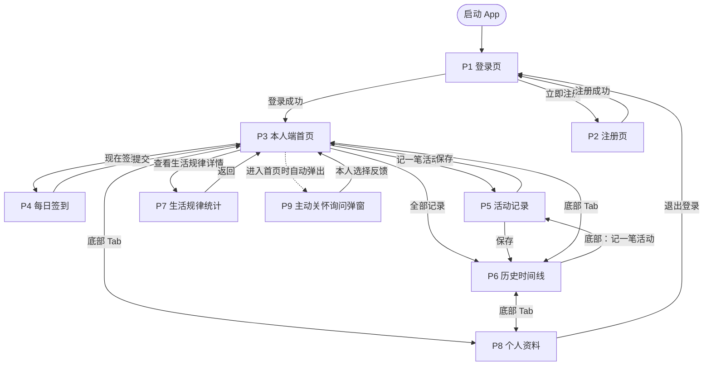

# Android 本人端 UI 设计说明

> 负责人：成员 A ｜ 版本：v1.2 ｜ 状态：**设计方案已确认 + 代码骨架已落地**
>
> 本文档对应《分工.md》里成员 A 的「第一项任务」：页面结构、页面跳转关系、首页布局、项目文件目录。
> 代码骨架已经在 `android-app/` 里落地，`gradlew assembleDebug` 能编译出 debug APK，全部使用模拟数据，
> 拿到仓库用 Android Studio 打开 `android-app` 就能看到效果。
>
> 如果对页面结构/字段有意见，**先改这份文档再改代码**：文档和代码不一致时，以本文档为准。

---

## 1. 设计边界（先说清楚我做什么、不做什么）

**我负责**：所有本人端页面的布局、组件、配色、字号、页面跳转、页面级状态展示（空数据 / 缺失 / 加载 / 错误）、关怀询问弹窗的界面。

**我不负责**：

- 网络请求、Token 保存、本地数据库（成员 B）
- 后端接口、权限校验、邀请码生成（成员 C）
- 基线计算、可信度判定、变化识别规则（成员 D）

**我依赖的三样东西**：① B 提供的数据模型和 Repository 接口；② C 确认的 API 字段；③ D 返回的基线/事件字段。
**我的原则**：页面里不写死任何接口地址和字段名，所有数据通过 ViewModel 暴露的 `UiState` 进入界面。

---

## 2. 用户与设计约束

| 约束 | 来源 | 对设计的影响 |
| --- | --- | --- |
| 主要用户是中老年人 | 项目说明书 | 正文 ≥ 18sp，最小可点区域 56dp，一屏只放一个主要动作 |
| 团队是编程初学者 | 团队现状 | 不用实验性 API、不用复杂动画、不用自定义绘制控件，页面结构尽量一致 |
| 50 天做出 MVP | 排期 | 页面数量控制在 9 个，签到与心情合并成一页 |
| 隐私优先 | 项目说明书 | 任何页面不显示"未授权家属能看到的内容"，家属端由 B 负责 |
| 不能把"没数据"说成"危险" | 核心创新点 | 数据可信度 6 态在 UI 上有固定表达，见第 7 节 |

---

## 3. 页面清单

| 编号 | 页面 | 路由 | 入口 | 核心内容 | 对应模块 |
| --- | --- | --- | --- | --- | --- |
| P1 | 登录页 | `login` | App 启动 | 用户名 + 密码、演示账号提示、去注册 | 模块 1 |
| P2 | 注册页 | `register` | P1「立即注册」 | 身份（本人/家属）、用户名、称呼、密码 | 模块 1 |
| P3 | 本人端首页 | `home` | 登录成功 / 底部「首页」 | 今日状态、待确认关怀、快捷操作、最近活动、近 7 天规律 | 模块 2/5/6/7 |
| P4 | 每日签到页 | `checkin` | P3「现在签到」 | 身体感觉、心情、备注、希望家人联系我 | 模块 2 |
| P5 | 活动记录页 | `activity` | P3「记一笔活动」、P6 底部按钮 | 8 种活动类型、备注、今日已记录 | 模块 2 |
| P6 | 历史时间线 | `timeline` | 底部「记录」 | 按天分组的签到 + 活动，含"没有收到记录"的日子 | 模块 2/9 |
| P7 | 生活规律统计 | `stats` | P3「查看生活规律详情」 | 个人基线、近 14 天签到时间图、近 7 天活动图、可信度说明 | 模块 5/9 |
| P8 | 个人资料 | `profile` | 底部「我的」 | 个人信息、邀请码、家属与授权开关、隐私说明 | 模块 1/8 |
| P9 | 主动关怀询问 | 弹窗（无独立路由） | P3 进入时自动弹出 / 点击待确认卡片 | 5 个反馈选项，**先问本人，不先通知家属** | 模块 7 |

> P9 做成弹窗而不是页面：它的目的是"打断一下、确认一句"，跳页会让老人以为出了问题。

底部导航只有 3 个一级页面：**首页 / 记录 / 我的**。一级页面越少，越不容易迷路。

---

## 4. 页面跳转关系



规则：

1. 底部导航只在 P3 / P6 / P8 显示；P4、P5、P7 是二级页面，只有左上角返回。
2. 所有二级页面提交成功后 `popBackStack()` 回上一页，不新增页面栈。
3. 退出登录用 `popUpTo(graph.id) { inclusive = true }` 清空返回栈，防止按返回键回到已登录界面。

---

## 5. 首页布局（P3，答辩从这里开始）

从上到下的 6 个区块，`Column + verticalScroll`，左右边距 20dp：

```text
┌──────────────────────────────────────────────┐
│ ①  早上好，王秀兰                       (头像) │   headlineSmall 24sp
│    11月26日 星期三                            │   bodyMedium 16sp
├──────────────────────────────────────────────┤
│ ②  ⓘ 演示数据：本页记录为模拟数据…            │   黄色提示条
├──────────────────────────────────────────────┤
│ ③  今天的状态                    [数据缺失]  │   卡片
│    今天还没有收到你的签到记录                  │   titleMedium 20sp
│    可能只是今天起得晚…签到只要 10 秒钟         │   bodyMedium
│    [          现在签到          ]             │   主按钮 56dp
├──────────────────────────────────────────────┤
│ ④  有一件事想和你确认            [数据缺失]   │   黄色卡片，可点击
│    今天 10:30 还没有收到签到记录…             │
│    点这里回答 ›                               │
├──────────────────────────────────────────────┤
│ ⑤  ┌ 每日签到 ┐  ┌ 记一笔活动 ┐               │   两列等宽
│    │ 报个平安 │  │ 外出 / 用餐 │              │
├──────────────────────────────────────────────┤
│ ⑥  最近活动                      全部记录 ›    │
│    06:50  起床 · 今天起得早                   │
│    07:20  用餐 · 小米粥                       │
│    09:10  外出 · 去菜市场                     │
├──────────────────────────────────────────────┤
│ ⑦  作息规律（近 7 天）      [正常记录]        │
│    你平时大约 7:52 签到，前后浮动约 40 分钟    │
│    ▁▃▅▂ ▅▃▆  (7 根柱子，灰块=没有数据)        │
│    [ 11 天 · 可用于判断的有效记录 ]           │
│    查看生活规律详情 ›                         │
└──────────────────────────────────────────────┘
```

设计理由：

- **③ 必须排第一**：打开 App 最想知道的只有一件事——今天算不算报了平安。
- **④ 和 ③ 分开**：一个是"你还没签到"，一个是"系统想问你一句"，后者是项目的创新点，单独一张卡片才看得见。
- **⑦ 放在最后**：规律是"回头看"的信息，不能挤掉今天要做的事。

---

## 6. 视觉规范

### 6.1 颜色

| 用途 | 色值 | 说明 |
| --- | --- | --- |
| 主色 | `#B4572C` | 暖陶土橙，白色文字压在它上面对比度约 5.1:1 |
| 主色浅底 | `#FBE6D9` | 选中态、头像底色 |
| 页面背景 | `#FFF8F3` | 奶油色，比纯白柔和，长时间看不刺眼 |
| 卡片 | `#FFFFFF` + 1dp `#EFE4DA` 描边 | 不用阴影，避免中老年视觉疲劳 |
| 正文 | `#2B2724` | 与背景对比度 > 12:1 |
| 次要文字 | `#6B615A` | 与背景对比度 > 6:1 |
| 正常记录 | `#2F6E4E` / 底 `#E3F0E8` | 绿 |
| 本人反馈 | `#2C5F8A` / 底 `#E2EDF6` | 蓝 |
| 同步延迟、待确认 | `#8A5A0B` / 底 `#FBEFD6` | 琥珀 |
| 数据缺失、离线、不足 | `#5B6672` / 底 `#E8EDF2` | 灰，**刻意不用红色** |
| 需要关注 | `#9E3623` / 底 `#F7E1DC` | 深红，只在"本人明确说需要帮助"时用 |

> 关键决策：**"没有数据"永远用灰色，不用红色。** 红色是"危险"的语言，而后端此刻并不知道发生了什么。

### 6.2 字号（全部 sp，支持系统字体放大到 1.3 倍不破版）

| 名称 | 字号 / 行高 | 用在哪 |
| --- | --- | --- |
| displaySmall | 32 / 40，Bold | 登录页 App 名 |
| headlineSmall | 24 / 32，SemiBold | 页面主标题、问候语 |
| titleLarge | 22 / 30，SemiBold | TopAppBar 标题、弹窗标题 |
| titleMedium | 20 / 28，Medium | 卡片标题、快捷操作标题 |
| bodyLarge | 18 / 28 | 正文默认 |
| bodyMedium | 16 / 26 | 次要说明 |
| bodySmall | 15 / 22 | 辅助说明、时间、来源 |
| labelLarge | 18 / 24，Medium | 按钮文字 |

### 6.3 间距与尺寸

| 名称 | 值 | 用途 |
| --- | --- | --- |
| ScreenPadding | 20dp | 页面左右边距 |
| GapXs / S / M / L / Xl / Xxl | 4 / 8 / 12 / 16 / 24 / 32dp | 所有间距只用这几个值 |
| CardCorner | 20dp | 卡片圆角 |
| CardPadding | 18dp | 卡片内边距 |
| ButtonHeight | 56dp | 主按钮高度 |
| MinTouchHeight | 56dp | 所有可点元素的最小高度（≥ 48dp 无障碍底线） |

### 6.4 无障碍（必须做，答辩可以直接讲）

1. 所有 `Icon` 必须写 `contentDescription`；纯装饰图标写 `null`。
2. 正文对比度 ≥ 4.5:1，大字 ≥ 3:1；表格里已标注。
3. 不写死文本容器高度，字体放大后允许换行撑高。
4. 不用颜色单独表达含义：可信度标签 = **颜色 + 文字**，色盲用户也能看懂。
5. 触摸目标 ≥ 48dp，本项目统一取 56dp。

---

## 7. 数据可信度 6 态的 UI 表达（本项目最重要的界面规范）

| 枚举 | 界面标签 | 颜色 | 界面上的措辞（禁止出现"异常/危险/出事"） | 出现的页面 |
| --- | --- | --- | --- | --- |
| `NORMAL` ↔ `normal` | 正常记录 | 绿 | "已收到完整数据" | P3 / P7 |
| `USER_FEEDBACK` ↔ `user_feedback` | 本人反馈 | 蓝 | "由你自己填写" | P3 / P6 / P8 |
| `DELAYED` ↔ `sync_delay` | 同步延迟 | 琥珀 | "数据还没同步完成，稍后再看" | P6 |
| `MISSING` ↔ `missing_unknown` | 数据缺失 | 灰 | "今天还没有收到你的签到记录" | P3 / P6 |
| `OFFLINE` ↔ `device_offline` | 设备离线 | 灰 | "手机或手表处于离线状态" | P6 |
| `INSUFFICIENT` ↔ `insufficient` | 数据不足 | 灰 | "历史记录太少，暂不判断" | P7 |

> wire 值以 [api.md](api.md) 第 2 节为准；Kotlin 只认枚举，字符串转换在成员 B 的 Mappers 里做。

实现：`ui/components/Common.kt` 里的 `TrustBadge` + `trustColors()`，全 App 只此一处定义，禁止页面自己写颜色。

---

## 8. 空状态与异常规范

| 场景 | 界面表现 |
| --- | --- |
| 今天还没签到 | 卡片内直接给主按钮「现在签到」，不弹窗、不警告 |
| 没有任何活动记录 | 一行灰字「今天还没有记录活动」，不画空图表 |
| 没有数据的那一天 | 图表里画**灰色小块**，不画 0 高度的柱子（0 和"没有数据"必须能区分） |
| 有效记录 < 7 天 | 显示「数据不足，暂不判断」，基线数字显示 `--` |
| 提交失败（等 B 接后端） | 按钮恢复可点 + 红色说明文字，不丢用户已填内容 |

---

## 9. 文件目录结构

```text
android-app/
├── settings.gradle.kts            # 仓库声明（含国内镜像配置）
├── build.gradle.kts               # 根构建脚本，只声明插件版本
├── gradle.properties              # JVM 内存、AndroidX 等开关
├── gradle/libs.versions.toml      # ★ 所有依赖版本集中在这里
└── app/
    ├── build.gradle.kts           # 模块配置：compileSdk 35 / minSdk 26 / Java 17
    └── src/main/
        ├── AndroidManifest.xml
        ├── res/
        │   ├── values/{strings,colors,themes}.xml
        │   ├── xml/{backup_rules,data_extraction_rules}.xml
        │   └── mipmap-*/           # 启动图标（自适应图标 + 各密度 PNG）
        └── java/com/companionlite/
            ├── MainActivity.kt             # 唯一 Activity，setContent { AppNavHost() }
            ├── ui/theme/
            │   ├── Color.kt                # ★ 全部颜色常量（含可信度 6 态）
            │   ├── Type.kt                 # ★ 字号规范
            │   ├── Dimens.kt               # ★ 间距规范
            │   └── Theme.kt                # 只做浅色主题
            ├── ui/navigation/
            │   ├── Routes.kt               # 路由名 + 底部 3 个 Tab
            │   ├── AppBottomBar.kt         # 底部导航栏
            │   └── AppNavHost.kt           # ★ 全局导航，所有跳转都写在这里
            ├── ui/components/              # 全 App 复用组件（只允许 A 改）
            │   ├── Common.kt               # 顶栏、卡片、按钮、可信度标签、提示条
            │   ├── Charts.kt               # 柱状图（纯 Compose 布局，不用第三方库）
            │   └── ActivityRow.kt          # 活动记录行、时间线圆点、日期分组标题
            ├── ui/screens/
            │   ├── auth/{LoginScreen,RegisterScreen,AuthViewModel}.kt
            │   ├── home/{HomeScreen,HomeViewModel,CareAskDialog}.kt
            │   ├── checkin/{CheckInScreen,CheckInViewModel}.kt
            │   ├── activity/{ActivityRecordScreen,ActivityRecordViewModel}.kt
            │   ├── timeline/{TimelineScreen,TimelineViewModel}.kt
            │   ├── stats/{StatsScreen,StatsViewModel}.kt
            │   └── profile/{ProfileScreen,ProfileViewModel}.kt
            └── data/
                ├── model/Models.kt         # 公共数据模型（字段名以 docs/api.md 为准）
                └── mock/MockRepository.kt  # ★ 模拟数据，B 接入后端后整个替换
```

**为什么这么分：**

1. `ui/theme` 单独抽出来 —— 三个人以后加页面，颜色字号不会各写一套。
2. `ui/components` 放公共组件 —— 卡片、按钮只有一份，改一次全部生效。
3. 每个页面一个文件夹，`XxxScreen.kt` + `XxxViewModel.kt` 成对出现 —— 初学者最容易犯的错是把界面和数据处理写在一个文件里。
4. `data/mock` 被隔离在一个文件 —— B 接后端时只需要替换这一层，页面代码不用动。

---

## 10. 页面数据需求（给 B 和 C 看）

> 这是 A 对 B/C 的"点单"。字段名与路径以 [api.md](api.md) v2.0 为准，**A 不自己发明字段**。
> 右列是 A 接入时实际会调用的接口（成员 B 的 `CompanionRepository` 需覆盖这些）。

| 页面 | 需要的数据 | 提交的数据 | 调用接口 |
| --- | --- | --- | --- |
| P1 登录 | token、`user_id`、角色 | `username`、`password` | `POST /auth/login` |
| P2 注册 | —— | `role`、`username`、`display_name`、`password` | `POST /auth/register` |
| P3 首页 | 今日签到、基线、最近 3 条活动、待确认事件 | 无 | `GET /checkins/me/today`、`GET /baselines/me`、`GET /activities/me`、`GET /care-events/me`、`GET /auth/me` |
| P4 签到 | —— | `check_in_at`、`status`、`mood`、`note` | `POST /checkins`；开关打开时另发 `POST /feedback`（`feedback_type=want_family_contact`） |
| P5 活动 | 今日活动列表 | `activity_type`、`recorded_at`、`note` | `POST /activities`、`GET /activities/me` |
| P6 时间线 | 近 14 天签到 + 活动，**每条带 `trust_state`** | 无 | `GET /checkins/me`、`GET /activities/me`（客户端按天分组） |
| P7 统计 | 基线：中位数、波动、有效天数、日均活动数；近 7 天活动数 | 无 | `GET /baselines/me` + 客户端从活动列表聚合 |
| P8 我的 | 资料、邀请码、家属列表与授权范围 | 授权开关变更 | `GET /auth/me`、`POST /family/invite-code`、`GET /family/links`、`PUT /family/links/{id}/permission` |
| P9 询问 | 事件原因文案、事件 id | `response` | `GET /care-events/me`、`POST /care-events/{id}/respond` |

**A 需要的统一结构**：每个列表项都必须带 `trust_state`，取值是
`normal | missing_unknown | device_offline | sync_delay | user_feedback | insufficient`，否则界面无法区分"没数据"和"没活动"。

**P9 的状态**：后端 5 态 `pending → asking → answered → family_pending → closed`，
A 的 `CareEventStatus` 已按这 5 态实现，界面文案只描述"进行到哪一步"。

---

## 11. 验收清单（自测时逐条打勾）

- [ ] Android Studio 打开 `android-app` 后 Gradle 同步成功，能装到手机上运行
- [ ] 9 个页面全部可以到达，返回键行为符合第 4 节的跳转图
- [ ] 系统字体放大到最大档，所有页面文字不截断、按钮不重叠
- [ ] 首页在"今天已签到"和"今天未签到"两种数据下都布局正常
- [ ] 关怀询问弹窗 5 个选项都能点，选完首页出现「关怀事件已更新」卡片
- [ ] 时间线里"没有收到签到记录"的那天显示为灰色，不显示为 0 或空白
- [ ] 图表里灰块和柱子能一眼区分
- [ ] 所有模拟数据页面都有「演示数据」提示条
- [ ] 全部文案里搜不到「异常」「危险」「出事」「报警」这类判断词
- [ ] 没有硬编码接口地址、没有 `TODO` 留在界面文案里

---

## 12. 还需要 B / C / D 回答的问题

1. **C**：`trust_state` 字段是否同意加在签到、活动、基线三类返回里？枚举值就用第 7 节那 6 个？
2. **C**：家属邀请码是 6 位字母数字吗？「我的」页面按 `BX-7215` 的样式展示，可以调整。
3. **B**：登录成功后 token 存在哪（DataStore / SharedPreferences）？A 的页面不碰存储，只调用 B 的 `SessionRepository`。
4. **B**：签到提交失败时，是弹 Toast 还是在页面上显示错误文案？A 默认按"页面内红字"实现。
5. **D**：基线"有效天数"低于多少天算数据不足？A 暂定 7 天，界面需要这个数字来显示「数据不足，暂不判断」。
6. **D**：关怀事件的 5 个反馈选项，是否与后端的 `feedback_type` 枚举完全一致？
