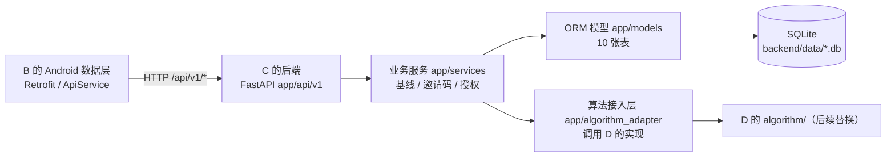

# 《伴行·时序 Companion Lite》后端全部源代码

**交付人：** 成员 C（后端方向）  
**模块范围：** FastAPI 后端全部 56 个 Python 文件（含测试）  
**代码位置：** `backend/`  
**对应分支：** `feature/backend`  
**验证状态：** 源码行数 4017，文件数 56；`pytest -q` **60 passed**，测试基于内存 SQLite，不污染真实数据

---

## 文档说明

这份文档把成员 C 负责的后端代码完整收录在一起，每个文件前有一段说明（这个文件负责什么、为什么这么写）。
代码在工程里是**分 56 个文件、8 个包**存的，这里按依赖顺序排开成一整份阅读材料：

```
先看地基 → 再看数据长什么样 → 再看输入怎么校验 → 再看业务怎么算 → 最后看接口怎么暴露
 config/core/database   models          schemas          services/adapter      api/v1/router
```

> ⚠️ 注意：这份文档是**阅读和提交材料用的**，不是可以直接运行的多文件工程。
> 真正运行请使用 `backend/` 分层目录，启动命令：`uvicorn app.main:app --reload`（在 `backend/` 下执行）。

---

## 一、这份代码在整个项目里的位置

项目是四人分工：A 做 Android 界面，B 做 Android 数据层，C 做后端（本文件），D 做算法。
C 负责的是一台 FastAPI 服务，把 SQLite 里的数据通过 REST 接口提供给 B 的 Android 客户端，
并把 D 的算法以「接入层」的方式挂进来。



C 的代码只依赖「数据怎么存」和「接口怎么给」，不实现算法逻辑——
算法由 D 提供，C 只负责组装输入、调用、保存输出。这条边界写在 `algorithm_adapter/` 的包注释里。

---

## 二、文件清单

| # | 文件 | 行数 | 职责 |
| --- | --- | --- | --- |
| 1 | `app/__init__.py` | 1 | 后端应用包标记 |
| 2 | `app/config.py` | 17 | 全局配置：数据库路径、JWT 密钥、令牌有效期，全部支持环境变量覆盖 |
| 3 | `app/main.py` | 36 | FastAPI 入口，lifespan 中建表并挂载 v1 路由 |
| 4 | `app/database.py` | 41 | 引擎 / Session / Base 与 SQLite 外键开关 |
| 5 | `app/core/__init__.py` | 1 | 核心工具包标记 |
| 6 | `app/core/security.py` | 40 | bcrypt 密码哈希与 JWT 签发 / 解析 |
| 7 | `app/core/time_utils.py` | 56 | 时间统一处理：库内一律 UTC，展示时按用户时区转换 |
| 8 | `app/models/__init__.py` | 22 | 汇总所有 ORM 模型，保证 create_all 能建表 |
| 9 | `app/models/user.py` | 29 | users 用户表 |
| 10 | `app/models/checkin.py` | 32 | daily_checkins 每日签到表 |
| 11 | `app/models/activity.py` | 29 | activity_records 活动记录表 |
| 12 | `app/models/device.py` | 33 | device_bindings 设备绑定表 |
| 13 | `app/models/health.py` | 36 | health_records 穿戴数据表 |
| 14 | `app/models/sync.py` | 32 | data_sync_logs 同步日志表 |
| 15 | `app/models/family.py` | 41 | family_links 家庭绑定与授权表 |
| 16 | `app/models/feedback.py` | 26 | user_feedback 用户反馈表 |
| 17 | `app/models/care.py` | 45 | care_events 关怀事件表 |
| 18 | `app/models/baseline.py` | 35 | baseline_profiles 生活基线表 |
| 19 | `app/schemas/__init__.py` | 1 | Pydantic 模型包标记 |
| 20 | `app/schemas/user.py` | 74 | 注册 / 登录 / 资料更新 / Token 模型 |
| 21 | `app/schemas/checkin.py` | 38 | 签到创建与输出模型及枚举常量 |
| 22 | `app/schemas/activity.py` | 41 | 活动记录模型及枚举常量 |
| 23 | `app/schemas/device.py` | 87 | 设备绑定与健康数据、同步日志模型 |
| 24 | `app/schemas/family.py` | 59 | 邀请码 / 绑定 / 授权模型 |
| 25 | `app/schemas/care.py` | 66 | 关怀事件与反馈模型 |
| 26 | `app/schemas/baseline.py` | 34 | 基线输出模型 |
| 27 | `app/algorithm_adapter/__init__.py` | 5 | 算法接入层包标记 |
| 28 | `app/algorithm_adapter/baseline.py` | 182 | 基线计算与变化识别的参考实现（标准库，供成员 D 替换） |
| 29 | `app/services/__init__.py` | 1 | 业务服务包标记 |
| 30 | `app/services/baseline_service.py` | 145 | 组装算法输入、保存基线输出、生成关怀事件 |
| 31 | `app/services/invite_code.py` | 39 | 邀请码生成 / 校验 / 作废 |
| 32 | `app/services/permission.py` | 57 | 家属授权校验的唯一安全入口 |
| 33 | `app/api/__init__.py` | 1 | API 包标记 |
| 34 | `app/api/deps.py` | 38 | 从 JWT 解析当前登录用户的公共依赖 |
| 35 | `app/api/v1/__init__.py` | 1 | v1 路由包标记 |
| 36 | `app/api/v1/router.py` | 25 | 汇总并挂载全部 v1 路由 |
| 37 | `app/api/v1/auth.py` | 112 | 注册 / 登录 / 当前用户 |
| 38 | `app/api/v1/checkins.py` | 88 | 签到提交与查询 |
| 39 | `app/api/v1/activities.py` | 103 | 活动记录增删改查 |
| 40 | `app/api/v1/devices.py` | 104 | 设备绑定与状态 |
| 41 | `app/api/v1/health.py` | 81 | 穿戴数据上报与查询 |
| 42 | `app/api/v1/sync.py` | 71 | 同步日志上报与查询 |
| 43 | `app/api/v1/family.py` | 169 | 邀请码 / 绑定 / 确认 / 授权 / 解绑 |
| 44 | `app/api/v1/care_events.py` | 308 | 关怀事件完整闭环与一键呼救 |
| 45 | `app/api/v1/feedback.py` | 55 | 用户主动反馈 |
| 46 | `app/api/v1/baselines.py` | 47 | 基线查询、重算与变化识别触发 |
| 47 | `app/api/v1/dashboard.py` | 218 | 本人端与家属端看板（按授权过滤） |
| 48 | `tests/__init__.py` | 1 | 测试包标记 |
| 49 | `tests/conftest.py` | 66 | 内存 SQLite 夹具与已注册用户夹具 |
| 50 | `tests/test_auth.py` | 113 | 认证接口测试 |
| 51 | `tests/test_checkins.py` | 88 | 签到接口测试 |
| 52 | `tests/test_activities.py` | 99 | 活动记录接口测试 |
| 53 | `tests/test_devices_health.py` | 212 | 设备与穿戴数据接口测试 |
| 54 | `tests/test_family.py` | 133 | 家庭绑定与授权测试 |
| 55 | `tests/test_care_events.py` | 301 | 关怀事件闭环测试 |
| 56 | `tests/test_baseline_dashboard.py` | 202 | 基线与看板授权测试 |

合计 **4017 行**（含空行与注释），共 **56 个文件**。

---

## 三、分层结构

```text
backend/
├── app/
│   ├── main.py               ← FastAPI 入口
│   ├── config.py             ← 配置
│   ├── database.py           ← 引擎 / Session / Base
│   ├── core/                 ← 安全、时间工具
│   ├── models/               ← 10 张 ORM 表
│   ├── schemas/              ← Pydantic 请求 / 响应模型
│   ├── algorithm_adapter/    ← 算法接入（D 的替换点）
│   ├── services/             ← 业务逻辑
│   └── api/                  ← 路由（v1 共 15 个模块）
└── tests/                    ← 8 个测试文件 + conftest
```

依赖方向自上而下，路由层不直接写算法，服务层不直接读 HTTP 请求体：

```text
api/v1/*  →  services/*  →  algorithm_adapter/*  →  D 的 algorithm/
    │             │
    └── schemas/  └── models/ → database.py
```

---

## 四、源码

以下按依赖顺序列出全部 56 个文件的完整源码。

### 4.1 应用入口与配置

#### `app/__init__.py`

后端应用包标记。

```python
"""伴行·时序后端应用。"""
```

#### `app/config.py`

全局配置：数据库路径、JWT 密钥、令牌有效期，全部支持环境变量覆盖。

```python
"""项目配置。所有敏感值通过环境变量覆盖，开发时有默认值。"""

import os
from pathlib import Path

# 项目根目录：backend/
BASE_DIR = Path(__file__).resolve().parent.parent

# SQLite 数据库文件路径
DATA_DIR = BASE_DIR / "data"
DATA_DIR.mkdir(parents=True, exist_ok=True)
DATABASE_URL = os.getenv("DATABASE_URL", f"sqlite:///{DATA_DIR / 'companionlite.db'}")

# JWT 密钥（开发用默认值，生产必须改）
SECRET_KEY = os.getenv("SECRET_KEY", "dev-only-secret-key-change-me-in-production")
ALGORITHM = "HS256"
ACCESS_TOKEN_EXPIRE_MINUTES = int(os.getenv("ACCESS_TOKEN_EXPIRE_MINUTES", "1440"))  # 24 小时
```

#### `app/main.py`

FastAPI 入口，lifespan 中建表并挂载 v1 路由。

```python
"""FastAPI 应用入口。

启动命令：uvicorn app.main:app --reload
"""

from contextlib import asynccontextmanager

from fastapi import FastAPI

from app.api.v1.router import api_router
from app.database import Base, engine

# 确保 ORM 模型被导入，create_all 才能建表
import app.models  # noqa: F401


@asynccontextmanager
async def lifespan(app: FastAPI):
    """应用启动时建表。开发阶段用 create_all，稳定后再引入 Alembic。"""
    Base.metadata.create_all(bind=engine)
    yield


app = FastAPI(
    title="伴行·时序 API",
    description="基于个人生活基线与可信数据分析的主动关怀系统",
    version="0.1.0",
    lifespan=lifespan,
)

app.include_router(api_router)


@app.get("/", tags=["健康检查"])
def health_check():
    return {"status": "ok", "service": "Companion Lite API"}
```

#### `app/database.py`

引擎 / Session / Base 与 SQLite 外键开关。

```python
"""数据库连接与 Session 管理。"""

import sqlite3

from sqlalchemy import create_engine, event
from sqlalchemy.engine import Engine
from sqlalchemy.orm import DeclarativeBase, sessionmaker

from app.config import DATABASE_URL

# SQLite 需要 check_same_thread=False，让 FastAPI 的线程池可以共享连接
connect_args = {"check_same_thread": False} if DATABASE_URL.startswith("sqlite") else {}
engine = create_engine(DATABASE_URL, connect_args=connect_args)


@event.listens_for(Engine, "connect")
def enable_sqlite_foreign_keys(dbapi_connection, connection_record):
    """SQLite 默认不执行外键约束，这里为每个连接显式开启。"""
    if not isinstance(dbapi_connection, sqlite3.Connection):
        return
    cursor = dbapi_connection.cursor()
    try:
        cursor.execute("PRAGMA foreign_keys=ON")
    finally:
        cursor.close()


SessionLocal = sessionmaker(autocommit=False, autoflush=False, bind=engine)


class Base(DeclarativeBase):
    """所有 ORM 模型的基类。"""


def get_db():
    """FastAPI 依赖：每个请求一个数据库 Session，结束后自动关闭。"""
    db = SessionLocal()
    try:
        yield db
    finally:
        db.close()
```

### 4.2 核心工具（core）

#### `app/core/__init__.py`

核心工具包标记。

```python
"""核心工具：安全、权限、时间。"""
```

#### `app/core/security.py`

bcrypt 密码哈希与 JWT 签发 / 解析。

```python
"""密码哈希与 JWT 令牌。密码绝不存明文。"""

from datetime import datetime, timedelta, timezone
from typing import Any

import bcrypt
import jwt

from app.config import ACCESS_TOKEN_EXPIRE_MINUTES, ALGORITHM, SECRET_KEY


def hash_password(password: str) -> str:
    """用 bcrypt 生成密码哈希。"""
    return bcrypt.hashpw(password.encode("utf-8"), bcrypt.gensalt()).decode("utf-8")


def verify_password(plain_password: str, hashed_password: str) -> bool:
    """校验明文密码与哈希是否匹配。"""
    try:
        return bcrypt.checkpw(plain_password.encode("utf-8"), hashed_password.encode("utf-8"))
    except (ValueError, TypeError):
        return False


def create_access_token(data: dict[str, Any], expires_delta: timedelta | None = None) -> str:
    """生成 JWT。data 里通常放 user_id 和 role。"""
    to_encode = data.copy()
    expire = datetime.now(timezone.utc) + (
        expires_delta or timedelta(minutes=ACCESS_TOKEN_EXPIRE_MINUTES)
    )
    to_encode.update({"exp": expire})
    return jwt.encode(to_encode, SECRET_KEY, algorithm=ALGORITHM)


def decode_access_token(token: str) -> dict[str, Any] | None:
    """解析 JWT，失败返回 None。"""
    try:
        return jwt.decode(token, SECRET_KEY, algorithms=[ALGORITHM])
    except jwt.PyJWTError:
        return None
```

#### `app/core/time_utils.py`

时间统一处理：库内一律 UTC，展示时按用户时区转换。

```python
"""时间是整个项目最容易出错的地方，统一在这里处理。

规则：数据库一律存 UTC 时间（无时区信息的 datetime，但语义是 UTC）。
展示时由客户端按 user.timezone 转换。
"""

from datetime import datetime, timedelta, timezone
from zoneinfo import ZoneInfo, ZoneInfoNotFoundError


def _resolve_timezone(value: str):
    """解析 IANA 时区；Windows 未安装 tzdata 时保留中国常用时区兜底。"""
    try:
        return ZoneInfo(value)
    except ZoneInfoNotFoundError:
        # Asia/Shanghai 自 1991 年后没有夏令时，固定 +08:00 与当前生活场景一致。
        fallback = {
            "UTC": timezone.utc,
            "Asia/Shanghai": timezone(timedelta(hours=8)),
            "Asia/Chongqing": timezone(timedelta(hours=8)),
            "Asia/Hong_Kong": timezone(timedelta(hours=8)),
        }
        if value in fallback:
            return fallback[value]
        raise


def utcnow() -> datetime:
    """返回当前的 UTC 时间（naive datetime，语义为 UTC）。"""
    return datetime.now(timezone.utc).replace(tzinfo=None)


def parse_aware(value: datetime) -> datetime:
    """把带时区的 datetime 转成 UTC naive datetime；不带时区时按 UTC 处理。"""
    if value.tzinfo is None:
        return value
    return value.astimezone(timezone.utc).replace(tzinfo=None)


def validate_timezone_name(value: str) -> str:
    """校验 IANA 时区名称，例如 Asia/Shanghai。"""
    try:
        _resolve_timezone(value)
    except (ZoneInfoNotFoundError, ValueError):
        raise ValueError("timezone 必须是有效的 IANA 时区名称") from None
    return value


def to_user_local(value: datetime, timezone_name: str) -> datetime:
    """把数据库中的 UTC 时间转换为用户本地时间。

    数据库中的 datetime 不带时区，但项目约定它表示 UTC，因此先补上 UTC
    时区再转换。返回值保留时区信息，便于按用户本地日期分组。
    """
    utc_value = value.replace(tzinfo=timezone.utc) if value.tzinfo is None else value
    return utc_value.astimezone(_resolve_timezone(timezone_name))
```

### 4.3 数据模型（models）

#### `app/models/__init__.py`

汇总所有 ORM 模型，保证 create_all 能建表。

```python
"""SQLAlchemy ORM 模型。

第一个模块只建 users 和 daily_checkins 两张表，
其余表在对应模块开发时再加入。
"""

from app.models.user import User
from app.models.checkin import DailyCheckin
from app.models.family import FamilyLink
from app.models.activity import ActivityRecord
from app.models.device import DeviceBinding
from app.models.health import HealthRecord
from app.models.sync import DataSyncLog
from app.models.care import CareEvent
from app.models.feedback import UserFeedback
from app.models.baseline import BaselineProfile

__all__ = [
    "User", "DailyCheckin", "FamilyLink", "ActivityRecord",
    "DeviceBinding", "HealthRecord", "DataSyncLog",
    "CareEvent", "UserFeedback", "BaselineProfile",
]
```

#### `app/models/user.py`

users 用户表。

```python
"""users 表：用户表。"""

from datetime import date, datetime

from sqlalchemy import Date, DateTime, String, Boolean
from sqlalchemy.orm import Mapped, mapped_column

from app.core.time_utils import utcnow
from app.database import Base


class User(Base):
    __tablename__ = "users"

    id: Mapped[int] = mapped_column(primary_key=True, autoincrement=True)
    username: Mapped[str] = mapped_column(String(50), unique=True, nullable=False, index=True)
    phone: Mapped[str | None] = mapped_column(String(20), unique=True, nullable=True)
    email: Mapped[str | None] = mapped_column(String(100), unique=True, nullable=True)
    password_hash: Mapped[str] = mapped_column(String(255), nullable=False)
    role: Mapped[str] = mapped_column(String(20), nullable=False, default="self")
    display_name: Mapped[str] = mapped_column(String(50), nullable=False)
    gender: Mapped[str | None] = mapped_column(String(10), nullable=True)
    birth_date: Mapped[date | None] = mapped_column(Date, nullable=True)
    timezone: Mapped[str] = mapped_column(String(50), nullable=False, default="Asia/Shanghai")
    status: Mapped[str] = mapped_column(String(20), nullable=False, default="active")
    created_at: Mapped[datetime] = mapped_column(DateTime, nullable=False, default=utcnow)
    updated_at: Mapped[datetime] = mapped_column(
        DateTime, nullable=False, default=utcnow, onupdate=utcnow
    )
```

#### `app/models/checkin.py`

daily_checkins 每日签到表。

```python
"""daily_checkins 表：每日签到表。"""

from datetime import datetime

from sqlalchemy import Boolean, DateTime, ForeignKey, Index, Integer, String
from sqlalchemy.orm import Mapped, mapped_column

from app.core.time_utils import utcnow
from app.database import Base


class DailyCheckin(Base):
    __tablename__ = "daily_checkins"
    __table_args__ = (
        Index("ix_checkin_user_time", "user_id", "check_in_at"),
    )

    id: Mapped[int] = mapped_column(primary_key=True, autoincrement=True)
    user_id: Mapped[int] = mapped_column(
        Integer, ForeignKey("users.id", ondelete="RESTRICT"), nullable=False
    )
    check_in_at: Mapped[datetime] = mapped_column(DateTime, nullable=False)
    mood: Mapped[str | None] = mapped_column(String(20), nullable=True)
    status: Mapped[str] = mapped_column(String(20), nullable=False, default="normal")
    note: Mapped[str | None] = mapped_column(String(500), nullable=True)
    data_source: Mapped[str] = mapped_column(String(20), nullable=False, default="manual")
    sync_status: Mapped[str] = mapped_column(String(20), nullable=False, default="synced")
    is_confirmed: Mapped[bool] = mapped_column(Boolean, nullable=False, default=True)
    created_at: Mapped[datetime] = mapped_column(DateTime, nullable=False, default=utcnow)
    updated_at: Mapped[datetime] = mapped_column(
        DateTime, nullable=False, default=utcnow, onupdate=utcnow
    )
```

#### `app/models/activity.py`

activity_records 活动记录表。

```python
"""activity_records 表：活动记录表。"""

from datetime import datetime

from sqlalchemy import Boolean, DateTime, ForeignKey, Index, Integer, String
from sqlalchemy.orm import Mapped, mapped_column

from app.core.time_utils import utcnow
from app.database import Base


class ActivityRecord(Base):
    __tablename__ = "activity_records"
    __table_args__ = (Index("ix_activity_user_time", "user_id", "recorded_at"),)

    id: Mapped[int] = mapped_column(primary_key=True, autoincrement=True)
    user_id: Mapped[int] = mapped_column(
        Integer, ForeignKey("users.id", ondelete="RESTRICT"), nullable=False
    )
    activity_type: Mapped[str] = mapped_column(String(30), nullable=False)
    recorded_at: Mapped[datetime] = mapped_column(DateTime, nullable=False)
    note: Mapped[str | None] = mapped_column(String(500), nullable=True)
    data_source: Mapped[str] = mapped_column(String(20), nullable=False, default="manual")
    sync_status: Mapped[str] = mapped_column(String(20), nullable=False, default="synced")
    is_confirmed: Mapped[bool] = mapped_column(Boolean, nullable=False, default=True)
    created_at: Mapped[datetime] = mapped_column(DateTime, nullable=False, default=utcnow)
    updated_at: Mapped[datetime] = mapped_column(
        DateTime, nullable=False, default=utcnow, onupdate=utcnow
    )
```

#### `app/models/device.py`

device_bindings 设备绑定表。

```python
"""device_bindings 表：设备绑定表。"""

from datetime import datetime

from sqlalchemy import DateTime, ForeignKey, Index, Integer, String, UniqueConstraint
from sqlalchemy.orm import Mapped, mapped_column

from app.core.time_utils import utcnow
from app.database import Base


class DeviceBinding(Base):
    __tablename__ = "device_bindings"
    __table_args__ = (
        UniqueConstraint("user_id", "device_id", name="uq_user_device"),
        Index("ix_device_user_status", "user_id", "status"),
    )

    id: Mapped[int] = mapped_column(primary_key=True, autoincrement=True)
    user_id: Mapped[int] = mapped_column(
        Integer, ForeignKey("users.id", ondelete="RESTRICT"), nullable=False
    )
    device_type: Mapped[str] = mapped_column(String(30), nullable=False)
    device_id: Mapped[str] = mapped_column(String(100), nullable=False)
    device_name: Mapped[str | None] = mapped_column(String(100), nullable=True)
    status: Mapped[str] = mapped_column(String(20), nullable=False, default="active")
    last_seen_at: Mapped[datetime | None] = mapped_column(DateTime, nullable=True)
    bound_at: Mapped[datetime] = mapped_column(DateTime, nullable=False, default=utcnow)
    unbound_at: Mapped[datetime | None] = mapped_column(DateTime, nullable=True)
    created_at: Mapped[datetime] = mapped_column(DateTime, nullable=False, default=utcnow)
    updated_at: Mapped[datetime] = mapped_column(
        DateTime, nullable=False, default=utcnow, onupdate=utcnow
    )
```

#### `app/models/health.py`

health_records 穿戴数据表。

```python
"""health_records 表：穿戴设备数据表。

重要：本表数据缺失不能推断为用户没有活动。
可信度判断由算法模块基于 data_source/sync_status/is_valid 等字段完成。
"""

from datetime import datetime

from sqlalchemy import Boolean, DateTime, ForeignKey, Index, Integer, Numeric, String
from sqlalchemy.orm import Mapped, mapped_column

from app.core.time_utils import utcnow
from app.database import Base


class HealthRecord(Base):
    __tablename__ = "health_records"
    __table_args__ = (Index("ix_health_user_type_time", "user_id", "data_type", "collected_at"),)

    id: Mapped[int] = mapped_column(primary_key=True, autoincrement=True)
    user_id: Mapped[int] = mapped_column(
        Integer, ForeignKey("users.id", ondelete="RESTRICT"), nullable=False
    )
    device_binding_id: Mapped[int | None] = mapped_column(
        Integer, ForeignKey("device_bindings.id", ondelete="RESTRICT"), nullable=True
    )
    data_type: Mapped[str] = mapped_column(String(30), nullable=False)
    value: Mapped[float] = mapped_column(Numeric(12, 2), nullable=False)
    unit: Mapped[str] = mapped_column(String(20), nullable=False)
    collected_at: Mapped[datetime] = mapped_column(DateTime, nullable=False)
    uploaded_at: Mapped[datetime | None] = mapped_column(DateTime, nullable=True)
    data_source: Mapped[str] = mapped_column(String(30), nullable=False, default="device")
    sync_status: Mapped[str] = mapped_column(String(20), nullable=False, default="synced")
    is_valid: Mapped[bool] = mapped_column(Boolean, nullable=False, default=True)
    is_confirmed: Mapped[bool] = mapped_column(Boolean, nullable=False, default=False)
    created_at: Mapped[datetime] = mapped_column(DateTime, nullable=False, default=utcnow)
```

#### `app/models/sync.py`

data_sync_logs 同步日志表。

```python
"""data_sync_logs 表：数据同步日志表。

用于区分设备离线、同步延迟和数据缺失三种不同情况。
"""

from datetime import datetime

from sqlalchemy import DateTime, ForeignKey, Index, Integer, String
from sqlalchemy.orm import Mapped, mapped_column

from app.core.time_utils import utcnow
from app.database import Base


class DataSyncLog(Base):
    __tablename__ = "data_sync_logs"
    __table_args__ = (Index("ix_sync_user_time", "user_id", "started_at"),)

    id: Mapped[int] = mapped_column(primary_key=True, autoincrement=True)
    user_id: Mapped[int] = mapped_column(
        Integer, ForeignKey("users.id", ondelete="RESTRICT"), nullable=False
    )
    device_binding_id: Mapped[int | None] = mapped_column(
        Integer, ForeignKey("device_bindings.id", ondelete="RESTRICT"), nullable=True
    )
    sync_type: Mapped[str] = mapped_column(String(30), nullable=False)
    status: Mapped[str] = mapped_column(String(20), nullable=False)
    started_at: Mapped[datetime] = mapped_column(DateTime, nullable=False)
    finished_at: Mapped[datetime | None] = mapped_column(DateTime, nullable=True)
    records_count: Mapped[int] = mapped_column(Integer, nullable=False, default=0)
    error_message: Mapped[str | None] = mapped_column(String(500), nullable=True)
    created_at: Mapped[datetime] = mapped_column(DateTime, nullable=False, default=utcnow)
```

#### `app/models/family.py`

family_links 家庭绑定与授权表。

```python
"""family_links 表：家庭关系及授权表。

这是整个项目的数据安全核心：家属能否访问本人数据，全看这张表。
"""

from datetime import datetime

from sqlalchemy import Boolean, DateTime, ForeignKey, Index, Integer, String, UniqueConstraint
from sqlalchemy.orm import Mapped, mapped_column

from app.core.time_utils import utcnow
from app.database import Base


class FamilyLink(Base):
    __tablename__ = "family_links"
    __table_args__ = (
        UniqueConstraint("owner_id", "family_id", name="uq_owner_family"),
        Index("ix_family_owner_status", "owner_id", "status"),
    )

    id: Mapped[int] = mapped_column(primary_key=True, autoincrement=True)
    owner_id: Mapped[int] = mapped_column(
        Integer, ForeignKey("users.id", ondelete="RESTRICT"), nullable=False
    )
    family_id: Mapped[int] = mapped_column(
        Integer, ForeignKey("users.id", ondelete="RESTRICT"), nullable=False
    )
    invite_code: Mapped[str | None] = mapped_column(String(20), nullable=True)
    relation: Mapped[str | None] = mapped_column(String(20), nullable=True)
    status: Mapped[str] = mapped_column(String(20), nullable=False, default="pending")
    # permission_scope: JSON 数组字符串，如 ["checkins","activities","care_events"]
    permission_scope: Mapped[str | None] = mapped_column(String(500), nullable=True)
    can_receive_alert: Mapped[bool] = mapped_column(Boolean, nullable=False, default=False)
    requested_at: Mapped[datetime] = mapped_column(DateTime, nullable=False, default=utcnow)
    confirmed_at: Mapped[datetime | None] = mapped_column(DateTime, nullable=True)
    revoked_at: Mapped[datetime | None] = mapped_column(DateTime, nullable=True)
    created_at: Mapped[datetime] = mapped_column(DateTime, nullable=False, default=utcnow)
    updated_at: Mapped[datetime] = mapped_column(
        DateTime, nullable=False, default=utcnow, onupdate=utcnow
    )
```

#### `app/models/feedback.py`

user_feedback 用户反馈表。

```python
"""user_feedback 表：用户反馈表。"""

from datetime import datetime

from sqlalchemy import DateTime, ForeignKey, Index, Integer, String
from sqlalchemy.orm import Mapped, mapped_column

from app.core.time_utils import utcnow
from app.database import Base


class UserFeedback(Base):
    __tablename__ = "user_feedback"
    __table_args__ = (Index("ix_feedback_user_time", "user_id", "created_at"),)

    id: Mapped[int] = mapped_column(primary_key=True, autoincrement=True)
    user_id: Mapped[int] = mapped_column(
        Integer, ForeignKey("users.id", ondelete="RESTRICT"), nullable=False
    )
    care_event_id: Mapped[int | None] = mapped_column(
        Integer, ForeignKey("care_events.id", ondelete="RESTRICT"), nullable=True
    )
    feedback_type: Mapped[str] = mapped_column(String(30), nullable=False)
    content: Mapped[str | None] = mapped_column(String(500), nullable=True)
    source: Mapped[str] = mapped_column(String(20), nullable=False, default="manual")
    created_at: Mapped[datetime] = mapped_column(DateTime, nullable=False, default=utcnow)
```

#### `app/models/care.py`

care_events 关怀事件表。

```python
"""care_events 表：关怀事件表。

状态机：pending -> asking -> answered -> family_pending -> closed
"""

from datetime import datetime

from sqlalchemy import Boolean, DateTime, ForeignKey, Index, Integer, String, Text
from sqlalchemy.orm import Mapped, mapped_column

from app.core.time_utils import utcnow
from app.database import Base


class CareEvent(Base):
    __tablename__ = "care_events"
    __table_args__ = (
        Index("ix_care_user_status", "user_id", "event_status"),
        Index("ix_care_family", "family_link_id"),
    )

    id: Mapped[int] = mapped_column(primary_key=True, autoincrement=True)
    user_id: Mapped[int] = mapped_column(
        Integer, ForeignKey("users.id", ondelete="RESTRICT"), nullable=False
    )
    family_link_id: Mapped[int | None] = mapped_column(
        Integer, ForeignKey("family_links.id", ondelete="RESTRICT"), nullable=True
    )
    event_type: Mapped[str] = mapped_column(String(30), nullable=False)
    is_emergency: Mapped[bool] = mapped_column(Boolean, nullable=False, default=False)
    trigger_rule: Mapped[str] = mapped_column(String(50), nullable=False)
    event_status: Mapped[str] = mapped_column(String(30), nullable=False, default="pending")
    concern_level: Mapped[str] = mapped_column(String(20), nullable=False, default="low")
    reason: Mapped[str] = mapped_column(Text, nullable=False)
    evidence: Mapped[str | None] = mapped_column(Text, nullable=True)
    asked_at: Mapped[datetime | None] = mapped_column(DateTime, nullable=True)
    user_response: Mapped[str | None] = mapped_column(String(30), nullable=True)
    responded_at: Mapped[datetime | None] = mapped_column(DateTime, nullable=True)
    family_notified_at: Mapped[datetime | None] = mapped_column(DateTime, nullable=True)
    family_contacted_at: Mapped[datetime | None] = mapped_column(DateTime, nullable=True)
    handled_at: Mapped[datetime | None] = mapped_column(DateTime, nullable=True)
    created_at: Mapped[datetime] = mapped_column(DateTime, nullable=False, default=utcnow)
    updated_at: Mapped[datetime] = mapped_column(
        DateTime, nullable=False, default=utcnow, onupdate=utcnow
    )
```

#### `app/models/baseline.py`

baseline_profiles 生活基线表。

```python
"""baseline_profiles 表：个人生活基线表。"""

from datetime import datetime, time

from sqlalchemy import Boolean, DateTime, ForeignKey, Integer, Numeric, String, Time
from sqlalchemy.orm import Mapped, mapped_column

from app.core.time_utils import utcnow
from app.database import Base


class BaselineProfile(Base):
    __tablename__ = "baseline_profiles"

    id: Mapped[int] = mapped_column(primary_key=True, autoincrement=True)
    user_id: Mapped[int] = mapped_column(
        Integer, ForeignKey("users.id", ondelete="RESTRICT"), nullable=False, unique=True
    )
    window_days: Mapped[int] = mapped_column(Integer, nullable=False, default=14)
    checkin_time_median: Mapped[time | None] = mapped_column(Time, nullable=True)
    checkin_time_mean: Mapped[time | None] = mapped_column(Time, nullable=True)
    checkin_time_stddev: Mapped[float | None] = mapped_column(Numeric(8, 2), nullable=True)
    checkin_iqr_min: Mapped[time | None] = mapped_column(Time, nullable=True)
    checkin_iqr_max: Mapped[time | None] = mapped_column(Time, nullable=True)
    avg_daily_activities: Mapped[float | None] = mapped_column(Numeric(8, 2), nullable=True)
    avg_weekly_activities: Mapped[float | None] = mapped_column(Numeric(8, 2), nullable=True)
    avg_daily_steps: Mapped[float | None] = mapped_column(Numeric(10, 2), nullable=True)
    feedback_distribution: Mapped[str | None] = mapped_column(String(500), nullable=True)
    valid_days: Mapped[int] = mapped_column(Integer, nullable=False, default=0)
    data_sufficient: Mapped[bool] = mapped_column(Boolean, nullable=False, default=False)
    calculated_at: Mapped[datetime] = mapped_column(DateTime, nullable=False, default=utcnow)
    created_at: Mapped[datetime] = mapped_column(DateTime, nullable=False, default=utcnow)
    updated_at: Mapped[datetime] = mapped_column(
        DateTime, nullable=False, default=utcnow, onupdate=utcnow
    )
```

### 4.4 请求校验（schemas）

#### `app/schemas/__init__.py`

Pydantic 模型包标记。

```python
"""Pydantic 请求/响应模型。"""
```

#### `app/schemas/user.py`

注册 / 登录 / 资料更新 / Token 模型。

```python
"""用户相关的请求/响应模型。"""

from datetime import date, datetime

from pydantic import BaseModel, ConfigDict, Field, field_validator

from app.core.time_utils import validate_timezone_name


class UserRegister(BaseModel):
    """注册请求。"""

    username: str = Field(min_length=3, max_length=50)
    password: str = Field(min_length=6, max_length=128, description="至少 6 位")
    display_name: str = Field(min_length=1, max_length=50)
    phone: str | None = Field(default=None, max_length=20)
    email: str | None = Field(default=None, max_length=100)
    role: str = Field(default="self", description="self=本人, family=家属")
    timezone: str = Field(default="Asia/Shanghai", max_length=50)

    @field_validator("timezone")
    @classmethod
    def check_timezone(cls, value: str) -> str:
        return validate_timezone_name(value)


class UserUpdate(BaseModel):
    """本人可修改的资料。用户名和角色不允许在这里修改。"""

    display_name: str | None = Field(default=None, min_length=1, max_length=50)
    phone: str | None = Field(default=None, max_length=20)
    email: str | None = Field(default=None, max_length=100)
    gender: str | None = Field(default=None, max_length=10)
    birth_date: date | None = None
    timezone: str | None = Field(default=None, max_length=50)

    @field_validator("timezone")
    @classmethod
    def check_optional_timezone(cls, value: str | None) -> str | None:
        if value is None:
            return None
        return validate_timezone_name(value)


class UserLogin(BaseModel):
    """登录请求。"""

    username: str
    password: str


class UserOut(BaseModel):
    """用户信息响应（不含密码哈希）。"""

    model_config = ConfigDict(from_attributes=True)

    id: int
    username: str
    display_name: str
    role: str
    phone: str | None = None
    email: str | None = None
    gender: str | None = None
    birth_date: date | None = None
    timezone: str
    status: str
    created_at: datetime


class Token(BaseModel):
    """登录成功返回的 JWT。"""

    access_token: str
    token_type: str = "bearer"
```

#### `app/schemas/checkin.py`

签到创建与输出模型及枚举常量。

```python
"""签到相关的请求/响应模型。字段命名严格遵循团队统一约定。"""

from datetime import datetime

from pydantic import BaseModel, ConfigDict, Field

MOOD_VALUES = {"good", "normal", "uncomfortable", "need_help"}
STATUS_VALUES = {"normal", "good", "uncomfortable", "need_help"}
DATA_SOURCES = {"manual", "device"}
SYNC_STATUSES = {"synced", "pending", "failed"}


class CheckinCreate(BaseModel):
    """提交签到请求。check_in_at 由客户端提供，必须是 UTC 时间（带 Z 后缀或 +00:00）。"""

    check_in_at: datetime
    mood: str | None = Field(default=None, description="good/normal/uncomfortable/need_help")
    status: str = Field(default="normal", description="normal/good/uncomfortable/need_help")
    note: str | None = Field(default=None, max_length=500)
    data_source: str = Field(default="manual", description="manual/device")
    sync_status: str = Field(default="synced", description="synced/pending")


class CheckinOut(BaseModel):
    """签到响应。"""

    model_config = ConfigDict(from_attributes=True)

    id: int
    user_id: int
    check_in_at: datetime
    mood: str | None = None
    status: str
    note: str | None = None
    data_source: str
    sync_status: str
    is_confirmed: bool
    created_at: datetime
```

#### `app/schemas/activity.py`

活动记录模型及枚举常量。

```python
"""活动记录相关请求/响应模型。"""

from datetime import datetime

from pydantic import BaseModel, ConfigDict, Field

ACTIVITY_TYPES = {
    "wake_up", "go_out", "go_home", "meal", "exercise", "rest", "medication", "other"
}
DATA_SOURCES = {"manual", "device"}
SYNC_STATUSES = {"synced", "pending", "failed"}


class ActivityCreate(BaseModel):
    activity_type: str = Field(description="wake_up/go_out/go_home/meal/exercise/rest/medication/other")
    recorded_at: datetime
    note: str | None = Field(default=None, max_length=500)
    data_source: str = Field(default="manual")
    sync_status: str = Field(default="synced")


class ActivityUpdate(BaseModel):
    """修改活动记录，所有字段可选。"""

    activity_type: str | None = None
    recorded_at: datetime | None = None
    note: str | None = None


class ActivityOut(BaseModel):
    model_config = ConfigDict(from_attributes=True)

    id: int
    user_id: int
    activity_type: str
    recorded_at: datetime
    note: str | None = None
    data_source: str
    sync_status: str
    is_confirmed: bool
    created_at: datetime
```

#### `app/schemas/device.py`

设备绑定与健康数据、同步日志模型。

```python
"""设备/健康数据/同步日志相关模型。"""

from datetime import datetime

from pydantic import BaseModel, ConfigDict, Field

DEVICE_TYPES = {"xiaomi_watch", "other"}
DATA_TYPES = {"steps", "heart_rate", "sleep", "activity_duration"}
HEALTH_UNITS = {"steps": "steps", "heart_rate": "bpm", "sleep": "minutes", "activity_duration": "minutes"}
DATA_SOURCES = {"manual", "device"}
SYNC_STATUSES = {"synced", "pending", "failed"}
SYNC_LOG_STATUSES = {"success", "failed", "pending"}


class DeviceCreate(BaseModel):
    device_type: str = Field(description="xiaomi_watch/other")
    device_id: str = Field(min_length=1, max_length=100)
    device_name: str | None = Field(default=None, max_length=100)


class DeviceOut(BaseModel):
    model_config = ConfigDict(from_attributes=True)

    id: int
    user_id: int
    device_type: str
    device_id: str
    device_name: str | None = None
    status: str
    last_seen_at: datetime | None = None
    bound_at: datetime


class DeviceStatusUpdate(BaseModel):
    status: str = Field(description="active/offline/unbound")


class HealthRecordCreate(BaseModel):
    data_type: str = Field(description="steps/heart_rate/sleep/activity_duration")
    value: float = Field(ge=0)
    device_binding_id: int | None = None
    collected_at: datetime
    uploaded_at: datetime | None = None
    data_source: str = Field(default="device")
    sync_status: str = Field(default="synced")


class HealthRecordOut(BaseModel):
    model_config = ConfigDict(from_attributes=True)

    id: int
    user_id: int
    device_binding_id: int | None = None
    data_type: str
    value: float
    unit: str
    collected_at: datetime
    uploaded_at: datetime | None = None
    data_source: str
    sync_status: str
    is_valid: bool
    is_confirmed: bool
    created_at: datetime


class SyncLogCreate(BaseModel):
    sync_type: str
    status: str = Field(description="success/failed/pending")
    device_binding_id: int | None = None
    started_at: datetime
    finished_at: datetime | None = None
    records_count: int = Field(default=0, ge=0)
    error_message: str | None = Field(default=None, max_length=500)


class SyncLogOut(BaseModel):
    model_config = ConfigDict(from_attributes=True)

    id: int
    user_id: int
    device_binding_id: int | None = None
    sync_type: str
    status: str
    started_at: datetime
    finished_at: datetime | None = None
    records_count: int
    error_message: str | None = None
```

#### `app/schemas/family.py`

邀请码 / 绑定 / 授权模型。

```python
"""家庭关系相关请求/响应模型。"""

import json
from datetime import datetime

from pydantic import BaseModel, ConfigDict, Field, field_validator

VALID_SCOPES = {"checkins", "activities", "health", "care_events", "feedback", "baseline"}


class InviteCodeOut(BaseModel):
    """本人生成的邀请码。"""

    invite_code: str
    expires_in_minutes: int = 60


class FamilyBindIn(BaseModel):
    """家属用邀请码申请绑定。"""

    invite_code: str = Field(min_length=6, max_length=6)
    relation: str | None = Field(default=None, max_length=20)


class FamilyLinkOut(BaseModel):
    """家庭关系响应。授权范围统一返回 JSON 数组，不向客户端暴露存储细节。"""

    model_config = ConfigDict(from_attributes=True)

    id: int
    owner_id: int
    family_id: int
    relation: str | None = None
    status: str
    permission_scope: list[str] = Field(default_factory=list)
    can_receive_alert: bool
    requested_at: datetime
    confirmed_at: datetime | None = None
    revoked_at: datetime | None = None

    @field_validator("permission_scope", mode="before")
    @classmethod
    def parse_permission_scope(cls, value):
        if value is None:
            return []
        if isinstance(value, list):
            return value
        try:
            parsed = json.loads(value)
        except (TypeError, ValueError):
            return []
        return [item for item in parsed if item in VALID_SCOPES] if isinstance(parsed, list) else []


class PermissionUpdate(BaseModel):
    """本人设置家属的授权范围。"""

    permission_scope: list[str] = Field(default_factory=list)
    can_receive_alert: bool = False
```

#### `app/schemas/care.py`

关怀事件与反馈模型。

```python
"""关怀事件与反馈相关模型。"""

from datetime import datetime

from pydantic import BaseModel, ConfigDict, Field

EVENT_TYPES = {"checkin_delay", "activity_drop", "feedback_concern", "user_request", "sos"}
CONCERN_LEVELS = {"low", "medium", "high"}
USER_RESPONSES = {"fine", "busy", "unwell", "want_family_contact", "no_answer"}
FEEDBACK_TYPES = USER_RESPONSES | {"other"}


class CareEventCreate(BaseModel):
    """通常由算法或本人触发创建。"""

    event_type: str
    trigger_rule: str = Field(max_length=50)
    concern_level: str = Field(default="low")
    reason: str = Field(min_length=1)
    evidence: str | None = None


class CareEventOut(BaseModel):
    model_config = ConfigDict(from_attributes=True)

    id: int
    user_id: int
    family_link_id: int | None = None
    event_type: str
    is_emergency: bool
    trigger_rule: str
    event_status: str
    concern_level: str
    reason: str
    evidence: str | None = None
    asked_at: datetime | None = None
    user_response: str | None = None
    responded_at: datetime | None = None
    family_notified_at: datetime | None = None
    family_contacted_at: datetime | None = None
    handled_at: datetime | None = None
    created_at: datetime


class RespondIn(BaseModel):
    """本人回应关怀询问。"""

    response: str = Field(description="fine/busy/unwell/want_family_contact/no_answer")


class FeedbackCreate(BaseModel):
    feedback_type: str = Field(description="fine/busy/unwell/want_family_contact/no_answer/other")
    content: str | None = Field(default=None, max_length=500)
    care_event_id: int | None = None


class FeedbackOut(BaseModel):
    model_config = ConfigDict(from_attributes=True)

    id: int
    user_id: int
    care_event_id: int | None = None
    feedback_type: str
    content: str | None = None
    source: str
    created_at: datetime
```

#### `app/schemas/baseline.py`

基线输出模型。

```python
"""基线与看板相关模型。"""

from datetime import datetime, time

from pydantic import BaseModel, ConfigDict


class BaselineOut(BaseModel):
    model_config = ConfigDict(from_attributes=True)

    id: int
    user_id: int
    window_days: int
    checkin_time_median: time | None = None
    checkin_time_mean: time | None = None
    checkin_time_stddev: float | None = None
    checkin_iqr_min: time | None = None
    checkin_iqr_max: time | None = None
    avg_daily_activities: float | None = None
    avg_weekly_activities: float | None = None
    avg_daily_steps: float | None = None
    feedback_distribution: str | None = None
    valid_days: int
    data_sufficient: bool
    calculated_at: datetime


class DataStatus(BaseModel):
    """数据可信度状态（简化版，供看板展示）。"""

    device_status: str  # active/offline/unbound
    last_sync_status: str  # success/failed/pending/none
    data_sufficient: bool
    note: str
```

### 4.5 算法接入（algorithm_adapter）

#### `app/algorithm_adapter/__init__.py`

算法接入层包标记。

```python
"""成员 D 算法模块的接入层。

后端只负责组装输入数据、调用算法、保存输出，不实现算法逻辑。
成员 D 提供 algorithm/ 目录的实现后，只需替换 adapter.py 中的调用。
"""
```

#### `app/algorithm_adapter/baseline.py`

基线计算与变化识别的参考实现（标准库，供成员 D 替换）。

```python
"""基线与变化识别算法（参考实现）。

这是成员 C 提供的临时参考实现，用 Python 标准库 statistics 完成，
只为让后端闭环能跑通。成员 D 完成正式算法（NumPy/Pandas）后替换本文件即可，
输入输出格式保持不变。
"""

import json
from datetime import datetime, time, timedelta

from app.core.time_utils import to_user_local, utcnow

MIN_VALID_DAYS = 7  # 少于 7 天有效数据，判定为数据不足


def _seconds_of_day(dt: datetime) -> int:
    return dt.hour * 3600 + dt.minute * 60 + dt.second


def _seconds_to_time(seconds: float) -> time:
    seconds = int(seconds) % 86400
    return time(hour=seconds // 3600, minute=(seconds % 3600) // 60, second=seconds % 60)


def _percentile(sorted_values: list[float], p: float) -> float:
    """简单百分位计算。"""
    if not sorted_values:
        return 0.0
    if len(sorted_values) == 1:
        return sorted_values[0]
    index = p * (len(sorted_values) - 1)
    lower = int(index)
    upper = min(lower + 1, len(sorted_values) - 1)
    frac = index - lower
    return sorted_values[lower] * (1 - frac) + sorted_values[upper] * frac


def compute_baseline(
    checkins: list[dict],
    activities: list[dict],
    feedbacks: list[dict],
    health_records: list[dict],
    window_days: int = 14,
    timezone_name: str = "UTC",
) -> dict:
    """计算个人生活基线。

    输入：各数据源的记录字典列表
    输出：基线字典（字段与 baseline_profiles 表对应）
    """
    cutoff = utcnow() - timedelta(days=window_days)

    recent_checkins = [
        c
        for c in checkins
        if c["check_in_at"] >= cutoff
        and c.get("sync_status", "synced") == "synced"
    ]
    local_checkins = [
        (c, to_user_local(c["check_in_at"], timezone_name)) for c in recent_checkins
    ]
    checkin_seconds = sorted(_seconds_of_day(local_time) for _, local_time in local_checkins)

    # 有效天数使用用户本地日期。数据库保存 UTC，但“每天几点签到”是本地生活规律。
    checkin_dates = {local_time.date() for _, local_time in local_checkins}
    valid_days = len(checkin_dates)
    data_sufficient = valid_days >= MIN_VALID_DAYS and len(checkin_seconds) >= MIN_VALID_DAYS

    baseline = {
        "window_days": window_days,
        "valid_days": valid_days,
        "data_sufficient": data_sufficient,
        "checkin_time_median": None,
        "checkin_time_mean": None,
        "checkin_time_stddev": 0.0,
        "checkin_iqr_min": None,
        "checkin_iqr_max": None,
        "avg_daily_activities": 0.0,
        "avg_weekly_activities": 0.0,
        "avg_daily_steps": 0.0,
        "feedback_distribution": json.dumps({}),
    }

    if checkin_seconds:
        n = len(checkin_seconds)
        mean = sum(checkin_seconds) / n
        median = _percentile(checkin_seconds, 0.5)
        variance = sum((x - mean) ** 2 for x in checkin_seconds) / n
        q1 = _percentile(checkin_seconds, 0.25)
        q3 = _percentile(checkin_seconds, 0.75)
        baseline["checkin_time_median"] = _seconds_to_time(median)
        baseline["checkin_time_mean"] = _seconds_to_time(mean)
        baseline["checkin_time_stddev"] = round(variance ** 0.5, 2)
        baseline["checkin_iqr_min"] = _seconds_to_time(q1)
        baseline["checkin_iqr_max"] = _seconds_to_time(q3)

    recent_activities = [
        a
        for a in activities
        if a["recorded_at"] >= cutoff and a.get("sync_status", "synced") == "synced"
    ]
    activity_dates = [
        to_user_local(a["recorded_at"], timezone_name).date() for a in recent_activities
    ]
    covered_activity_count = sum(date in checkin_dates for date in activity_dates)
    if valid_days:
        # 只除以“有有效签到覆盖的本地天数”，避免把未知数据当成零活动。
        avg_daily = covered_activity_count / valid_days
        baseline["avg_daily_activities"] = round(avg_daily, 2)
        baseline["avg_weekly_activities"] = round(avg_daily * 7, 2)

    daily_steps: dict = {}
    for record in health_records:
        if (
            record["data_type"] != "steps"
            or record["collected_at"] < cutoff
            or record.get("sync_status", "synced") != "synced"
            or not record.get("is_valid", True)
        ):
            continue
        local_date = to_user_local(record["collected_at"], timezone_name).date()
        # 穿戴设备常上报当天累计步数；同一天取最大值，避免把累计值相加。
        daily_steps[local_date] = max(daily_steps.get(local_date, 0.0), record["value"])
    if daily_steps:
        baseline["avg_daily_steps"] = round(sum(daily_steps.values()) / len(daily_steps), 2)

    distribution: dict[str, int] = {}
    for f in feedbacks:
        if f["created_at"] < cutoff:
            continue
        distribution[f["feedback_type"]] = distribution.get(f["feedback_type"], 0) + 1
    baseline["feedback_distribution"] = json.dumps(distribution)

    return baseline


def detect_changes(
    baseline: dict,
    checkins: list[dict],
    feedbacks: list[dict],
    timezone_name: str = "UTC",
) -> list[dict]:
    """变化识别（规则一：签到时间偏离；规则三：反馈变化）。

    重要：数据不足时不产出任何变化结论。
    """
    if not baseline.get("data_sufficient"):
        return []

    changes = []

    # 规则一：最近一次签到是否晚于 IQR 上界 1 小时以上
    iqr_max = baseline.get("checkin_iqr_max")
    if iqr_max and checkins:
        latest = max(checkins, key=lambda c: c["check_in_at"])
        latest_seconds = _seconds_of_day(
            to_user_local(latest["check_in_at"], timezone_name)
        )
        iqr_max_seconds = iqr_max.hour * 3600 + iqr_max.minute * 60
        if latest_seconds > iqr_max_seconds + 3600:
            changes.append({
                "event_type": "checkin_delay",
                "trigger_rule": "rule_checkin_time_deviation",
                "concern_level": "low",
                "reason": f"最近签到时间明显晚于本人历史规律（历史区间上限 {iqr_max.strftime('%H:%M')}）",
                "evidence": json.dumps({"iqr_max": iqr_max.strftime("%H:%M")}),
            })

    # 规则三：最近 3 次反馈连续为 unwell 或 need_help
    recent_feedback = sorted(feedbacks, key=lambda f: f["created_at"], reverse=True)[:3]
    if len(recent_feedback) == 3 and all(
        f["feedback_type"] in {"unwell", "need_help"} for f in recent_feedback
    ):
        changes.append({
            "event_type": "feedback_concern",
            "trigger_rule": "rule_feedback_consecutive",
            "concern_level": "medium",
            "reason": "最近 3 次反馈连续表示状态不佳",
            "evidence": json.dumps({"feedback_types": [f["feedback_type"] for f in recent_feedback]}),
        })

    return changes
```

### 4.6 业务服务（services）

#### `app/services/__init__.py`

业务服务包标记。

```python
"""业务逻辑层。"""
```

#### `app/services/baseline_service.py`

组装算法输入、保存基线输出、生成关怀事件。

```python
"""基线计算服务：从数据库组装算法输入，调用算法，保存输出。"""

from sqlalchemy.orm import Session

from app.algorithm_adapter.baseline import compute_baseline, detect_changes
from app.models.activity import ActivityRecord
from app.models.baseline import BaselineProfile
from app.models.care import CareEvent
from app.models.checkin import DailyCheckin
from app.models.feedback import UserFeedback
from app.models.health import HealthRecord
from app.models.user import User


def recalculate_baseline(db: Session, user_id: int, window_days: int = 14) -> BaselineProfile:
    """重新计算指定用户的基线，并写入数据库。"""
    from datetime import timedelta

    from app.core.time_utils import utcnow

    cutoff = utcnow() - timedelta(days=window_days)

    checkins = db.query(DailyCheckin).filter(
        DailyCheckin.user_id == user_id, DailyCheckin.check_in_at >= cutoff
    ).all()
    activities = db.query(ActivityRecord).filter(
        ActivityRecord.user_id == user_id, ActivityRecord.recorded_at >= cutoff
    ).all()
    feedbacks = db.query(UserFeedback).filter(
        UserFeedback.user_id == user_id, UserFeedback.created_at >= cutoff
    ).all()
    health = db.query(HealthRecord).filter(
        HealthRecord.user_id == user_id, HealthRecord.collected_at >= cutoff
    ).all()
    user = db.query(User).filter(User.id == user_id).first()
    timezone_name = user.timezone if user else "UTC"

    checkin_dicts = [
        {"check_in_at": c.check_in_at, "sync_status": c.sync_status} for c in checkins
    ]
    activity_dicts = [
        {
            "activity_type": a.activity_type,
            "recorded_at": a.recorded_at,
            "sync_status": a.sync_status,
        }
        for a in activities
    ]
    feedback_dicts = [
        {"feedback_type": f.feedback_type, "created_at": f.created_at} for f in feedbacks
    ]
    health_dicts = [
        {
            "data_type": h.data_type,
            "value": float(h.value),
            "collected_at": h.collected_at,
            "sync_status": h.sync_status,
            "is_valid": h.is_valid,
        }
        for h in health
    ]

    result = compute_baseline(
        checkin_dicts,
        activity_dicts,
        feedback_dicts,
        health_dicts,
        window_days,
        timezone_name,
    )

    profile = db.query(BaselineProfile).filter(BaselineProfile.user_id == user_id).first()
    if profile is None:
        profile = BaselineProfile(user_id=user_id)
        db.add(profile)

    for key, value in result.items():
        setattr(profile, key, value)
    db.commit()
    db.refresh(profile)
    return profile


def run_change_detection(db: Session, user_id: int) -> list[CareEvent]:
    """基于当前基线运行变化识别，为每条变化创建关怀事件。

    数据不足时不创建任何事件。
    """
    from datetime import timedelta

    from app.core.time_utils import utcnow

    profile = db.query(BaselineProfile).filter(BaselineProfile.user_id == user_id).first()
    if profile is None or not profile.data_sufficient:
        return []

    cutoff = utcnow() - timedelta(days=profile.window_days)
    checkins = db.query(DailyCheckin).filter(
        DailyCheckin.user_id == user_id, DailyCheckin.check_in_at >= cutoff
    ).all()
    feedbacks = db.query(UserFeedback).filter(
        UserFeedback.user_id == user_id, UserFeedback.created_at >= cutoff
    ).all()
    user = db.query(User).filter(User.id == user_id).first()
    timezone_name = user.timezone if user else "UTC"

    baseline_dict = {
        "data_sufficient": profile.data_sufficient,
        "checkin_iqr_max": profile.checkin_iqr_max,
    }
    changes = detect_changes(
        baseline_dict,
        [{"check_in_at": c.check_in_at} for c in checkins],
        [{"feedback_type": f.feedback_type, "created_at": f.created_at} for f in feedbacks],
        timezone_name,
    )

    events = []
    for change in changes:
        duplicated = (
            db.query(CareEvent.id)
            .filter(
                CareEvent.user_id == user_id,
                CareEvent.trigger_rule == change["trigger_rule"],
                CareEvent.event_status != "closed",
            )
            .first()
        )
        if duplicated:
            continue
        event = CareEvent(
            user_id=user_id,
            event_type=change["event_type"],
            trigger_rule=change["trigger_rule"],
            concern_level=change["concern_level"],
            reason=change["reason"],
            evidence=change.get("evidence"),
            event_status="pending",
        )
        db.add(event)
        events.append(event)
    db.commit()
    for event in events:
        db.refresh(event)
    return events
```

#### `app/services/invite_code.py`

邀请码生成 / 校验 / 作废。

```python
"""邀请码生成与存储。

简化版：用内存字典存 邀请码 -> (owner_id, 过期时间)。
比赛 Demo 够用；正式部署时应改用数据库表或 Redis。
"""

import secrets
import string
from datetime import datetime, timedelta, timezone

from app.core.time_utils import utcnow

_code_store: dict[str, tuple[int, datetime]] = {}
CODE_VALID_MINUTES = 60
ALPHABET = string.ascii_uppercase + string.digits


def generate_invite_code(owner_id: int) -> str:
    """为本人的一次绑定申请生成 6 位邀请码，1 小时有效。"""
    code = "".join(secrets.choice(ALPHABET) for _ in range(6))
    _code_store[code] = (owner_id, utcnow() + timedelta(minutes=CODE_VALID_MINUTES))
    return code


def resolve_invite_code(code: str) -> int | None:
    """校验邀请码，有效返回 owner_id，无效或过期返回 None。"""
    entry = _code_store.get(code.upper())
    if entry is None:
        return None
    owner_id, expires_at = entry
    if utcnow() > expires_at:
        _code_store.pop(code.upper(), None)
        return None
    return owner_id


def consume_invite_code(code: str) -> None:
    """绑定成功后作废旧邀请码，防止重复使用。"""
    _code_store.pop(code.upper(), None)
```

#### `app/services/permission.py`

家属授权校验的唯一安全入口。

```python
"""授权校验：所有家属访问本人数据的唯一安全入口。

规则：
1. 只有 status=active 的 family_links 才有效。
2. 撤销授权后（status=revoked）立即拒绝。
3. permission_scope 是 JSON 数组字符串，为空表示未授权任何数据。
4. sos（一键呼救）事件由本人发起，不需要家属授权即可通知家属。
"""

import json

from fastapi import HTTPException, status
from sqlalchemy.orm import Session

from app.models.family import FamilyLink

ALL_SCOPES = {"checkins", "activities", "health", "care_events", "feedback", "baseline"}


def get_active_link(db: Session, owner_id: int, family_id: int) -> FamilyLink | None:
    """查找 本人->家属 的有效绑定。"""
    return (
        db.query(FamilyLink)
        .filter(
            FamilyLink.owner_id == owner_id,
            FamilyLink.family_id == family_id,
            FamilyLink.status == "active",
        )
        .first()
    )


def require_scope(db: Session, owner_id: int, family_id: int, scope: str) -> None:
    """要求家属对本人指定数据类型有授权，否则 403。"""
    link = get_active_link(db, owner_id, family_id)
    if link is None:
        raise HTTPException(
            status_code=status.HTTP_403_FORBIDDEN,
            detail="未建立有效的家庭绑定或授权已撤销",
        )
    scopes = parse_scope(link.permission_scope)
    if scope not in scopes:
        raise HTTPException(
            status_code=status.HTTP_403_FORBIDDEN,
            detail=f"未获得 {scope} 类型的查看授权",
        )


def parse_scope(scope_json: str | None) -> list[str]:
    """解析 permission_scope，过滤掉非法值。"""
    try:
        values = json.loads(scope_json or "[]")
    except (ValueError, TypeError):
        return []
    if not isinstance(values, list):
        return []
    return list(dict.fromkeys(v for v in values if v in ALL_SCOPES))
```

### 4.7 API 路由（api）

#### `app/api/__init__.py`

API 包标记。

```python
"""API 路由包。"""
```

#### `app/api/deps.py`

从 JWT 解析当前登录用户的公共依赖。

```python
"""公共依赖：从 JWT 中解析当前登录用户。"""

from sqlalchemy.orm import Session
from fastapi import Depends, HTTPException, status
from fastapi.security import OAuth2PasswordBearer

from app.core.security import decode_access_token
from app.database import get_db
from app.models.user import User

oauth2_scheme = OAuth2PasswordBearer(tokenUrl="/api/v1/auth/login")


def get_current_user(
    token: str = Depends(oauth2_scheme),
    db: Session = Depends(get_db),
) -> User:
    """校验 JWT 并返回当前用户。无效令牌统一返回 401。"""
    credentials_error = HTTPException(
        status_code=status.HTTP_401_UNAUTHORIZED,
        detail="无法验证身份，请重新登录",
        headers={"WWW-Authenticate": "Bearer"},
    )
    payload = decode_access_token(token)
    if payload is None:
        raise credentials_error

    user_id = payload.get("user_id")
    if user_id is None:
        raise credentials_error

    user = db.query(User).filter(User.id == user_id).first()
    if user is None:
        raise credentials_error
    if user.status != "active":
        raise HTTPException(status_code=403, detail="账号已被禁用")

    return user
```

#### `app/api/v1/__init__.py`

v1 路由包标记。

```python
"""API v1 路由。"""
```

#### `app/api/v1/router.py`

汇总并挂载全部 v1 路由。

```python
"""汇总 v1 版本的所有路由。

第一个模块只挂载 auth 和 checkins，
其余模块开发完成后在这里逐个加入。
"""

from fastapi import APIRouter

from app.api.v1 import (
    auth, checkins, family, activities, devices, health, sync, care_events, feedback,
    baselines, dashboard,
)

api_router = APIRouter(prefix="/api/v1")
api_router.include_router(auth.router)
api_router.include_router(checkins.router)
api_router.include_router(family.router)
api_router.include_router(activities.router)
api_router.include_router(devices.router)
api_router.include_router(health.router)
api_router.include_router(sync.router)
api_router.include_router(care_events.router)
api_router.include_router(feedback.router)
api_router.include_router(baselines.router)
api_router.include_router(dashboard.router)
```

#### `app/api/v1/auth.py`

注册 / 登录 / 当前用户。

```python
"""认证接口：注册、登录、获取当前用户。"""

from fastapi import APIRouter, Depends, HTTPException, status
from sqlalchemy import or_
from sqlalchemy.exc import IntegrityError
from sqlalchemy.orm import Session

from app.api.deps import get_current_user
from app.core.security import create_access_token, hash_password, verify_password
from app.database import get_db
from app.models.user import User
from app.schemas.user import Token, UserLogin, UserOut, UserRegister, UserUpdate

router = APIRouter(prefix="/auth", tags=["认证"])

VALID_ROLES = {"self", "family"}


@router.post("/register", response_model=UserOut, status_code=status.HTTP_201_CREATED)
def register(payload: UserRegister, db: Session = Depends(get_db)):
    """注册新用户。用户名、手机号、邮箱不能与已有用户重复。"""
    if payload.role not in VALID_ROLES:
        raise HTTPException(status_code=400, detail="role 只能是 self 或 family")

    conditions = [User.username == payload.username]
    if payload.phone:
        conditions.append(User.phone == payload.phone)
    if payload.email:
        conditions.append(User.email == payload.email)

    exists = db.query(User).filter(or_(*conditions)).first()
    if exists:
        raise HTTPException(status_code=409, detail="用户名、手机号或邮箱已被占用")

    user = User(
        username=payload.username,
        password_hash=hash_password(payload.password),
        display_name=payload.display_name,
        phone=payload.phone,
        email=payload.email,
        role=payload.role,
        timezone=payload.timezone,
    )
    db.add(user)
    try:
        db.commit()
    except IntegrityError:
        db.rollback()
        raise HTTPException(status_code=409, detail="用户名、手机号或邮箱已被占用") from None
    db.refresh(user)
    return user


@router.post("/login", response_model=Token)
def login(payload: UserLogin, db: Session = Depends(get_db)):
    """登录成功返回 JWT。用户名不存在与密码错误返回相同提示，避免泄露信息。"""
    user = db.query(User).filter(User.username == payload.username).first()
    if user is None or not verify_password(payload.password, user.password_hash):
        raise HTTPException(
            status_code=status.HTTP_401_UNAUTHORIZED,
            detail="用户名或密码错误",
        )
    if user.status != "active":
        raise HTTPException(status_code=403, detail="账号已被禁用")

    token = create_access_token({"user_id": user.id, "role": user.role})
    return Token(access_token=token)


@router.get("/me", response_model=UserOut)
def read_me(current_user: User = Depends(get_current_user)):
    """获取当前登录用户信息。"""
    return current_user


@router.put("/me", response_model=UserOut)
def update_me(
    payload: UserUpdate,
    db: Session = Depends(get_db),
    current_user: User = Depends(get_current_user),
):
    """修改本人资料、联系方式和时区。

    时区只影响展示和本地日期统计，数据库中已有的时间戳仍保持 UTC。
    """
    updates = payload.model_dump(exclude_unset=True)
    if "display_name" in updates and updates["display_name"] is None:
        raise HTTPException(status_code=400, detail="display_name 不能为空")

    conditions = []
    if updates.get("phone") is not None:
        conditions.append(User.phone == updates["phone"])
    if updates.get("email") is not None:
        conditions.append(User.email == updates["email"])
    if conditions:
        exists = (
            db.query(User)
            .filter(User.id != current_user.id, or_(*conditions))
            .first()
        )
        if exists:
            raise HTTPException(status_code=409, detail="手机号或邮箱已被占用")

    for field, value in updates.items():
        setattr(current_user, field, value)
    try:
        db.commit()
    except IntegrityError:
        db.rollback()
        raise HTTPException(status_code=409, detail="手机号或邮箱已被占用") from None
    db.refresh(current_user)
    return current_user
```

#### `app/api/v1/checkins.py`

签到提交与查询。

```python
"""签到接口：提交签到、查询本人历史。

第一个模块只实现本人端接口。
家属端查询需要 family_links 表和授权校验，等家庭模块开发时再加入。
"""

from datetime import timedelta

from fastapi import APIRouter, Depends, HTTPException, Query, status
from sqlalchemy.orm import Session

from app.api.deps import get_current_user
from app.core.time_utils import parse_aware, utcnow
from app.database import get_db
from app.models.checkin import DailyCheckin
from app.models.user import User
from app.schemas.checkin import (
    DATA_SOURCES,
    MOOD_VALUES,
    STATUS_VALUES,
    SYNC_STATUSES,
    CheckinCreate,
    CheckinOut,
)

router = APIRouter(prefix="/checkins", tags=["签到"])


@router.post("", response_model=CheckinOut, status_code=status.HTTP_201_CREATED)
def create_checkin(
    payload: CheckinCreate,
    db: Session = Depends(get_db),
    current_user: User = Depends(get_current_user),
):
    """提交一条签到记录。时间统一转成 UTC 后存入数据库。"""
    if payload.mood is not None and payload.mood not in MOOD_VALUES:
        raise HTTPException(status_code=400, detail="mood 取值不合法")
    if payload.status not in STATUS_VALUES:
        raise HTTPException(status_code=400, detail="status 取值不合法")
    if payload.data_source not in DATA_SOURCES:
        raise HTTPException(status_code=400, detail="data_source 取值不合法")
    if payload.sync_status not in SYNC_STATUSES:
        raise HTTPException(status_code=400, detail="sync_status 取值不合法")

    checkin = DailyCheckin(
        user_id=current_user.id,
        check_in_at=parse_aware(payload.check_in_at),
        mood=payload.mood,
        status=payload.status,
        note=payload.note,
        data_source=payload.data_source,
        sync_status=payload.sync_status,
    )
    db.add(checkin)
    db.commit()
    db.refresh(checkin)
    return checkin


@router.get("/me/today", response_model=list[CheckinOut])
def read_today_checkins(
    db: Session = Depends(get_db),
    current_user: User = Depends(get_current_user),
):
    """获取本人最近 24 小时的签到记录。"""
    since = utcnow() - timedelta(hours=24)
    return (
        db.query(DailyCheckin)
        .filter(DailyCheckin.user_id == current_user.id, DailyCheckin.check_in_at >= since)
        .order_by(DailyCheckin.check_in_at.desc())
        .all()
    )


@router.get("/me", response_model=list[CheckinOut])
def read_my_checkins(
    limit: int = Query(default=50, ge=1, le=200),
    db: Session = Depends(get_db),
    current_user: User = Depends(get_current_user),
):
    """获取本人签到历史，按时间倒序，最多 limit 条。"""
    return (
        db.query(DailyCheckin)
        .filter(DailyCheckin.user_id == current_user.id)
        .order_by(DailyCheckin.check_in_at.desc())
        .limit(limit)
        .all()
    )
```

#### `app/api/v1/activities.py`

活动记录增删改查。

```python
"""活动记录接口：增删改查（本人端）。家属端查询在 dashboard 模块按授权提供。"""

from fastapi import APIRouter, Depends, HTTPException, Query, status
from sqlalchemy.orm import Session

from app.api.deps import get_current_user
from app.core.time_utils import parse_aware
from app.database import get_db
from app.models.activity import ActivityRecord
from app.models.user import User
from app.schemas.activity import (
    ACTIVITY_TYPES,
    DATA_SOURCES,
    SYNC_STATUSES,
    ActivityCreate,
    ActivityOut,
    ActivityUpdate,
)

router = APIRouter(prefix="/activities", tags=["活动记录"])


@router.post("", response_model=ActivityOut, status_code=status.HTTP_201_CREATED)
def create_activity(
    payload: ActivityCreate,
    db: Session = Depends(get_db),
    current_user: User = Depends(get_current_user),
):
    if payload.activity_type not in ACTIVITY_TYPES:
        raise HTTPException(status_code=400, detail="activity_type 取值不合法")
    if payload.data_source not in DATA_SOURCES:
        raise HTTPException(status_code=400, detail="data_source 取值不合法")
    if payload.sync_status not in SYNC_STATUSES:
        raise HTTPException(status_code=400, detail="sync_status 取值不合法")

    activity = ActivityRecord(
        user_id=current_user.id,
        activity_type=payload.activity_type,
        recorded_at=parse_aware(payload.recorded_at),
        note=payload.note,
        data_source=payload.data_source,
        sync_status=payload.sync_status,
    )
    db.add(activity)
    db.commit()
    db.refresh(activity)
    return activity


@router.get("/me", response_model=list[ActivityOut])
def list_my_activities(
    activity_type: str | None = Query(default=None),
    limit: int = Query(default=50, ge=1, le=200),
    db: Session = Depends(get_db),
    current_user: User = Depends(get_current_user),
):
    query = db.query(ActivityRecord).filter(ActivityRecord.user_id == current_user.id)
    if activity_type:
        query = query.filter(ActivityRecord.activity_type == activity_type)
    return query.order_by(ActivityRecord.recorded_at.desc()).limit(limit).all()


@router.put("/{activity_id}", response_model=ActivityOut)
def update_activity(
    activity_id: int,
    payload: ActivityUpdate,
    db: Session = Depends(get_db),
    current_user: User = Depends(get_current_user),
):
    activity = db.query(ActivityRecord).filter(ActivityRecord.id == activity_id).first()
    if activity is None:
        raise HTTPException(status_code=404, detail="活动记录不存在")
    if activity.user_id != current_user.id:
        raise HTTPException(status_code=403, detail="只能修改自己的活动记录")

    if payload.activity_type is not None:
        if payload.activity_type not in ACTIVITY_TYPES:
            raise HTTPException(status_code=400, detail="activity_type 取值不合法")
        activity.activity_type = payload.activity_type
    if payload.recorded_at is not None:
        activity.recorded_at = parse_aware(payload.recorded_at)
    if payload.note is not None:
        activity.note = payload.note

    db.commit()
    db.refresh(activity)
    return activity


@router.delete("/{activity_id}", status_code=status.HTTP_204_NO_CONTENT)
def delete_activity(
    activity_id: int,
    db: Session = Depends(get_db),
    current_user: User = Depends(get_current_user),
):
    activity = db.query(ActivityRecord).filter(ActivityRecord.id == activity_id).first()
    if activity is None:
        raise HTTPException(status_code=404, detail="活动记录不存在")
    if activity.user_id != current_user.id:
        raise HTTPException(status_code=403, detail="只能删除自己的活动记录")

    db.delete(activity)
    db.commit()
```

#### `app/api/v1/devices.py`

设备绑定与状态。

```python
"""设备绑定接口。"""

from fastapi import APIRouter, Depends, HTTPException
from sqlalchemy.orm import Session

from app.api.deps import get_current_user
from app.core.time_utils import utcnow
from app.database import get_db
from app.models.device import DeviceBinding
from app.models.user import User
from app.schemas.device import DEVICE_TYPES, DeviceCreate, DeviceOut, DeviceStatusUpdate

router = APIRouter(prefix="/devices", tags=["设备"])


@router.post("", response_model=DeviceOut, status_code=201)
def bind_device(
    payload: DeviceCreate,
    db: Session = Depends(get_db),
    current_user: User = Depends(get_current_user),
):
    if payload.device_type not in DEVICE_TYPES:
        raise HTTPException(status_code=400, detail="device_type 取值不合法")

    existing = (
        db.query(DeviceBinding)
        .filter(DeviceBinding.user_id == current_user.id, DeviceBinding.device_id == payload.device_id)
        .first()
    )
    if existing:
        if existing.status == "unbound":
            existing.status = "active"
            existing.unbound_at = None
            existing.device_name = payload.device_name
            db.commit()
            db.refresh(existing)
            return existing
        raise HTTPException(status_code=409, detail="设备已绑定")

    device = DeviceBinding(
        user_id=current_user.id,
        device_type=payload.device_type,
        device_id=payload.device_id,
        device_name=payload.device_name,
        status="active",
    )
    db.add(device)
    db.commit()
    db.refresh(device)
    return device


@router.get("/me", response_model=list[DeviceOut])
def list_devices(
    db: Session = Depends(get_db),
    current_user: User = Depends(get_current_user),
):
    return (
        db.query(DeviceBinding)
        .filter(DeviceBinding.user_id == current_user.id, DeviceBinding.status != "unbound")
        .order_by(DeviceBinding.bound_at.desc())
        .all()
    )


@router.put("/{device_id}/status", response_model=DeviceOut)
def update_device_status(
    device_id: int,
    payload: DeviceStatusUpdate,
    db: Session = Depends(get_db),
    current_user: User = Depends(get_current_user),
):
    if payload.status not in {"active", "offline", "unbound"}:
        raise HTTPException(status_code=400, detail="status 取值不合法")
    device = db.query(DeviceBinding).filter(DeviceBinding.id == device_id).first()
    if device is None:
        raise HTTPException(status_code=404, detail="设备不存在")
    if device.user_id != current_user.id:
        raise HTTPException(status_code=403, detail="只能操作自己的设备")

    device.status = payload.status
    if payload.status == "active":
        device.last_seen_at = utcnow()
    if payload.status == "unbound":
        device.unbound_at = utcnow()
    db.commit()
    db.refresh(device)
    return device


@router.delete("/{device_id}", status_code=204)
def unbind_device(
    device_id: int,
    db: Session = Depends(get_db),
    current_user: User = Depends(get_current_user),
):
    device = db.query(DeviceBinding).filter(DeviceBinding.id == device_id).first()
    if device is None:
        raise HTTPException(status_code=404, detail="设备不存在")
    if device.user_id != current_user.id:
        raise HTTPException(status_code=403, detail="只能操作自己的设备")
    device.status = "unbound"
    device.unbound_at = utcnow()
    db.commit()
```

#### `app/api/v1/health.py`

穿戴数据上报与查询。

```python
"""穿戴数据接口。

心率数据只记录与展示趋势，不做报警、不做医疗判断。
"""

from fastapi import APIRouter, Depends, HTTPException, Query
from sqlalchemy.orm import Session

from app.api.deps import get_current_user
from app.core.time_utils import parse_aware
from app.database import get_db
from app.models.device import DeviceBinding
from app.models.health import HealthRecord
from app.models.user import User
from app.schemas.device import (
    DATA_SOURCES,
    DATA_TYPES,
    HEALTH_UNITS,
    SYNC_STATUSES,
    HealthRecordCreate,
    HealthRecordOut,
)

router = APIRouter(prefix="/health-records", tags=["穿戴数据"])


@router.post("", response_model=HealthRecordOut, status_code=201)
def create_health_record(
    payload: HealthRecordCreate,
    db: Session = Depends(get_db),
    current_user: User = Depends(get_current_user),
):
    if payload.data_type not in DATA_TYPES:
        raise HTTPException(status_code=400, detail="data_type 取值不合法")
    if payload.data_source not in DATA_SOURCES:
        raise HTTPException(status_code=400, detail="data_source 取值不合法")
    if payload.sync_status not in SYNC_STATUSES:
        raise HTTPException(status_code=400, detail="sync_status 取值不合法")

    if payload.device_binding_id is not None:
        device = db.query(DeviceBinding).filter(DeviceBinding.id == payload.device_binding_id).first()
        if (
            device is None
            or device.user_id != current_user.id
            or device.status == "unbound"
        ):
            raise HTTPException(status_code=400, detail="设备绑定不存在或不属于当前用户")

    collected_at = parse_aware(payload.collected_at)
    uploaded_at = parse_aware(payload.uploaded_at) if payload.uploaded_at else None
    if uploaded_at is not None and uploaded_at < collected_at:
        raise HTTPException(status_code=400, detail="uploaded_at 不能早于 collected_at")

    record = HealthRecord(
        user_id=current_user.id,
        device_binding_id=payload.device_binding_id,
        data_type=payload.data_type,
        value=payload.value,
        unit=HEALTH_UNITS[payload.data_type],
        collected_at=collected_at,
        uploaded_at=uploaded_at,
        data_source=payload.data_source,
        sync_status=payload.sync_status,
    )
    db.add(record)
    db.commit()
    db.refresh(record)
    return record


@router.get("/me", response_model=list[HealthRecordOut])
def list_health_records(
    data_type: str | None = Query(default=None),
    limit: int = Query(default=100, ge=1, le=500),
    db: Session = Depends(get_db),
    current_user: User = Depends(get_current_user),
):
    query = db.query(HealthRecord).filter(HealthRecord.user_id == current_user.id)
    if data_type:
        query = query.filter(HealthRecord.data_type == data_type)
    return query.order_by(HealthRecord.collected_at.desc()).limit(limit).all()
```

#### `app/api/v1/sync.py`

同步日志上报与查询。

```python
"""数据同步日志接口。用于区分离线、同步延迟和数据缺失。"""

from fastapi import APIRouter, Depends, HTTPException
from sqlalchemy.orm import Session

from app.api.deps import get_current_user
from app.core.time_utils import parse_aware
from app.database import get_db
from app.models.device import DeviceBinding
from app.models.sync import DataSyncLog
from app.models.user import User
from app.schemas.device import SYNC_LOG_STATUSES, SyncLogCreate, SyncLogOut

router = APIRouter(prefix="/sync-logs", tags=["同步日志"])


@router.post("", response_model=SyncLogOut, status_code=201)
def create_sync_log(
    payload: SyncLogCreate,
    db: Session = Depends(get_db),
    current_user: User = Depends(get_current_user),
):
    if payload.status not in SYNC_LOG_STATUSES:
        raise HTTPException(status_code=400, detail="status 取值不合法")

    if payload.device_binding_id is not None:
        device = (
            db.query(DeviceBinding)
            .filter(DeviceBinding.id == payload.device_binding_id)
            .first()
        )
        if (
            device is None
            or device.user_id != current_user.id
            or device.status == "unbound"
        ):
            raise HTTPException(status_code=400, detail="设备绑定不存在或不属于当前用户")

    started_at = parse_aware(payload.started_at)
    finished_at = parse_aware(payload.finished_at) if payload.finished_at else None
    if finished_at is not None and finished_at < started_at:
        raise HTTPException(status_code=400, detail="finished_at 不能早于 started_at")

    log = DataSyncLog(
        user_id=current_user.id,
        device_binding_id=payload.device_binding_id,
        sync_type=payload.sync_type,
        status=payload.status,
        started_at=started_at,
        finished_at=finished_at,
        records_count=payload.records_count,
        error_message=payload.error_message,
    )
    db.add(log)
    db.commit()
    db.refresh(log)
    return log


@router.get("/me", response_model=list[SyncLogOut])
def list_sync_logs(
    db: Session = Depends(get_db),
    current_user: User = Depends(get_current_user),
):
    return (
        db.query(DataSyncLog)
        .filter(DataSyncLog.user_id == current_user.id)
        .order_by(DataSyncLog.started_at.desc())
        .limit(100)
        .all()
    )
```

#### `app/api/v1/family.py`

邀请码 / 绑定 / 确认 / 授权 / 解绑。

```python
"""家庭关系接口：邀请码、绑定、确认、授权、解绑。"""

import json

from fastapi import APIRouter, Depends, HTTPException, status
from sqlalchemy.orm import Session

from app.api.deps import get_current_user
from app.core.time_utils import utcnow
from app.database import get_db
from app.models.family import FamilyLink
from app.models.user import User
from app.schemas.family import (
    FamilyBindIn,
    FamilyLinkOut,
    InviteCodeOut,
    PermissionUpdate,
    VALID_SCOPES,
)
from app.services import invite_code
from app.services.permission import parse_scope

router = APIRouter(prefix="/family", tags=["家庭关系"])


@router.post("/invite-code", response_model=InviteCodeOut)
def create_invite_code(current_user: User = Depends(get_current_user)):
    """本人生成邀请码，发给家属用于申请绑定。"""
    if current_user.role != "self":
        raise HTTPException(status_code=403, detail="只有本人账号可以生成邀请码")
    code = invite_code.generate_invite_code(current_user.id)
    return InviteCodeOut(invite_code=code)


@router.post("/bind", response_model=FamilyLinkOut, status_code=status.HTTP_201_CREATED)
def bind_family(
    payload: FamilyBindIn,
    db: Session = Depends(get_db),
    current_user: User = Depends(get_current_user),
):
    """家属用邀请码申请绑定，状态为 pending，等本人确认。"""
    if current_user.role != "family":
        raise HTTPException(status_code=403, detail="只有家属账号可以申请绑定")

    owner_id = invite_code.resolve_invite_code(payload.invite_code)
    if owner_id is None:
        raise HTTPException(status_code=400, detail="邀请码无效或已过期")
    if owner_id == current_user.id:
        raise HTTPException(status_code=400, detail="不能绑定自己")

    existing = (
        db.query(FamilyLink)
        .filter(FamilyLink.owner_id == owner_id, FamilyLink.family_id == current_user.id)
        .first()
    )
    if existing:
        if existing.status == "revoked":
            # 允许重新申请：改为 pending
            existing.status = "pending"
            existing.confirmed_at = None
            existing.revoked_at = None
            existing.permission_scope = None
            existing.relation = payload.relation
            db.commit()
            db.refresh(existing)
            invite_code.consume_invite_code(payload.invite_code)
            return existing
        raise HTTPException(status_code=409, detail="已存在家庭绑定关系")

    link = FamilyLink(
        owner_id=owner_id,
        family_id=current_user.id,
        invite_code=payload.invite_code,
        relation=payload.relation,
        status="pending",
    )
    db.add(link)
    db.commit()
    db.refresh(link)
    invite_code.consume_invite_code(payload.invite_code)
    return link


@router.get("/links", response_model=list[FamilyLinkOut])
def list_links(
    db: Session = Depends(get_db),
    current_user: User = Depends(get_current_user),
):
    """查看与我相关的家庭关系（本人或家属视角）。"""
    return (
        db.query(FamilyLink)
        .filter(
            (FamilyLink.owner_id == current_user.id) | (FamilyLink.family_id == current_user.id)
        )
        .order_by(FamilyLink.created_at.desc())
        .all()
    )


@router.put("/links/{link_id}/confirm", response_model=FamilyLinkOut)
def confirm_link(
    link_id: int,
    db: Session = Depends(get_db),
    current_user: User = Depends(get_current_user),
):
    """本人确认绑定。确认后状态为 active，但授权范围默认为空，需单独设置。"""
    link = db.query(FamilyLink).filter(FamilyLink.id == link_id).first()
    if link is None:
        raise HTTPException(status_code=404, detail="绑定记录不存在")
    if link.owner_id != current_user.id:
        raise HTTPException(status_code=403, detail="只有本人可以确认绑定")
    if link.status != "pending":
        raise HTTPException(status_code=400, detail="该绑定不是待确认状态")

    link.status = "active"
    link.confirmed_at = utcnow()
    db.commit()
    db.refresh(link)
    return link


@router.put("/links/{link_id}/permission", response_model=FamilyLinkOut)
def update_permission(
    link_id: int,
    payload: PermissionUpdate,
    db: Session = Depends(get_db),
    current_user: User = Depends(get_current_user),
):
    """本人设置家属可查看的数据类型和是否接收关怀提醒。"""
    link = db.query(FamilyLink).filter(FamilyLink.id == link_id).first()
    if link is None:
        raise HTTPException(status_code=404, detail="绑定记录不存在")
    if link.owner_id != current_user.id:
        raise HTTPException(status_code=403, detail="只有本人可以设置授权")
    if link.status != "active":
        raise HTTPException(status_code=400, detail="绑定尚未生效")

    invalid = set(payload.permission_scope) - VALID_SCOPES
    if invalid:
        raise HTTPException(status_code=400, detail=f"非法授权类型: {sorted(invalid)}")

    scopes = list(dict.fromkeys(parse_scope(json.dumps(payload.permission_scope))))
    link.permission_scope = json.dumps(scopes)
    link.can_receive_alert = payload.can_receive_alert
    db.commit()
    db.refresh(link)
    return link


@router.delete("/links/{link_id}", response_model=FamilyLinkOut)
def revoke_link(
    link_id: int,
    db: Session = Depends(get_db),
    current_user: User = Depends(get_current_user),
):
    """本人撤销授权。撤销后立即阻止后续未授权访问。"""
    link = db.query(FamilyLink).filter(FamilyLink.id == link_id).first()
    if link is None:
        raise HTTPException(status_code=404, detail="绑定记录不存在")
    if link.owner_id != current_user.id:
        raise HTTPException(status_code=403, detail="只有本人可以解除绑定")

    link.status = "revoked"
    link.revoked_at = utcnow()
    link.permission_scope = None
    link.can_receive_alert = False
    db.commit()
    db.refresh(link)
    return link
```

#### `app/api/v1/care_events.py`

关怀事件完整闭环与一键呼救。

```python
"""关怀事件接口：完整闭环。

本人端：查看询问、回应、通知家属、一键呼救。
家属端：查看待处理事件、标记已联系、关闭事件（需授权）。
"""

from fastapi import APIRouter, Depends, HTTPException
from sqlalchemy.orm import Session

from app.api.deps import get_current_user
from app.core.time_utils import utcnow
from app.database import get_db
from app.models.care import CareEvent
from app.models.family import FamilyLink
from app.models.feedback import UserFeedback
from app.models.user import User
from app.schemas.care import (
    CONCERN_LEVELS,
    EVENT_TYPES,
    USER_RESPONSES,
    CareEventCreate,
    CareEventOut,
    RespondIn,
)
from app.services.permission import parse_scope

router = APIRouter(prefix="/care-events", tags=["关怀事件"])


def _get_targeted_family_link(
    db: Session,
    event: CareEvent,
    family_id: int,
) -> FamilyLink:
    """确认事件确实通知给了当前家属，且该家属仍有 care_events 授权。"""
    if event.family_notified_at is None or event.family_link_id is None:
        raise HTTPException(status_code=403, detail="该事件未获授权查看")
    link = (
        db.query(FamilyLink)
        .filter(
            FamilyLink.id == event.family_link_id,
            FamilyLink.family_id == family_id,
            FamilyLink.status == "active",
        )
        .first()
    )
    if link is None or "care_events" not in parse_scope(link.permission_scope):
        raise HTTPException(status_code=403, detail="该事件未获授权查看")
    return link


@router.post("", response_model=CareEventOut, status_code=201)
def create_care_event(
    payload: CareEventCreate,
    db: Session = Depends(get_db),
    current_user: User = Depends(get_current_user),
):
    """创建关怀事件（通常由算法触发，本人也可主动创建）。"""
    if payload.event_type not in EVENT_TYPES:
        raise HTTPException(status_code=400, detail="event_type 取值不合法")
    if payload.concern_level not in CONCERN_LEVELS:
        raise HTTPException(status_code=400, detail="concern_level 取值不合法")

    event = CareEvent(
        user_id=current_user.id,
        event_type=payload.event_type,
        trigger_rule=payload.trigger_rule,
        concern_level=payload.concern_level,
        reason=payload.reason,
        evidence=payload.evidence,
        event_status="pending",
    )
    db.add(event)
    db.commit()
    db.refresh(event)
    return event


@router.get("/me", response_model=list[CareEventOut])
def my_events(
    db: Session = Depends(get_db),
    current_user: User = Depends(get_current_user),
):
    """本人收到的关怀询问。"""
    return (
        db.query(CareEvent)
        .filter(CareEvent.user_id == current_user.id)
        .order_by(CareEvent.created_at.desc())
        .limit(100)
        .all()
    )


@router.get("/family", response_model=list[CareEventOut])
def family_events(
    db: Session = Depends(get_db),
    current_user: User = Depends(get_current_user),
):
    """家属待处理事件：只返回已授权本人、且已通知家属的事件。"""
    links = (
        db.query(FamilyLink)
        .filter(FamilyLink.family_id == current_user.id, FamilyLink.status == "active")
        .all()
    )
    link_ids = []
    for link in links:
        scopes = parse_scope(link.permission_scope)
        if "care_events" in scopes:
            link_ids.append(link.id)
    if not link_ids:
        return []

    return (
        db.query(CareEvent)
        .filter(
            CareEvent.family_link_id.in_(link_ids),
            CareEvent.family_notified_at.isnot(None),
        )
        .order_by(CareEvent.created_at.desc())
        .limit(100)
        .all()
    )


@router.get("/{event_id}", response_model=CareEventOut)
def get_event(
    event_id: int,
    db: Session = Depends(get_db),
    current_user: User = Depends(get_current_user),
):
    event = db.query(CareEvent).filter(CareEvent.id == event_id).first()
    if event is None:
        raise HTTPException(status_code=404, detail="事件不存在")

    if event.user_id == current_user.id:
        return event
    _get_targeted_family_link(db, event, current_user.id)
    return event


@router.post("/{event_id}/ask", response_model=CareEventOut)
def ask_user(
    event_id: int,
    db: Session = Depends(get_db),
    current_user: User = Depends(get_current_user),
):
    """标记为已向本人发出询问。"""
    event = db.query(CareEvent).filter(CareEvent.id == event_id).first()
    if event is None or event.user_id != current_user.id:
        raise HTTPException(status_code=404, detail="事件不存在")
    if event.event_status in {"answered", "family_pending", "closed"}:
        raise HTTPException(status_code=409, detail="当前事件状态不能再次发起询问")
    event.event_status = "asking"
    event.asked_at = utcnow()
    db.commit()
    db.refresh(event)
    return event


@router.post("/{event_id}/respond", response_model=CareEventOut)
def respond(
    event_id: int,
    payload: RespondIn,
    db: Session = Depends(get_db),
    current_user: User = Depends(get_current_user),
):
    """本人回应关怀询问，同时保存一条 user_feedback。"""
    if payload.response not in USER_RESPONSES:
        raise HTTPException(status_code=400, detail="response 取值不合法")

    event = db.query(CareEvent).filter(CareEvent.id == event_id).first()
    if event is None or event.user_id != current_user.id:
        raise HTTPException(status_code=404, detail="事件不存在")
    if event.event_status not in {"pending", "asking"}:
        raise HTTPException(status_code=409, detail="当前事件状态不能提交回应")

    event.user_response = payload.response
    event.responded_at = utcnow()
    event.event_status = "answered"

    feedback = UserFeedback(
        user_id=current_user.id,
        care_event_id=event.id,
        feedback_type=payload.response,
        source="care_response",
    )
    db.add(feedback)
    db.commit()
    db.refresh(event)
    return event


@router.post("/{event_id}/notify-family", response_model=CareEventOut)
def notify_family(
    event_id: int,
    db: Session = Depends(get_db),
    current_user: User = Depends(get_current_user),
):
    """按授权通知家属。没有授权家属时返回 400。"""
    event = db.query(CareEvent).filter(CareEvent.id == event_id).first()
    if event is None or event.user_id != current_user.id:
        raise HTTPException(status_code=404, detail="事件不存在")
    if event.event_status == "closed":
        raise HTTPException(status_code=409, detail="事件已经关闭")
    if event.family_notified_at is not None:
        # 重复调用不改变已经选定的家属，避免一次事件被转发给另一位家属。
        return event

    links = (
        db.query(FamilyLink)
        .filter(FamilyLink.owner_id == current_user.id, FamilyLink.status == "active")
        .all()
    )
    authorized = [
        l for l in links
        if "care_events" in parse_scope(l.permission_scope) and l.can_receive_alert
    ]
    if not authorized:
        raise HTTPException(
            status_code=400,
            detail="没有同时获得关怀事件授权并开启提醒的家属",
        )

    target = authorized[0]
    event.family_link_id = target.id
    event.family_notified_at = utcnow()
    event.event_status = "family_pending"
    db.commit()
    db.refresh(event)
    return event


@router.post("/{event_id}/mark-contacted", response_model=CareEventOut)
def mark_contacted(
    event_id: int,
    db: Session = Depends(get_db),
    current_user: User = Depends(get_current_user),
):
    """家属标记已联系本人（需授权）。"""
    event = db.query(CareEvent).filter(CareEvent.id == event_id).first()
    if event is None:
        raise HTTPException(status_code=404, detail="事件不存在")
    _get_targeted_family_link(db, event, current_user.id)
    if event.event_status != "family_pending":
        raise HTTPException(status_code=409, detail="当前事件不在待家属处理状态")

    event.family_contacted_at = utcnow()
    db.commit()
    db.refresh(event)
    return event


@router.post("/{event_id}/close", response_model=CareEventOut)
def close_event(
    event_id: int,
    db: Session = Depends(get_db),
    current_user: User = Depends(get_current_user),
):
    """关闭事件。本人或已授权家属可操作。"""
    event = db.query(CareEvent).filter(CareEvent.id == event_id).first()
    if event is None:
        raise HTTPException(status_code=404, detail="事件不存在")
    if event.user_id != current_user.id:
        _get_targeted_family_link(db, event, current_user.id)
    if event.event_status == "closed":
        raise HTTPException(status_code=409, detail="事件已经关闭")

    event.event_status = "closed"
    event.handled_at = utcnow()
    db.commit()
    db.refresh(event)
    return event


@router.post("/sos", response_model=CareEventOut, status_code=201)
def sos(
    db: Session = Depends(get_db),
    current_user: User = Depends(get_current_user),
):
    """一键呼救：本人主动触发，创建紧急事件并通知已授权家属。

    系统不自动拨打 120。由用户本人或家属拨打电话。
    """
    links = (
        db.query(FamilyLink)
        .filter(FamilyLink.owner_id == current_user.id, FamilyLink.status == "active")
        .all()
    )
    authorized = [
        l for l in links
        if "care_events" in parse_scope(l.permission_scope) and l.can_receive_alert
    ]

    event = CareEvent(
        user_id=current_user.id,
        event_type="sos",
        is_emergency=True,
        trigger_rule="user_manual_sos",
        concern_level="high",
        reason="用户主动发起一键呼救",
        event_status="family_pending" if authorized else "pending",
        family_link_id=authorized[0].id if authorized else None,
        family_notified_at=utcnow() if authorized else None,
    )
    db.add(event)
    db.commit()
    db.refresh(event)
    return event
```

#### `app/api/v1/feedback.py`

用户主动反馈。

```python
"""用户反馈接口：主动反馈提交与查询。"""

from fastapi import APIRouter, Depends, HTTPException
from sqlalchemy.orm import Session

from app.api.deps import get_current_user
from app.database import get_db
from app.models.feedback import UserFeedback
from app.models.user import User
from app.schemas.care import FEEDBACK_TYPES, FeedbackCreate, FeedbackOut

router = APIRouter(prefix="/feedback", tags=["用户反馈"])


@router.post("", response_model=FeedbackOut, status_code=201)
def create_feedback(
    payload: FeedbackCreate,
    db: Session = Depends(get_db),
    current_user: User = Depends(get_current_user),
):
    if payload.feedback_type not in FEEDBACK_TYPES:
        raise HTTPException(status_code=400, detail="feedback_type 取值不合法")

    if payload.care_event_id is not None:
        from app.models.care import CareEvent

        event = db.query(CareEvent).filter(CareEvent.id == payload.care_event_id).first()
        if event is None or event.user_id != current_user.id:
            raise HTTPException(status_code=400, detail="关怀事件不存在或不属于当前用户")

    feedback = UserFeedback(
        user_id=current_user.id,
        feedback_type=payload.feedback_type,
        content=payload.content,
        care_event_id=payload.care_event_id,
        source="manual",
    )
    db.add(feedback)
    db.commit()
    db.refresh(feedback)
    return feedback


@router.get("/me", response_model=list[FeedbackOut])
def my_feedback(
    db: Session = Depends(get_db),
    current_user: User = Depends(get_current_user),
):
    return (
        db.query(UserFeedback)
        .filter(UserFeedback.user_id == current_user.id)
        .order_by(UserFeedback.created_at.desc())
        .limit(100)
        .all()
    )
```

#### `app/api/v1/baselines.py`

基线查询、重算与变化识别触发。

```python
"""基线接口：查询和触发重新计算。"""

from fastapi import APIRouter, Depends
from sqlalchemy.orm import Session

from app.api.deps import get_current_user
from app.database import get_db
from app.models.baseline import BaselineProfile
from app.models.user import User
from app.schemas.baseline import BaselineOut
from app.schemas.care import CareEventOut
from app.services.baseline_service import recalculate_baseline, run_change_detection

router = APIRouter(prefix="/baselines", tags=["生活基线"])


@router.get("/me", response_model=BaselineOut | None)
def get_my_baseline(
    db: Session = Depends(get_db),
    current_user: User = Depends(get_current_user),
):
    """获取本人基线。从未计算过返回 null。"""
    return (
        db.query(BaselineProfile).filter(BaselineProfile.user_id == current_user.id).first()
    )


@router.post("/me/recalculate", response_model=BaselineOut)
def recalculate(
    db: Session = Depends(get_db),
    current_user: User = Depends(get_current_user),
):
    """触发重新计算本人基线。"""
    return recalculate_baseline(db, current_user.id)


@router.post("/me/detect-changes", response_model=list[CareEventOut])
def detect_my_changes(
    db: Session = Depends(get_db),
    current_user: User = Depends(get_current_user),
):
    """运行变化识别并保存关怀事件。

    数据不足时返回空数组；同一规则已有未关闭事件时不会重复创建。
    该接口供算法模块或演示流程显式触发，不会在每次查询时产生副作用。
    """
    return run_change_detection(db, current_user.id)
```

#### `app/api/v1/dashboard.py`

本人端与家属端看板（按授权过滤）。

```python
"""看板接口：本人端首页与家属端首页。

家属端严格按 family_links.permission_scope 过滤，
未授权的数据一律不返回。
"""

from fastapi import APIRouter, Depends, HTTPException
from sqlalchemy.orm import Session

from app.api.deps import get_current_user
from app.database import get_db
from app.models.activity import ActivityRecord
from app.models.baseline import BaselineProfile
from app.models.care import CareEvent
from app.models.checkin import DailyCheckin
from app.models.device import DeviceBinding
from app.models.family import FamilyLink
from app.models.feedback import UserFeedback
from app.models.sync import DataSyncLog
from app.models.user import User
from app.services.permission import parse_scope

router = APIRouter(prefix="/dashboard", tags=["看板"])


def _data_status(db: Session, user_id: int) -> dict:
    """数据可信度状态摘要：区分设备离线、同步延迟、数据不足。"""
    # 取所有未解绑设备；只要有 offline 的，状态就应反映为离线
    devices = (
        db.query(DeviceBinding)
        .filter(DeviceBinding.user_id == user_id, DeviceBinding.status != "unbound")
        .all()
    )
    device_status = "offline" if any(d.status == "offline" for d in devices) else (
        "active" if devices else "unbound"
    )
    last_sync = (
        db.query(DataSyncLog)
        .filter(DataSyncLog.user_id == user_id)
        .order_by(DataSyncLog.started_at.desc())
        .first()
    )
    baseline = db.query(BaselineProfile).filter(BaselineProfile.user_id == user_id).first()

    sync_status = last_sync.status if last_sync else "none"
    sufficient = baseline.data_sufficient if baseline else False

    if device_status == "offline":
        note = "设备离线，未收到的数据不代表没有活动"
    elif sync_status in {"pending", "failed"}:
        note = "数据同步延迟，部分数据尚未上传"
    elif not sufficient:
        note = "数据不足，暂不判断生活规律变化"
    else:
        note = "数据状态正常"

    return {
        "device_status": device_status,
        "last_sync_status": sync_status,
        "data_sufficient": sufficient,
        "note": note,
    }


@router.get("/self")
def self_dashboard(
    db: Session = Depends(get_db),
    current_user: User = Depends(get_current_user),
):
    """本人端首页：签到、活动、基线、数据状态、关怀提醒。"""
    latest_checkins = (
        db.query(DailyCheckin)
        .filter(DailyCheckin.user_id == current_user.id)
        .order_by(DailyCheckin.check_in_at.desc())
        .limit(5)
        .all()
    )
    latest_activities = (
        db.query(ActivityRecord)
        .filter(ActivityRecord.user_id == current_user.id)
        .order_by(ActivityRecord.recorded_at.desc())
        .limit(5)
        .all()
    )
    pending_events = (
        db.query(CareEvent)
        .filter(CareEvent.user_id == current_user.id, CareEvent.event_status.in_(["pending", "asking"]))
        .order_by(CareEvent.created_at.desc())
        .all()
    )
    baseline = (
        db.query(BaselineProfile).filter(BaselineProfile.user_id == current_user.id).first()
    )

    return {
        "user_id": current_user.id,
        "recent_checkins": [
            {"check_in_at": c.check_in_at.isoformat(), "mood": c.mood, "status": c.status}
            for c in latest_checkins
        ],
        "recent_activities": [
            {"activity_type": a.activity_type, "recorded_at": a.recorded_at.isoformat()}
            for a in latest_activities
        ],
        "baseline": {
            "data_sufficient": baseline.data_sufficient if baseline else False,
            "checkin_time_median": baseline.checkin_time_median.isoformat() if baseline and baseline.checkin_time_median else None,
        },
        "pending_care_events": [
            {"id": e.id, "event_type": e.event_type, "reason": e.reason, "event_status": e.event_status}
            for e in pending_events
        ],
        "data_status": _data_status(db, current_user.id),
    }


@router.get("/family/{user_id}")
def family_dashboard(
    user_id: int,
    db: Session = Depends(get_db),
    current_user: User = Depends(get_current_user),
):
    """家属端首页：只返回本人明确授权的数据。"""
    link = (
        db.query(FamilyLink)
        .filter(
            FamilyLink.owner_id == user_id,
            FamilyLink.family_id == current_user.id,
            FamilyLink.status == "active",
        )
        .first()
    )
    if link is None:
        raise HTTPException(status_code=403, detail="未建立有效的家庭绑定")

    scopes = parse_scope(link.permission_scope)
    owner = db.query(User).filter(User.id == user_id).first()
    if owner is None:
        raise HTTPException(status_code=404, detail="用户不存在")

    result: dict = {
        "user_id": user_id,
        "display_name": owner.display_name,
        "authorized_scopes": scopes,
    }

    if "checkins" in scopes:
        rows = (
            db.query(DailyCheckin)
            .filter(DailyCheckin.user_id == user_id)
            .order_by(DailyCheckin.check_in_at.desc())
            .limit(5)
            .all()
        )
        result["recent_checkins"] = [
            {"check_in_at": c.check_in_at.isoformat(), "mood": c.mood, "status": c.status}
            for c in rows
        ]

    if "activities" in scopes:
        rows = (
            db.query(ActivityRecord)
            .filter(ActivityRecord.user_id == user_id)
            .order_by(ActivityRecord.recorded_at.desc())
            .limit(5)
            .all()
        )
        result["recent_activities"] = [
            {"activity_type": a.activity_type, "recorded_at": a.recorded_at.isoformat()}
            for a in rows
        ]

    if "care_events" in scopes:
        rows = (
            db.query(CareEvent)
            .filter(
                CareEvent.user_id == user_id,
                CareEvent.family_link_id == link.id,
                CareEvent.family_notified_at.isnot(None),
            )
            .order_by(CareEvent.created_at.desc())
            .limit(10)
            .all()
        )
        result["care_events"] = [
            {
                "id": e.id,
                "event_type": e.event_type,
                "event_status": e.event_status,
                "reason": e.reason,
                "is_emergency": e.is_emergency,
            }
            for e in rows
        ]

    if "feedback" in scopes:
        rows = (
            db.query(UserFeedback)
            .filter(UserFeedback.user_id == user_id)
            .order_by(UserFeedback.created_at.desc())
            .limit(10)
            .all()
        )
        result["feedbacks"] = [
            {"feedback_type": f.feedback_type, "content": f.content, "created_at": f.created_at.isoformat()}
            for f in rows
        ]

    if "baseline" in scopes:
        baseline = db.query(BaselineProfile).filter(BaselineProfile.user_id == user_id).first()
        result["baseline"] = {
            "data_sufficient": baseline.data_sufficient if baseline else False,
            "checkin_time_median": baseline.checkin_time_median.isoformat() if baseline and baseline.checkin_time_median else None,
        }

    # 数据状态对家属可见（帮助理解"没有数据不代表危险"）
    result["data_status"] = _data_status(db, user_id)
    return result
```

### 4.8 测试（tests）

#### `tests/__init__.py`

测试包标记。

```python
"""测试包。"""
```

#### `tests/conftest.py`

内存 SQLite 夹具与已注册用户夹具。

```python
"""测试夹具：使用内存 SQLite 数据库，不污染真实数据。"""

import pytest
from fastapi.testclient import TestClient
from sqlalchemy import create_engine
from sqlalchemy.orm import sessionmaker
from sqlalchemy.pool import StaticPool

from app.database import Base, get_db
from app.main import app

# StaticPool 保证内存数据库在多个连接间共享
TEST_DATABASE_URL = "sqlite://"
test_engine = create_engine(
    TEST_DATABASE_URL,
    connect_args={"check_same_thread": False},
    poolclass=StaticPool,
)
TestSessionLocal = sessionmaker(autocommit=False, autoflush=False, bind=test_engine)


def override_get_db():
    db = TestSessionLocal()
    try:
        yield db
    finally:
        db.close()


@pytest.fixture(autouse=True)
def setup_database():
    """每个测试前重建表，保证测试之间隔离。"""
    Base.metadata.create_all(bind=test_engine)
    yield
    Base.metadata.drop_all(bind=test_engine)


@pytest.fixture
def client():
    app.dependency_overrides[get_db] = override_get_db
    with TestClient(app) as c:
        yield c
    app.dependency_overrides.clear()


@pytest.fixture
def registered_user(client):
    """注册一个测试用户并返回 token 和用户信息。"""
    response = client.post(
        "/api/v1/auth/register",
        json={
            "username": "testuser",
            "password": "secret123",
            "display_name": "测试用户",
        },
    )
    assert response.status_code == 201
    user = response.json()

    login = client.post(
        "/api/v1/auth/login",
        json={"username": "testuser", "password": "secret123"},
    )
    assert login.status_code == 200
    token = login.json()["access_token"]
    return {"token": token, "user": user, "headers": {"Authorization": f"Bearer {token}"}}
```

#### `tests/test_auth.py`

认证接口测试。

```python
"""认证模块测试：注册、重复注册、登录、密码错误、JWT 校验。"""

from app.core.security import hash_password, verify_password


def test_password_is_hashed():
    """密码必须哈希保存，且能正确校验。"""
    hashed = hash_password("secret123")
    assert hashed != "secret123"
    assert verify_password("secret123", hashed) is True
    assert verify_password("wrong", hashed) is False


def test_register_success(client):
    """注册成功返回 201，响应中不含密码哈希。"""
    response = client.post(
        "/api/v1/auth/register",
        json={"username": "alice", "password": "secret123", "display_name": "爱丽丝"},
    )
    assert response.status_code == 201
    data = response.json()
    assert data["username"] == "alice"
    assert data["role"] == "self"
    assert "password_hash" not in data
    assert "password" not in data


def test_register_duplicate_username(client):
    """重复用户名返回 409。"""
    payload = {"username": "alice", "password": "secret123", "display_name": "爱丽丝"}
    assert client.post("/api/v1/auth/register", json=payload).status_code == 201
    assert client.post("/api/v1/auth/register", json=payload).status_code == 409


def test_register_invalid_role(client):
    """非法角色返回 400。"""
    response = client.post(
        "/api/v1/auth/register",
        json={"username": "bob", "password": "secret123", "display_name": "鲍勃", "role": "admin"},
    )
    assert response.status_code == 400


def test_login_success(client):
    """正确密码登录返回 JWT。"""
    client.post(
        "/api/v1/auth/register",
        json={"username": "alice", "password": "secret123", "display_name": "爱丽丝"},
    )
    response = client.post(
        "/api/v1/auth/login",
        json={"username": "alice", "password": "secret123"},
    )
    assert response.status_code == 200
    assert response.json()["token_type"] == "bearer"
    assert len(response.json()["access_token"]) > 20


def test_login_wrong_password(client):
    """错误密码返回 401。"""
    client.post(
        "/api/v1/auth/register",
        json={"username": "alice", "password": "secret123", "display_name": "爱丽丝"},
    )
    response = client.post(
        "/api/v1/auth/login",
        json={"username": "alice", "password": "wrongpass"},
    )
    assert response.status_code == 401


def test_me_requires_token(client):
    """不带 token 访问 /auth/me 返回 401。"""
    assert client.get("/api/v1/auth/me").status_code == 401


def test_me_with_token(client, registered_user):
    """带 token 访问 /auth/me 返回当前用户。"""
    response = client.get("/api/v1/auth/me", headers=registered_user["headers"])
    assert response.status_code == 200
    assert response.json()["username"] == "testuser"


def test_update_profile(client, registered_user):
    """本人可以修改资料和时区，用户名与角色不随普通资料更新改变。"""
    response = client.put(
        "/api/v1/auth/me",
        json={
            "display_name": "新的显示名",
            "phone": "13800000000",
            "timezone": "UTC",
        },
        headers=registered_user["headers"],
    )
    assert response.status_code == 200
    assert response.json()["display_name"] == "新的显示名"
    assert response.json()["timezone"] == "UTC"
    assert response.json()["username"] == "testuser"
    assert response.json()["role"] == "self"


def test_invalid_timezone_rejected(client):
    """非法时区不能进入数据库，避免基线计算在运行时失败。"""
    response = client.post(
        "/api/v1/auth/register",
        json={
            "username": "badtime",
            "password": "secret123",
            "display_name": "错误时区",
            "timezone": "Mars/Olympus",
        },
    )
    assert response.status_code == 422
```

#### `tests/test_checkins.py`

签到接口测试。

```python
"""签到模块测试：提交、查询、时区转换、鉴权、字段校验。"""

from datetime import datetime, timezone


def test_create_and_read_checkin(client, registered_user):
    """提交签到后能通过历史接口查到，且字段统一。"""
    payload = {
        "check_in_at": "2026-11-26T08:30:00Z",
        "mood": "good",
        "status": "normal",
        "note": "今天状态不错",
        "data_source": "manual",
    }
    create = client.post("/api/v1/checkins", json=payload, headers=registered_user["headers"])
    assert create.status_code == 201
    data = create.json()
    assert data["user_id"] == registered_user["user"]["id"]
    assert data["check_in_at"] == "2026-11-26T08:30:00"
    assert data["mood"] == "good"
    assert data["is_confirmed"] is True

    history = client.get("/api/v1/checkins/me", headers=registered_user["headers"])
    assert history.status_code == 200
    assert len(history.json()) == 1
    assert history.json()[0]["note"] == "今天状态不错"


def test_checkin_with_timezone_converts_to_utc(client, registered_user):
    """带时区的签到时间必须转换为 UTC 存储。"""
    payload = {"check_in_at": "2026-11-26T16:30:00+08:00", "status": "normal"}
    create = client.post("/api/v1/checkins", json=payload, headers=registered_user["headers"])
    assert create.status_code == 201
    # 16:30 +08:00 = 08:30 UTC
    assert create.json()["check_in_at"] == "2026-11-26T08:30:00"


def test_checkin_requires_auth(client):
    """不带 token 提交签到返回 401。"""
    response = client.post(
        "/api/v1/checkins",
        json={"check_in_at": "2026-11-26T08:30:00Z", "status": "normal"},
    )
    assert response.status_code == 401


def test_checkin_invalid_mood(client, registered_user):
    """非法 mood 返回 400。"""
    response = client.post(
        "/api/v1/checkins",
        json={"check_in_at": "2026-11-26T08:30:00Z", "mood": "happy"},
        headers=registered_user["headers"],
    )
    assert response.status_code == 400


def test_today_checkins(client, registered_user):
    """最近 24 小时的签到出现在 /me/today 中。"""
    payload = {"check_in_at": datetime.now(timezone.utc).isoformat(), "status": "normal"}
    create = client.post("/api/v1/checkins", json=payload, headers=registered_user["headers"])
    assert create.status_code == 201

    today = client.get("/api/v1/checkins/me/today", headers=registered_user["headers"])
    assert today.status_code == 200
    assert len(today.json()) == 1


def test_checkins_isolated_between_users(client, registered_user):
    """用户 A 看不到用户 B 的签到。"""
    client.post(
        "/api/v1/checkins",
        json={"check_in_at": "2026-11-26T08:30:00Z", "status": "normal"},
        headers=registered_user["headers"],
    )

    # 注册第二个用户
    client.post(
        "/api/v1/auth/register",
        json={"username": "bob", "password": "secret123", "display_name": "鲍勃"},
    )
    bob_login = client.post(
        "/api/v1/auth/login", json={"username": "bob", "password": "secret123"}
    )
    bob_headers = {"Authorization": f"Bearer {bob_login.json()['access_token']}"}

    bob_history = client.get("/api/v1/checkins/me", headers=bob_headers)
    assert bob_history.status_code == 200
    assert len(bob_history.json()) == 0
```

#### `tests/test_activities.py`

活动记录接口测试。

```python
"""活动记录测试：创建、查询、筛选、修改、删除、权限隔离。"""

import pytest


@pytest.fixture
def user_headers(client):
    client.post(
        "/api/v1/auth/register",
        json={"username": "actuser", "password": "secret123", "display_name": "活动用户"},
    )
    token = client.post(
        "/api/v1/auth/login", json={"username": "actuser", "password": "secret123"}
    ).json()["access_token"]
    return {"Authorization": f"Bearer {token}"}


def test_create_and_list_activity(client, user_headers):
    response = client.post(
        "/api/v1/activities",
        json={"activity_type": "meal", "recorded_at": "2026-11-26T12:05:00Z", "note": "午饭"},
        headers=user_headers,
    )
    assert response.status_code == 201
    assert response.json()["activity_type"] == "meal"
    assert response.json()["is_confirmed"] is True

    listing = client.get("/api/v1/activities/me", headers=user_headers)
    assert listing.status_code == 200
    assert len(listing.json()) == 1


def test_filter_by_type(client, user_headers):
    for t in ["meal", "exercise", "meal"]:
        client.post(
            "/api/v1/activities",
            json={"activity_type": t, "recorded_at": "2026-11-26T12:05:00Z"},
            headers=user_headers,
        )
    meals = client.get("/api/v1/activities/me?activity_type=meal", headers=user_headers)
    assert len(meals.json()) == 2


def test_invalid_activity_type(client, user_headers):
    response = client.post(
        "/api/v1/activities",
        json={"activity_type": "flying", "recorded_at": "2026-11-26T12:05:00Z"},
        headers=user_headers,
    )
    assert response.status_code == 400


def test_update_activity(client, user_headers):
    activity_id = client.post(
        "/api/v1/activities",
        json={"activity_type": "meal", "recorded_at": "2026-11-26T12:05:00Z"},
        headers=user_headers,
    ).json()["id"]
    response = client.put(
        f"/api/v1/activities/{activity_id}",
        json={"activity_type": "exercise", "note": "改为运动"},
        headers=user_headers,
    )
    assert response.status_code == 200
    assert response.json()["activity_type"] == "exercise"
    assert response.json()["note"] == "改为运动"


def test_delete_activity(client, user_headers):
    activity_id = client.post(
        "/api/v1/activities",
        json={"activity_type": "rest", "recorded_at": "2026-11-26T13:00:00Z"},
        headers=user_headers,
    ).json()["id"]
    assert client.delete(f"/api/v1/activities/{activity_id}", headers=user_headers).status_code == 204
    assert len(client.get("/api/v1/activities/me", headers=user_headers).json()) == 0


def test_cannot_modify_others_activity(client, user_headers):
    activity_id = client.post(
        "/api/v1/activities",
        json={"activity_type": "meal", "recorded_at": "2026-11-26T12:05:00Z"},
        headers=user_headers,
    ).json()["id"]

    client.post(
        "/api/v1/auth/register",
        json={"username": "other", "password": "secret123", "display_name": "其他人"},
    )
    other_token = client.post(
        "/api/v1/auth/login", json={"username": "other", "password": "secret123"}
    ).json()["access_token"]
    other_headers = {"Authorization": f"Bearer {other_token}"}

    assert client.put(
        f"/api/v1/activities/{activity_id}",
        json={"note": "篡改"},
        headers=other_headers,
    ).status_code == 403
```

#### `tests/test_devices_health.py`

设备与穿戴数据接口测试。

```python
"""设备/健康数据/同步日志测试。"""

import pytest


@pytest.fixture
def user_headers(client):
    client.post(
        "/api/v1/auth/register",
        json={"username": "devuser", "password": "secret123", "display_name": "设备用户"},
    )
    token = client.post(
        "/api/v1/auth/login", json={"username": "devuser", "password": "secret123"}
    ).json()["access_token"]
    return {"Authorization": f"Bearer {token}"}


def test_bind_and_list_device(client, user_headers):
    response = client.post(
        "/api/v1/devices",
        json={"device_type": "xiaomi_watch", "device_id": "MI-12345", "device_name": "小米手环"},
        headers=user_headers,
    )
    assert response.status_code == 201
    assert response.json()["status"] == "active"

    listing = client.get("/api/v1/devices/me", headers=user_headers)
    assert len(listing.json()) == 1


def test_invalid_device_type(client, user_headers):
    response = client.post(
        "/api/v1/devices",
        json={"device_type": "apple", "device_id": "X-1"},
        headers=user_headers,
    )
    assert response.status_code == 400


def test_device_offline_status(client, user_headers):
    device_id = client.post(
        "/api/v1/devices",
        json={"device_type": "xiaomi_watch", "device_id": "MI-1"},
        headers=user_headers,
    ).json()["id"]
    response = client.put(
        f"/api/v1/devices/{device_id}/status",
        json={"status": "offline"},
        headers=user_headers,
    )
    assert response.status_code == 200
    assert response.json()["status"] == "offline"


def test_health_record_with_device(client, user_headers):
    device_id = client.post(
        "/api/v1/devices",
        json={"device_type": "xiaomi_watch", "device_id": "MI-2"},
        headers=user_headers,
    ).json()["id"]
    response = client.post(
        "/api/v1/health-records",
        json={
            "data_type": "steps",
            "value": 8234,
            "device_binding_id": device_id,
            "collected_at": "2026-11-26T20:00:00Z",
        },
        headers=user_headers,
    )
    assert response.status_code == 201
    assert response.json()["unit"] == "steps"
    assert response.json()["is_valid"] is True


def test_heart_rate_record_no_alarm(client, user_headers):
    """心率数据只记录，不产生任何报警字段。"""
    response = client.post(
        "/api/v1/health-records",
        json={"data_type": "heart_rate", "value": 78, "collected_at": "2026-11-26T20:00:00Z"},
        headers=user_headers,
    )
    assert response.status_code == 201
    assert response.json()["unit"] == "bpm"
    data = response.json()
    assert "alarm" not in data
    assert "is_abnormal" not in data


def test_invalid_health_type(client, user_headers):
    response = client.post(
        "/api/v1/health-records",
        json={"data_type": "blood_pressure", "value": 120, "collected_at": "2026-11-26T20:00:00Z"},
        headers=user_headers,
    )
    assert response.status_code == 400


def test_foreign_device_rejected(client, user_headers):
    """不能用别人的设备上报数据。"""
    device_id = client.post(
        "/api/v1/devices",
        json={"device_type": "other", "device_id": "D-1"},
        headers=user_headers,
    ).json()["id"]
    client.post(
        "/api/v1/auth/register",
        json={"username": "otherdev", "password": "secret123", "display_name": "其他用户"},
    )
    other_token = client.post(
        "/api/v1/auth/login", json={"username": "otherdev", "password": "secret123"}
    ).json()["access_token"]
    response = client.post(
        "/api/v1/health-records",
        json={
            "data_type": "steps",
            "value": 100,
            "device_binding_id": device_id,
            "collected_at": "2026-11-26T20:00:00Z",
        },
        headers={"Authorization": f"Bearer {other_token}"},
    )
    assert response.status_code == 400


def test_sync_log(client, user_headers):
    response = client.post(
        "/api/v1/sync-logs",
        json={
            "sync_type": "device",
            "status": "success",
            "started_at": "2026-11-26T20:00:00Z",
            "finished_at": "2026-11-26T20:01:00Z",
            "records_count": 30,
        },
        headers=user_headers,
    )
    assert response.status_code == 201
    assert response.json()["records_count"] == 30

    logs = client.get("/api/v1/sync-logs/me", headers=user_headers)
    assert len(logs.json()) == 1


def test_invalid_data_source_rejected(client, user_headers):
    """数据来源和同步状态只能使用团队约定的值。"""
    checkin = client.post(
        "/api/v1/checkins",
        json={
            "check_in_at": "2026-11-26T08:30:00Z",
            "data_source": "made_up",
        },
        headers=user_headers,
    )
    assert checkin.status_code == 400

    health = client.post(
        "/api/v1/health-records",
        json={
            "data_type": "steps",
            "value": 100,
            "collected_at": "2026-11-26T20:00:00Z",
            "sync_status": "unknown",
        },
        headers=user_headers,
    )
    assert health.status_code == 400


def test_health_upload_time_cannot_precede_collection(client, user_headers):
    response = client.post(
        "/api/v1/health-records",
        json={
            "data_type": "steps",
            "value": 100,
            "collected_at": "2026-11-26T20:00:00Z",
            "uploaded_at": "2026-11-26T19:00:00Z",
        },
        headers=user_headers,
    )
    assert response.status_code == 400


def test_sync_log_cannot_reference_another_users_device(client, user_headers):
    """同步日志和健康数据一样，必须验证设备归属。"""
    other_device = client.post(
        "/api/v1/devices",
        json={"device_type": "other", "device_id": "OTHER-SYNC"},
        headers=user_headers,
    )
    assert other_device.status_code == 201
    client.post(
        "/api/v1/auth/register",
        json={"username": "syncstranger", "password": "secret123", "display_name": "陌生人"},
    )
    token = client.post(
        "/api/v1/auth/login",
        json={"username": "syncstranger", "password": "secret123"},
    ).json()["access_token"]
    stranger_headers = {"Authorization": f"Bearer {token}"}

    response = client.post(
        "/api/v1/sync-logs",
        json={
            "sync_type": "device",
            "status": "success",
            "device_binding_id": other_device.json()["id"],
            "started_at": "2026-11-26T20:00:00Z",
        },
        headers=stranger_headers,
    )
    assert response.status_code == 400
```

#### `tests/test_family.py`

家庭绑定与授权测试。

```python
"""家庭关系与授权测试：邀请码、绑定、确认、授权范围、撤销。"""

import pytest


@pytest.fixture
def owner_and_family(client):
    """创建本人和家属两个账号。"""
    client.post(
        "/api/v1/auth/register",
        json={"username": "owner", "password": "secret123", "display_name": "本人", "role": "self"},
    )
    client.post(
        "/api/v1/auth/register",
        json={"username": "family", "password": "secret123", "display_name": "家属", "role": "family"},
    )
    owner_token = client.post(
        "/api/v1/auth/login", json={"username": "owner", "password": "secret123"}
    ).json()["access_token"]
    family_token = client.post(
        "/api/v1/auth/login", json={"username": "family", "password": "secret123"}
    ).json()["access_token"]
    return {
        "owner": {"Authorization": f"Bearer {owner_token}"},
        "family": {"Authorization": f"Bearer {family_token}"},
    }


def test_full_binding_flow(client, owner_and_family):
    """完整流程：生成邀请码 -> 家属绑定 -> 本人确认 -> 设置授权。"""
    h = owner_and_family

    code = client.post("/api/v1/family/invite-code", headers=h["owner"])
    assert code.status_code == 200
    invite_code = code.json()["invite_code"]
    assert len(invite_code) == 6

    bind = client.post(
        "/api/v1/family/bind",
        json={"invite_code": invite_code, "relation": "子女"},
        headers=h["family"],
    )
    assert bind.status_code == 201
    link_id = bind.json()["id"]
    assert bind.json()["status"] == "pending"

    confirm = client.put(f"/api/v1/family/links/{link_id}/confirm", headers=h["owner"])
    assert confirm.status_code == 200
    assert confirm.json()["status"] == "active"

    perm = client.put(
        f"/api/v1/family/links/{link_id}/permission",
        json={"permission_scope": ["checkins", "activities"], "can_receive_alert": True},
        headers=h["owner"],
    )
    assert perm.status_code == 200
    assert "checkins" in perm.json()["permission_scope"]
    assert perm.json()["can_receive_alert"] is True


def test_family_cannot_generate_invite_code(client, owner_and_family):
    """家属不能生成邀请码。"""
    response = client.post("/api/v1/family/invite-code", headers=owner_and_family["family"])
    assert response.status_code == 403


def test_invalid_invite_code(client, owner_and_family):
    """无效邀请码返回 400。"""
    response = client.post(
        "/api/v1/family/bind",
        json={"invite_code": "ZZZZZZ", "relation": "子女"},
        headers=owner_and_family["family"],
    )
    assert response.status_code == 400


def test_invite_code_single_use(client, owner_and_family):
    """邀请码用一次后作废。"""
    h = owner_and_family
    code = client.post("/api/v1/family/invite-code", headers=h["owner"]).json()["invite_code"]
    client.post(
        "/api/v1/family/bind", json={"invite_code": code}, headers=h["family"]
    )
    second = client.post(
        "/api/v1/family/bind", json={"invite_code": code}, headers=h["family"]
    )
    assert second.status_code == 400


def test_only_owner_can_confirm(client, owner_and_family):
    """家属不能自己确认绑定。"""
    h = owner_and_family
    code = client.post("/api/v1/family/invite-code", headers=h["owner"]).json()["invite_code"]
    link_id = client.post(
        "/api/v1/family/bind", json={"invite_code": code}, headers=h["family"]
    ).json()["id"]
    response = client.put(f"/api/v1/family/links/{link_id}/confirm", headers=h["family"])
    assert response.status_code == 403


def test_revoke_permission(client, owner_and_family):
    """撤销授权后 status 变为 revoked，授权范围清空。"""
    h = owner_and_family
    code = client.post("/api/v1/family/invite-code", headers=h["owner"]).json()["invite_code"]
    link_id = client.post(
        "/api/v1/family/bind", json={"invite_code": code}, headers=h["family"]
    ).json()["id"]
    client.put(f"/api/v1/family/links/{link_id}/confirm", headers=h["owner"])
    client.put(
        f"/api/v1/family/links/{link_id}/permission",
        json={"permission_scope": ["checkins"]},
        headers=h["owner"],
    )
    revoke = client.delete(f"/api/v1/family/links/{link_id}", headers=h["owner"])
    assert revoke.status_code == 200
    assert revoke.json()["status"] == "revoked"
    assert revoke.json()["permission_scope"] == []


def test_invalid_scope_rejected(client, owner_and_family):
    """非法的授权类型返回 400。"""
    h = owner_and_family
    code = client.post("/api/v1/family/invite-code", headers=h["owner"]).json()["invite_code"]
    link_id = client.post(
        "/api/v1/family/bind", json={"invite_code": code}, headers=h["family"]
    ).json()["id"]
    client.put(f"/api/v1/family/links/{link_id}/confirm", headers=h["owner"])
    response = client.put(
        f"/api/v1/family/links/{link_id}/permission",
        json={"permission_scope": ["all_data"]},
        headers=h["owner"],
    )
    assert response.status_code == 400
```

#### `tests/test_care_events.py`

关怀事件闭环测试。

```python
"""关怀事件与反馈测试：状态流转、授权、一键呼救。"""

import json

import pytest


@pytest.fixture
def family_setup(client):
    """本人 + 家属，完成绑定确认和 care_events 授权。"""
    client.post(
        "/api/v1/auth/register",
        json={"username": "owner2", "password": "secret123", "display_name": "本人", "role": "self"},
    )
    client.post(
        "/api/v1/auth/register",
        json={"username": "family2", "password": "secret123", "display_name": "家属", "role": "family"},
    )
    owner_token = client.post(
        "/api/v1/auth/login", json={"username": "owner2", "password": "secret123"}
    ).json()["access_token"]
    family_token = client.post(
        "/api/v1/auth/login", json={"username": "family2", "password": "secret123"}
    ).json()["access_token"]
    owner_h = {"Authorization": f"Bearer {owner_token}"}
    family_h = {"Authorization": f"Bearer {family_token}"}

    code = client.post("/api/v1/family/invite-code", headers=owner_h).json()["invite_code"]
    link_id = client.post(
        "/api/v1/family/bind", json={"invite_code": code, "relation": "子女"}, headers=family_h
    ).json()["id"]
    client.put(f"/api/v1/family/links/{link_id}/confirm", headers=owner_h)
    client.put(
        f"/api/v1/family/links/{link_id}/permission",
        json={"permission_scope": ["care_events", "feedback"], "can_receive_alert": True},
        headers=owner_h,
    )
    return {"owner": owner_h, "family": family_h, "link_id": link_id}


def test_full_care_loop(client, family_setup):
    """完整闭环：创建事件 -> 询问 -> 回应 -> 通知家属 -> 家属看到 -> 标记联系 -> 关闭。"""
    h = family_setup
    event = client.post(
        "/api/v1/care-events",
        json={
            "event_type": "checkin_delay",
            "trigger_rule": "rule_checkin_time_deviation",
            "reason": "今日签到时间明显晚于本人历史规律，数据同步正常",
            "concern_level": "low",
        },
        headers=h["owner"],
    )
    assert event.status_code == 201
    event_id = event.json()["id"]
    assert event.json()["event_status"] == "pending"

    asked = client.post(f"/api/v1/care-events/{event_id}/ask", headers=h["owner"])
    assert asked.json()["event_status"] == "asking"
    assert asked.json()["asked_at"] is not None

    responded = client.post(
        f"/api/v1/care-events/{event_id}/respond",
        json={"response": "busy"},
        headers=h["owner"],
    )
    assert responded.json()["event_status"] == "answered"
    assert responded.json()["user_response"] == "busy"

    notified = client.post(f"/api/v1/care-events/{event_id}/notify-family", headers=h["owner"])
    assert notified.json()["event_status"] == "family_pending"
    assert notified.json()["family_notified_at"] is not None
    assert notified.json()["family_link_id"] == h["link_id"]

    family_list = client.get("/api/v1/care-events/family", headers=h["family"])
    assert len(family_list.json()) == 1

    contacted = client.post(f"/api/v1/care-events/{event_id}/mark-contacted", headers=h["family"])
    assert contacted.json()["family_contacted_at"] is not None

    closed = client.post(f"/api/v1/care-events/{event_id}/close", headers=h["family"])
    assert closed.json()["event_status"] == "closed"
    assert closed.json()["handled_at"] is not None


def test_response_creates_feedback(client, family_setup):
    """本人回应时自动保存一条用户反馈。"""
    h = family_setup
    event_id = client.post(
        "/api/v1/care-events",
        json={
            "event_type": "feedback_concern",
            "trigger_rule": "rule_feedback",
            "reason": "连续反馈状态不佳",
        },
        headers=h["owner"],
    ).json()["id"]
    client.post(f"/api/v1/care-events/{event_id}/respond", json={"response": "unwell"}, headers=h["owner"])

    feedback = client.get("/api/v1/feedback/me", headers=h["owner"])
    assert len(feedback.json()) == 1
    assert feedback.json()[0]["feedback_type"] == "unwell"
    assert feedback.json()[0]["source"] == "care_response"


def test_sos_creates_emergency_event(client, family_setup):
    """一键呼救创建 is_emergency=true 的紧急事件并通知家属。"""
    h = family_setup
    response = client.post("/api/v1/care-events/sos", headers=h["owner"])
    assert response.status_code == 201
    data = response.json()
    assert data["event_type"] == "sos"
    assert data["is_emergency"] is True
    assert data["concern_level"] == "high"
    assert data["event_status"] == "family_pending"
    assert data["family_notified_at"] is not None

    family_list = client.get("/api/v1/care-events/family", headers=h["family"])
    assert len(family_list.json()) == 1
    assert family_list.json()[0]["is_emergency"] is True


def test_sos_without_authorized_family(client):
    """没有授权家属时，sos 事件仍创建但状态为 pending。"""
    client.post(
        "/api/v1/auth/register",
        json={"username": "solo", "password": "secret123", "display_name": "独居用户"},
    )
    token = client.post(
        "/api/v1/auth/login", json={"username": "solo", "password": "secret123"}
    ).json()["access_token"]
    response = client.post(
        "/api/v1/care-events/sos", headers={"Authorization": f"Bearer {token}"}
    )
    assert response.status_code == 201
    assert response.json()["event_status"] == "pending"
    assert response.json()["family_link_id"] is None


def test_family_cannot_see_unnotified_event(client, family_setup):
    """家属看不到尚未通知的事件。"""
    h = family_setup
    client.post(
        "/api/v1/care-events",
        json={"event_type": "checkin_delay", "trigger_rule": "r", "reason": "测试"},
        headers=h["owner"],
    )
    assert len(client.get("/api/v1/care-events/family", headers=h["family"]).json()) == 0


def test_unauthorized_family_cannot_access(client, family_setup):
    """未授权 care_events 的家属不能访问事件详情。"""
    h = family_setup
    event_id = client.post(
        "/api/v1/care-events",
        json={"event_type": "checkin_delay", "trigger_rule": "r", "reason": "测试"},
        headers=h["owner"],
    ).json()["id"]

    # 撤销授权
    client.delete(f"/api/v1/family/links/{h['link_id']}", headers=h["owner"])

    assert client.get(f"/api/v1/care-events/{event_id}", headers=h["family"]).status_code == 403


def test_invalid_response_rejected(client, family_setup):
    """非法的回应选项返回 400。"""
    h = family_setup
    event_id = client.post(
        "/api/v1/care-events",
        json={"event_type": "checkin_delay", "trigger_rule": "r", "reason": "测试"},
        headers=h["owner"],
    ).json()["id"]
    assert client.post(
        f"/api/v1/care-events/{event_id}/respond",
        json={"response": "maybe"},
        headers=h["owner"],
    ).status_code == 400


def test_manual_feedback(client, family_setup):
    """用户主动提交反馈。"""
    h = family_setup
    response = client.post(
        "/api/v1/feedback",
        json={"feedback_type": "want_family_contact", "content": "希望孩子联系我"},
        headers=h["owner"],
    )
    assert response.status_code == 201
    assert response.json()["feedback_type"] == "want_family_contact"
    assert response.json()["source"] == "manual"


def test_event_is_visible_only_to_targeted_family(client, family_setup):
    """有多位已授权家属时，未收到该事件的家属不能查看或处理它。"""
    h = family_setup
    client.post(
        "/api/v1/auth/register",
        json={
            "username": "family_extra",
            "password": "secret123",
            "display_name": "第二位家属",
            "role": "family",
        },
    )
    extra_headers = {
        "Authorization": "Bearer "
        + client.post(
            "/api/v1/auth/login",
            json={"username": "family_extra", "password": "secret123"},
        ).json()["access_token"]
    }
    code = client.post(
        "/api/v1/family/invite-code", headers=h["owner"]
    ).json()["invite_code"]
    extra_link_id = client.post(
        "/api/v1/family/bind",
        json={"invite_code": code},
        headers=extra_headers,
    ).json()["id"]
    client.put(f"/api/v1/family/links/{extra_link_id}/confirm", headers=h["owner"])
    client.put(
        f"/api/v1/family/links/{extra_link_id}/permission",
        json={"permission_scope": ["care_events"], "can_receive_alert": True},
        headers=h["owner"],
    )

    event_id = client.post(
        "/api/v1/care-events",
        json={"event_type": "checkin_delay", "trigger_rule": "r", "reason": "测试"},
        headers=h["owner"],
    ).json()["id"]
    client.post(f"/api/v1/care-events/{event_id}/ask", headers=h["owner"])
    client.post(
        f"/api/v1/care-events/{event_id}/respond",
        json={"response": "busy"},
        headers=h["owner"],
    )
    notified = client.post(
        f"/api/v1/care-events/{event_id}/notify-family", headers=h["owner"]
    ).json()

    if notified["family_link_id"] == h["link_id"]:
        untargeted = extra_headers
    else:
        untargeted = h["family"]

    assert client.get(
        f"/api/v1/care-events/{event_id}", headers=untargeted
    ).status_code == 403
    assert client.post(
        f"/api/v1/care-events/{event_id}/close", headers=untargeted
    ).status_code == 403
    assert all(
        event["id"] != event_id
        for event in client.get(
            "/api/v1/care-events/family", headers=untargeted
        ).json()
    )


def test_alert_switch_must_be_enabled(client, family_setup):
    """仅授权 care_events 但关闭提醒时，不能向该家属发送事件。"""
    h = family_setup
    client.put(
        f"/api/v1/family/links/{h['link_id']}/permission",
        json={"permission_scope": ["care_events"], "can_receive_alert": False},
        headers=h["owner"],
    )
    event_id = client.post(
        "/api/v1/care-events",
        json={"event_type": "checkin_delay", "trigger_rule": "r", "reason": "测试"},
        headers=h["owner"],
    ).json()["id"]
    notified = client.post(
        f"/api/v1/care-events/{event_id}/notify-family", headers=h["owner"]
    )
    assert notified.status_code == 400

    sos = client.post("/api/v1/care-events/sos", headers=h["owner"])
    assert sos.status_code == 201
    assert sos.json()["event_status"] == "pending"
    assert sos.json()["family_link_id"] is None


def test_cannot_respond_after_event_closed(client, family_setup):
    h = family_setup
    event_id = client.post(
        "/api/v1/care-events",
        json={"event_type": "checkin_delay", "trigger_rule": "r", "reason": "测试"},
        headers=h["owner"],
    ).json()["id"]
    assert client.post(
        f"/api/v1/care-events/{event_id}/close", headers=h["owner"]
    ).status_code == 200
    response = client.post(
        f"/api/v1/care-events/{event_id}/respond",
        json={"response": "fine"},
        headers=h["owner"],
    )
    assert response.status_code == 409
```

#### `tests/test_baseline_dashboard.py`

基线与看板授权测试。

```python
"""基线与看板测试：数据不足保护、基线计算、授权过滤。"""

from datetime import timedelta

import pytest

from app.core.time_utils import utcnow


@pytest.fixture
def owner_family(client):
    client.post(
        "/api/v1/auth/register",
        json={"username": "own3", "password": "secret123", "display_name": "本人", "role": "self"},
    )
    client.post(
        "/api/v1/auth/register",
        json={"username": "fam3", "password": "secret123", "display_name": "家属", "role": "family"},
    )
    oh = {"Authorization": "Bearer " + client.post(
        "/api/v1/auth/login", json={"username": "own3", "password": "secret123"}
    ).json()["access_token"]}
    fh = {"Authorization": "Bearer " + client.post(
        "/api/v1/auth/login", json={"username": "fam3", "password": "secret123"}
    ).json()["access_token"]}

    code = client.post("/api/v1/family/invite-code", headers=oh).json()["invite_code"]
    link_id = client.post(
        "/api/v1/family/bind", json={"invite_code": code}, headers=fh
    ).json()["id"]
    client.put(f"/api/v1/family/links/{link_id}/confirm", headers=oh)
    return {"owner": oh, "family": fh, "link_id": link_id,
            "owner_id": client.get("/api/v1/auth/me", headers=oh).json()["id"]}


def test_baseline_insufficient_data(client, owner_family):
    """数据不足时 data_sufficient=false，不产生变化结论。"""
    h = owner_family
    client.post(
        "/api/v1/checkins",
        json={"check_in_at": utcnow().isoformat(), "status": "normal"},
        headers=h["owner"],
    )
    profile = client.post("/api/v1/baselines/me/recalculate", headers=h["owner"])
    assert profile.status_code == 200
    assert profile.json()["data_sufficient"] is False
    assert profile.json()["valid_days"] == 1


def test_baseline_sufficient_data(client, owner_family):
    """8 天签到数据后，按北京时间计算基线。"""
    h = owner_family
    for day in range(8):
        # 00:15 UTC 等于北京时间 08:15。
        checkin_time = (utcnow() - timedelta(days=day)).replace(
            hour=0, minute=15, second=0
        )
        client.post(
            "/api/v1/checkins",
            json={"check_in_at": checkin_time.isoformat() + "Z", "status": "normal"},
            headers=h["owner"],
        )
    profile = client.post("/api/v1/baselines/me/recalculate", headers=h["owner"])
    assert profile.json()["data_sufficient"] is True
    assert profile.json()["valid_days"] == 8
    assert profile.json()["checkin_time_median"] == "08:15:00"


def test_baseline_uses_user_timezone(client, owner_family):
    """同样的 UTC 时间在不同用户时区下应得到不同本地签到时间。"""
    h = owner_family
    client.put(
        "/api/v1/auth/me",
        json={"timezone": "UTC"},
        headers=h["owner"],
    )
    for day in range(8):
        checkin_time = (utcnow() - timedelta(days=day)).replace(
            hour=8, minute=15, second=0
        )
        client.post(
            "/api/v1/checkins",
            json={"check_in_at": checkin_time.isoformat() + "Z", "status": "normal"},
            headers=h["owner"],
        )
    profile = client.post("/api/v1/baselines/me/recalculate", headers=h["owner"])
    assert profile.json()["checkin_time_median"] == "08:15:00"


def test_self_dashboard(client, owner_family):
    """本人看板包含签到、活动、数据状态。"""
    h = owner_family
    client.post(
        "/api/v1/checkins",
        json={"check_in_at": utcnow().isoformat(), "status": "normal", "mood": "good"},
        headers=h["owner"],
    )
    dashboard = client.get("/api/v1/dashboard/self", headers=h["owner"])
    assert dashboard.status_code == 200
    data = dashboard.json()
    assert len(data["recent_checkins"]) == 1
    assert "data_status" in data
    assert "note" in data["data_status"]


def test_family_dashboard_no_scope(client, owner_family):
    """家属未获授权时看不到任何本人数据。"""
    h = owner_family
    client.post(
        "/api/v1/checkins",
        json={"check_in_at": utcnow().isoformat(), "status": "normal"},
        headers=h["owner"],
    )
    dashboard = client.get(f"/api/v1/dashboard/family/{h['owner_id']}", headers=h["family"])
    assert dashboard.status_code == 200
    assert "recent_checkins" not in dashboard.json()
    assert dashboard.json()["authorized_scopes"] == []


def test_family_dashboard_with_scope(client, owner_family):
    """授权 checkins 后家属能看到签到，但仍看不到活动。"""
    h = owner_family
    client.post(
        "/api/v1/checkins",
        json={"check_in_at": utcnow().isoformat(), "status": "normal"},
        headers=h["owner"],
    )
    client.post(
        "/api/v1/activities",
        json={"activity_type": "meal", "recorded_at": utcnow().isoformat()},
        headers=h["owner"],
    )
    client.put(
        f"/api/v1/family/links/{h['link_id']}/permission",
        json={"permission_scope": ["checkins"]},
        headers=h["owner"],
    )
    dashboard = client.get(f"/api/v1/dashboard/family/{h['owner_id']}", headers=h["family"])
    data = dashboard.json()
    assert len(data["recent_checkins"]) == 1
    assert "recent_activities" not in data


def test_family_dashboard_unbound(client, owner_family):
    """未绑定的家属访问他人看板返回 403。"""
    h = owner_family
    client.post(
        "/api/v1/auth/register",
        json={"username": "stranger", "password": "secret123", "display_name": "陌生人", "role": "family"},
    )
    sh = {"Authorization": "Bearer " + client.post(
        "/api/v1/auth/login", json={"username": "stranger", "password": "secret123"}
    ).json()["access_token"]}
    assert client.get(f"/api/v1/dashboard/family/{h['owner_id']}", headers=sh).status_code == 403


def test_data_status_distinguishes_offline(client, owner_family):
    """设备离线时数据状态明确说明，不判断为危险。"""
    h = owner_family
    client.post(
        "/api/v1/devices",
        json={"device_type": "xiaomi_watch", "device_id": "W-1"},
        headers=h["owner"],
    )
    device_id = client.get("/api/v1/devices/me", headers=h["owner"]).json()[0]["id"]
    client.put(f"/api/v1/devices/{device_id}/status", json={"status": "offline"}, headers=h["owner"])

    dashboard = client.get("/api/v1/dashboard/self", headers=h["owner"])
    note = dashboard.json()["data_status"]["note"]
    assert "设备离线" in note
    assert "不代表没有活动" in note


def test_detect_changes_saves_event_without_duplicates(client, owner_family):
    """变化识别接口保存关怀事件，同一未关闭规则不重复创建。"""
    h = owner_family
    for day in range(1, 9):
        checkin_time = (utcnow() - timedelta(days=day)).replace(
            hour=0, minute=15, second=0
        )
        client.post(
            "/api/v1/checkins",
            json={"check_in_at": checkin_time.isoformat() + "Z", "status": "normal"},
            headers=h["owner"],
        )
    baseline = client.post("/api/v1/baselines/me/recalculate", headers=h["owner"])
    assert baseline.json()["data_sufficient"] is True

    late_today = utcnow().replace(hour=10, minute=0, second=0)
    client.post(
        "/api/v1/checkins",
        json={"check_in_at": late_today.isoformat() + "Z", "status": "normal"},
        headers=h["owner"],
    )
    first = client.post("/api/v1/baselines/me/detect-changes", headers=h["owner"])
    assert first.status_code == 200
    assert len(first.json()) == 1
    assert first.json()[0]["trigger_rule"] == "rule_checkin_time_deviation"

    second = client.post("/api/v1/baselines/me/detect-changes", headers=h["owner"])
    assert second.status_code == 200
    assert second.json() == []
```

---

## 五、接口清单（与 B 的 Android 客户端契约）

所有接口挂在 `/api/v1` 前缀下，除注册 / 登录外都需要 `Authorization: Bearer <token>`。

| 模块 | 前缀 | 主要接口 |
| --- | --- | --- |
| auth | `/auth` | POST /register、POST /login、GET /me、PUT /me |
| checkins | `/checkins` | POST、GET /me/today、GET /me |
| activities | `/activities` | POST、GET /me、PUT /{id}、DELETE /{id} |
| devices | `/devices` | POST、GET /me、PUT /{id}/status、DELETE /{id} |
| health | `/health-records` | POST、GET /me |
| sync | `/sync-logs` | POST、GET /me |
| family | `/family` | POST /invite-code、POST /bind、GET /links、PUT /links/{id}/confirm、PUT /links/{id}/permission、DELETE /links/{id} |
| care-events | `/care-events` | POST、GET /me、GET /family、POST /{id}/ask、/respond、/notify-family、/mark-contacted、/close、POST /sos |
| feedback | `/feedback` | POST、GET /me |
| baselines | `/baselines` | GET /me、POST /me/recalculate、POST /me/detect-changes |
| dashboard | `/dashboard` | GET /self、GET /family/{user_id} |

---

## 六、几个关键设计

### 6.1 时间：库内一律 UTC

`core/time_utils.py` 是唯一处理时间的地方。数据库里存的 `datetime` 不带时区，但语义固定为 UTC；
写入时用 `parse_aware` 把带时区的输入转成 UTC naive，读取展示时用 `to_user_local` 按 `user.timezone` 转换。
基线计算用用户**本地日期**分组——「每天几点签到」是本地生活规律，不能按 UTC 日期算。

### 6.2 数据不足时不下结论

`baseline.py` 的 `MIN_VALID_DAYS = 7`：少于 7 个有效本地日期，
`data_sufficient` 为 `False`，此时 `detect_changes` 直接返回空列表，看板显示「数据不足，暂不判断生活规律变化」。
设备离线、同步延迟也会在看板里单独标注，避免把「没收到数据」误读成「没有活动」。

### 6.3 家属授权是唯一入口

`services/permission.py` 的 `require_scope` / `parse_scope` 是所有家属访问本人数据的安全检查点。
只有 `status=active` 的绑定有效；撤销后 `permission_scope` 被清空，立即拒绝访问。
看板按授权范围逐块拼装返回体，未授权的数据字段根本不出现。

### 6.4 关怀事件状态机

```text
pending ──ask──▶ asking ──respond──▶ answered
   │                                      │
   └──notify-family──▶ family_pending ◀────┘
                            │
                      mark-contacted / close
                            ▼
                          closed
```

一键呼救（`/sos`）由本人主动触发，不受授权范围限制，直接创建 `is_emergency=True` 的紧急事件并通知已开启提醒的家属。
系统不自动拨打 120，由用户本人或家属拨打电话。

### 6.5 变化识别去重

`run_change_detection` 对同一用户、同一 `trigger_rule` 只保留一条未关闭事件，
重复触发不会产生一堆相同的关怀询问。变化识别由接口显式触发，不在每次查询时产生副作用。

---

## 七、验证与测试

在 `backend/` 目录下执行：

```bash
pip install fastapi uvicorn sqlalchemy pydantic bcrypt PyJWT pytest httpx tzdata
pytest -q                       # 运行全部测试（已验证：60 passed）
uvicorn app.main:app --reload   # 启动服务，访问 /docs 查看 Swagger
```

测试夹具 `tests/conftest.py` 用 `sqlite://` 内存库 + `StaticPool`，
每个测试前 `create_all`、测试后 `drop_all`，互不污染；`client` 夹具通过 `dependency_overrides` 替换数据库会话。

---

## 八、待确认事项（已在交付时说明）

1. **算法替换**：`algorithm_adapter/baseline.py` 是标准库参考实现，成员 D 的 NumPy/Pandas 版本就绪后替换调用即可，输入输出格式保持不变。
2. **邀请码存储**：`services/invite_code.py` 目前用内存字典，进程重启即失效；正式部署应改用数据库表或 Redis。
3. **数据库迁移**：目前用 `Base.metadata.create_all` 建表，表结构变更后需手动处理；稳定后引入 Alembic。
4. **密钥管理**：`SECRET_KEY` 开发默认值写在 `config.py`，生产环境必须通过环境变量覆盖。

---

## 附录 A：依赖清单

```text
fastapi          Web 框架与路由
uvicorn          ASGI 服务器
sqlalchemy       ORM 与数据库会话
pydantic         请求 / 响应模型校验
bcrypt           密码哈希
PyJWT            JWT 签发与解析
pytest           测试框架
httpx            TestClient 依赖
tzdata           Windows 下 ZoneInfo 的时区数据
```
